<!-- Concept 06 ARCADE FLOOR. Generated by docs/front-page/arcade-floor/src/readme.mjs; edit that, not this. -->

<p align="center">
  
</p>

<h1 align="center">README.NFO</h1>

<p align="center"><b>Retro headers for your README, drawn fresh for your project by Claude Code or Codex.</b><br>
153 styles from the 90s and 2000s. You get 10, numbered; pick one and it goes on top.</p>

<p align="center">
<a href="#insert-coin"></a>
<a href="#the-floor"></a>
<a href="#hall-of-fame"></a>
<a href="../../../styles/INDEX.md"></a>
</p>

## INSERT COIN

```sh
npx readme-nfo
```

1. Install [Node.js 22+](https://nodejs.org) and sign in to
   [Claude Code](https://claude.com/claude-code) or
   [Codex](https://developers.openai.com/codex).
2. In your project's folder, run the line above.
3. A gallery opens with 10 numbered headers. Type the number you like
   and it goes at the top of your README. Review with `git diff`, then commit.

The defaults are good. No flags, no config.

```text
1 SIGN IN  Claude Code or Codex
2 INSERT   npx readme-nfo
3 PICK     npx readme-nfo use 3
```

**1P Claude · 2P Codex.** It uses whichever one you're signed in to, and asks once
if you have both. To choose: `npx readme-nfo --claude` or `npx readme-nfo --codex`.

**Private repos work.** It reads your project folder, not GitHub, so there's no
token to set. Your project facts go only to the agent you picked.

**Want more?** `npx readme-nfo more` gives 10 new styles, numbered 11-20, on the
same gallery page. No style repeats. `npx readme-nfo use 14` swaps your header.

> [!TIP]
> Or ask your agent: *"Get me 10 headers from README.NFO"*. Then *"number 3"*
> to install it, or *"make 10 more"* for 11-20.
> [Add the README.NFO plugin to Claude Code or Codex](../../generation.md#ask-your-agent) first.

<!--
Before this page is true for visitors: publish readme-nfo to npm and push this
branch (the plugin and npx github: both need the new CLI on main).
-->

## CONTINUE?

<p align="center">
  
</p>

```text
01-10   npx readme-nfo
PICK 3  npx readme-nfo use 3
11-20   npx readme-nfo more
```

- **One gallery holds every credit.** Numbers never restart: 01-10, then 11-20,
  then 21-30, all on the same page.
- **No style repeats** on your gallery.
- **`use 3`** writes `.github/readme-nfo/header.svg` and `.github/readme-nfo/LICENSE`,
  and puts one marked block at the top of README.md. **`use 7`** swaps it.
- **Nothing is committed for you.** Review with `git diff`, then commit.
  To undo, delete the block and `.github/readme-nfo/`.

<details>
<summary>What lands in your README</summary>

```html
<!-- README.NFO header: start -->
<p align="center"></p>
<!-- README.NFO header: end -->
```

The image path is worked out from where your README lives, and the alt text names
your project.

</details>

## HALL OF FAME

Six real headers from this repo, running live. Click one for its page and source.

<p align="center">
  <a href="../../../examples/castaway/01-mode7-island_opus_5.5.md"></a>
  <a href="../../../examples/ultra-satisfactory/13-chrome-spheres_opus_5.5.md"></a><br>
  <sub><b>Castaway</b>: island title screen on a rotating sea · <b>Ultra-Satisfactory</b>: mirror spheres on a checker floor</sub>
</p>

<p align="center">
  <a href="../../../examples/castaway/65-memphis_opus_5.5.md"></a>
  <a href="../../../examples/ultra-satisfactory/12-cassette-jcard_opus_5.5.md"></a><br>
  <sub><b>Castaway</b>: squiggles, confetti and a live preview · <b>Ultra-Satisfactory</b>: cassette shell, J-card and obi strip</sub>
</p>

<p align="center">
  <a href="../../../examples/castaway/98-3d-pipes_opus_5.5.md"></a>
  <a href="../../../examples/naturalis-historia/03-demo-titles.md"></a><br>
  <sub><b>Castaway</b>: screensaver pipes spelling the title · <b>Naturalis Historia</b>: demo title card with temple and moon</sub>
</p>

### ONE BRIEF, THREE PROJECTS

The same style, written three times. Each header knows its own project.

<p align="center">
  <a href="../../../examples/gl4ss/01-off-air.md"></a>
  <a href="../../../examples/naturalis-historia/01-off-air.md">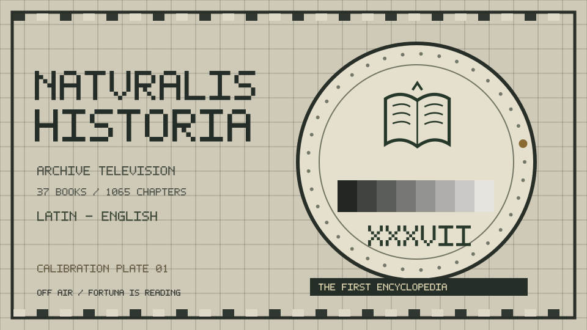</a>
  <a href="../../../examples/st3gg/01-off-air.md">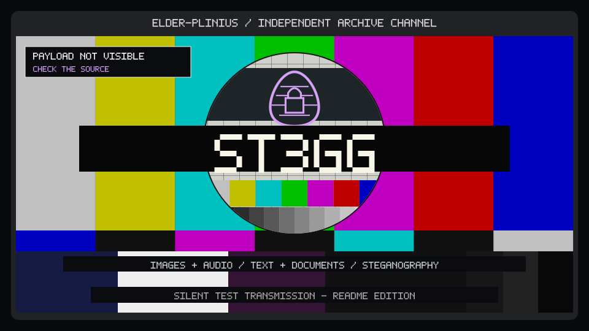</a><br>
  <sub><b>GL4SS</b> · <b>Naturalis Historia</b> · <b>ST3GG</b></sub>
</p>

### HIGH SCORES

```text
RANK  SCORE GALLERY
1ST   116   CASTAWAY
2ND   042   ULTRA-SATISFACTORY
3RD   041   README.NFO
4TH   040   HERETIC
5TH   006   DANCE VISION
6TH   005   GL4SS
6TH   005   NATURALIS-HISTORIA
6TH   005   ST3GG

TOTAL   260   HEADERS
STYLES  153/153 CLEAR
```

Small galleries to play through: [GL4SS](../../../examples/gl4ss/README.md) · [Naturalis Historia](../../../examples/naturalis-historia/README.md) · [ST3GG](../../../examples/st3gg/README.md). The big sets are on THE FLOOR below.

## THE FLOOR

Every cabinet is a real header from this repo, numbered the way your gallery
numbers yours. An amber arrow on a card means the original is animated.
Click one for its page.

<p align="center">
<a href="../../../examples/castaway/57-synthwave-outrun_opus_5.5.md">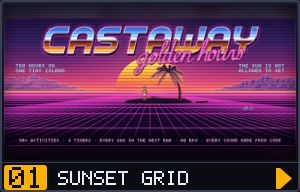</a>
<a href="../../../examples/heretic/15-demo-10.md">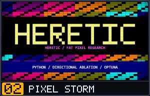</a>
<a href="../../../examples/ultra-satisfactory/41-attribute-grid-demo_opus_5.5.md">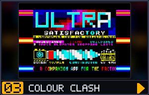</a>
<a href="../../../examples/gl4ss/05-luna-desktop.md">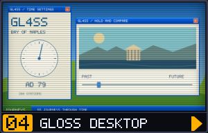</a>
<a href="../../../examples/castaway/52-teletext-page_opus_5.5.md">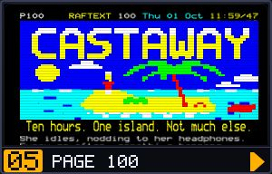</a>
<a href="../../../examples/ultra-satisfactory/26-vaporwave_opus_5.5.md">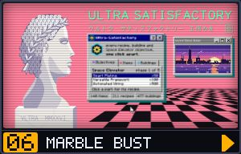</a>
<a href="../../../examples/castaway/09-pinball-dmd_opus_5.5.md">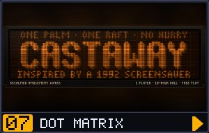</a>
<a href="../../../examples/heretic/14-idle-07.md">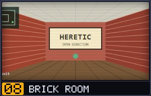</a>
<a href="../../../examples/castaway/56-vhs-tape_opus_5.5.md">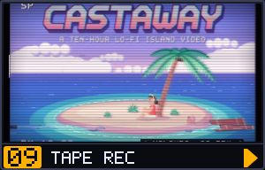</a>
<a href="../../../examples/st3gg/02-telnet-board.md">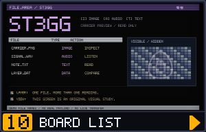</a>
</p>
<p align="center"><sub><b>01</b> Castaway: sunset grid · <b>02</b> Heretic: pixel storm · <b>03</b> Ultra-Satisfactory: colour clash · <b>04</b> GL4SS: gloss desktop · <b>05</b> Castaway: page 100 · <b>06</b> Ultra-Satisfactory: marble bust · <b>07</b> Castaway: dot matrix · <b>08</b> Heretic: brick room · <b>09</b> Castaway: tape rec · <b>10</b> ST3GG: board list</sub></p>

<p align="center">
<a href="../../../examples/castaway/24-skinned-installer_opus_5.5.md">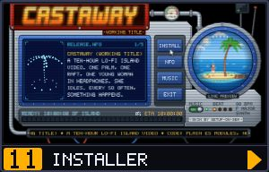</a>
<a href="../../../examples/ultra-satisfactory/33-sysop-dashboard_opus_5.5.md">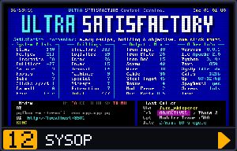</a>
<a href="../../../examples/castaway/30-petscii-picture_opus_5.5.md">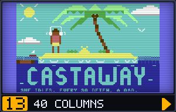</a>
<a href="../../../examples/heretic/28-c64-08.md">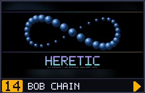</a>
<a href="../../../examples/naturalis-historia/04-viewdata.md">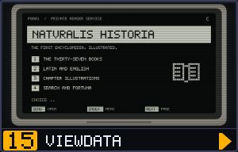</a>
<a href="../../../examples/castaway/95-light-synth_opus_5.5.md">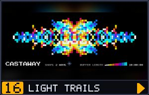</a>
<a href="../../../examples/ultra-satisfactory/38-piano-roll_opus_5.5.md">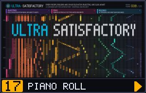</a>
<a href="../../../examples/heretic/26-demo-09.md">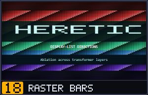</a>
<a href="../../../examples/castaway/50-door-game-screen_opus_5.5.md">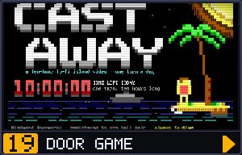</a>
<a href="../../../examples/ultra-satisfactory/10-arcade-attract_opus_5.5.md">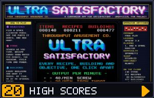</a>
</p>
<p align="center"><sub><b>11</b> Castaway: installer · <b>12</b> Ultra-Satisfactory: sysop · <b>13</b> Castaway: 40 columns · <b>14</b> Heretic: bob chain · <b>15</b> Naturalis Historia: viewdata · <b>16</b> Castaway: light trails · <b>17</b> Ultra-Satisfactory: piano roll · <b>18</b> Heretic: raster bars · <b>19</b> Castaway: door game · <b>20</b> Ultra-Satisfactory: high scores</sub></p>

<p align="center">
<a href="../../../examples/castaway/73-vfd-front-panel_opus_5.5.md">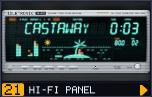</a>
<a href="../../../examples/heretic/16-mach-09.md">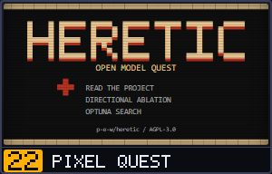</a>
<a href="../../../examples/castaway/26-vector-objects_opus_5.5.md">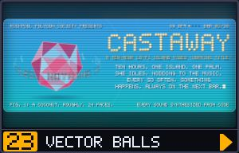</a>
<a href="../../../examples/st3gg/03-demo-titles.md">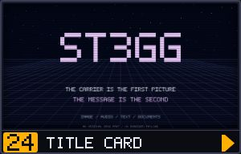</a>
<a href="../../../examples/ultra-satisfactory/27-signalwave-forecast_opus_5.5.md">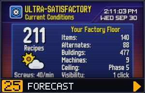</a>
<a href="../../../examples/castaway/60-one-bit-desktop_opus_5.5.md">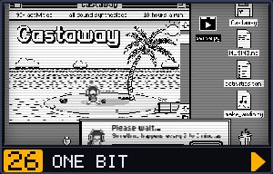</a>
<a href="../../../examples/heretic/21-pc-11.md">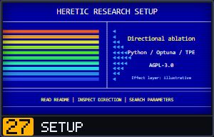</a>
<a href="../../../examples/castaway/87-file-system-landscape_opus_5.5.md">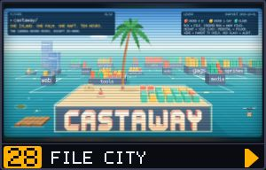</a>
<a href="../../../examples/ultra-satisfactory/32-generated-banner_opus_5.5.md">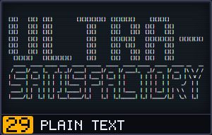</a>
<a href="../../../examples/heretic/30-hack-11.md">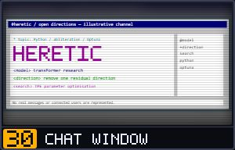</a>
</p>
<p align="center"><sub><b>21</b> Castaway: hi-fi panel · <b>22</b> Heretic: pixel quest · <b>23</b> Castaway: vector balls · <b>24</b> ST3GG: title card · <b>25</b> Ultra-Satisfactory: forecast · <b>26</b> Castaway: one bit · <b>27</b> Heretic: setup · <b>28</b> Castaway: file city · <b>29</b> Ultra-Satisfactory: plain text · <b>30</b> Heretic: chat window</sub></p>

<details>
<summary><b>CONTINUE?</b> 20 more cabinets</summary>

<p align="center">
<a href="../../../examples/castaway/90-pc-98-adventure-screen_opus_5.5.md">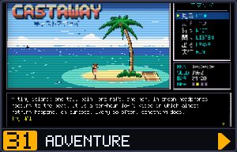</a>
<a href="../../../examples/heretic/13-demo-08.md">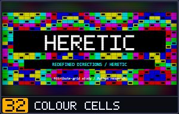</a>
<a href="../../../examples/ultra-satisfactory/31-type-in-listing_opus_5.5.md">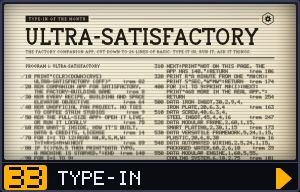</a>
<a href="../../../examples/castaway/71-console-title-screen_opus_5.5.md">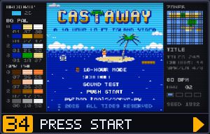</a>
<a href="../../../examples/gl4ss/04-viewdata.md">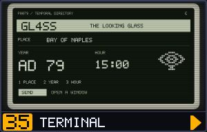</a>
<a href="../../../examples/castaway/113-atari-8-bit-demo_opus_5.5.md">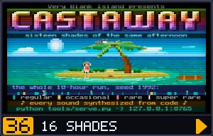</a>
<a href="../../../examples/heretic/22-trk-03.md">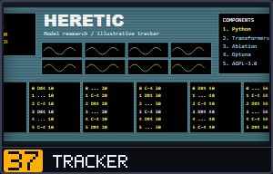</a>
<a href="../../../examples/ultra-satisfactory/42-aero-gloss_opus_5.5.md">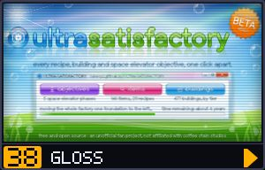</a>
<a href="../../../examples/castaway/66-neon-signage_opus_5.5.md">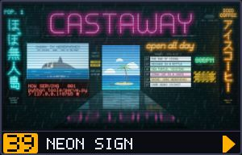</a>
<a href="../../../examples/heretic/33-c64-14.md"></a>
</p>
<p align="center"><sub><b>31</b> Castaway: adventure · <b>32</b> Heretic: colour cells · <b>33</b> Ultra-Satisfactory: type-in · <b>34</b> Castaway: press start · <b>35</b> GL4SS: terminal · <b>36</b> Castaway: 16 shades · <b>37</b> Heretic: tracker · <b>38</b> Ultra-Satisfactory: gloss · <b>39</b> Castaway: neon sign · <b>40</b> Heretic: loader menu</sub></p>

<p align="center">
<a href="../../../examples/castaway/64-glitch-art_opus_5.5.md"></a>
<a href="../../../examples/heretic/04-nfo-10.md"></a>
<a href="../../../examples/heretic/32-mach-12.md"></a>
<a href="../../../examples/castaway/47-ansi-logo-colly_opus_5.5.md"></a>
<a href="../../../examples/naturalis-historia/02-telnet-board.md"></a>
<a href="../../../examples/heretic/12-mach-07.md"></a>
<a href="../../../examples/castaway/45-newschool-ascii_opus_5.5.md"></a>
<a href="../../../examples/ultra-satisfactory/35-terminal-session_opus_5.5.md"></a>
<a href="../../../examples/heretic/08-vap-04.md"></a>
<a href="../../../examples/castaway/49-ansimation_opus_5.5.md"></a>
</p>
<p align="center"><sub><b>41</b> Castaway: glitch · <b>42</b> Heretic: line art · <b>43</b> Heretic: glow tube · <b>44</b> Castaway: ANSI logo · <b>45</b> Naturalis Historia: BBS index · <b>46</b> Heretic: LCD · <b>47</b> Castaway: ASCII blobs · <b>48</b> Ultra-Satisfactory: shell · <b>49</b> Heretic: sunset board · <b>50</b> Castaway: ansimation</sub></p>

</details>

<p align="center">All 260 headers in 8 galleries · <a href="../../../styles/INDEX.md">all 153 styles</a></p>

## OPTIONS

<details>
<summary>Flags, speed and URL mode</summary>

```text
ENGINE   < auto >     --claude
                      --codex
HEADERS  < 10 >       -6
MORE     < 11-20 >    more
INSTALL  < 3 >        use 3
MODEL    < default >  --model
JOBS     < 3 >        --jobs
URL      < off >      <url>
```

**URL mode** is for a repo you haven't cloned:
`npx readme-nfo github.com/you/project`. For a private repo it falls back to
`gh auth token` when `GH_TOKEN` is unset.

One header took 74 s on Claude Sonnet and 2 min 31 s on Codex in our tests.
Ten take a few minutes at 3 at a time.

Showcase headers came from long Claude Opus runs; CLI headers are quicker and simpler.

More detail: [docs/generation.md](../../generation.md).

</details>

## CREDITS

- Style research leans on public archives: [16colo.rs](https://16colo.rs),
  [Demozoo](https://demozoo.org), [Pouet](https://www.pouet.net) and
  [textfiles.com](http://www.textfiles.com).
- Built with [Node.js](https://nodejs.org) and [Playwright](https://playwright.dev).
- Scene styling is homage: no real group names or artwork.
- [MIT](../../../LICENSE), by Luke Woods. Every installed header carries the notice in
  `.github/readme-nfo/LICENSE`.

## GAME OVER

```text
┌─────────────────────────────┐
│ GAME OVER          CREDIT 0 │
│                             │
│ HI-SCORE .............. 260 │
│ STYLES ................ 153 │
│ FAMILIES ............... 13 │
│ LICENCE ............... MIT │
│                             │
│ INSERT COIN                 │
│   npx readme-nfo            │
└─────────────────────────────┘
────────────[ EOF ]────────────
```
