<p align="center"></p>

<h1 align="center">README.NFO</h1>

<p align="center">Retro headers for your README, drawn fresh for your project by <b>Claude Code</b> or <b>Codex</b>.<br>
<sub>153 styles · 260 example headers · 8 galleries · MIT</sub></p>

<p align="center">
<a href="#door--make-headers-for-your-project">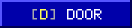</a>
<a href="#install--put-one-in-your-readme"></a>
<a href="#files--the-example-areas"></a>
<a href="#setup--door-options"></a>
<a href="#help">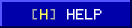</a>
<a href="#goodbye"></a>
</p>

## [D]oor · make headers for your project

README.NFO is a door: a small program that runs on your machine, hands your
project to your coding agent and brings back ten numbered headers.

```sh
npx readme-nfo
```

1. Install [Node.js 22+](https://nodejs.org) and sign in to
   [Claude Code](https://claude.com/claude-code) or
   [Codex](https://developers.openai.com/codex).
2. In your project's folder, run the line above.
3. A gallery opens with 10 numbered headers. Type the number you like
   and it goes at the top of your README. Review with `git diff`, then commit.

<p align="center">
<a href="https://claude.com/claude-code">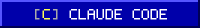</a>
<a href="https://developers.openai.com/codex">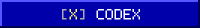</a>
<a href="#help"></a>
</p>

**Pick your engine: Claude or Codex.** It uses whichever one you're signed in to,
and asks once if you have both. To choose: `npx readme-nfo --claude` or
`npx readme-nfo --codex`.

**Local logon: private repos work.** It reads your project folder, not GitHub,
so there's no token to set. Your project facts go only to the agent you picked.

<sub>The door at work (3 headers drawn at a time):</sub>

```text
README.NFO door · local logon
Project ..... read from folder
Engine? [C] Claude  [X] Codex
Drawing 10 of 153 styles
#01 vap-05 ......... done
#02 c64-13 ......... done
#03 idle-10 ........ done
#04 ansi-08 ........ done
...
#10 print-02 ....... done
Gallery: readme-headers/
Install which? [1-10] 3
Added to README.md
Now git diff, then commit.
```

**Want more?** `npx readme-nfo more` gives 10 new styles, numbered 11-20, on the
same gallery page. No style repeats. `npx readme-nfo use 14` swaps your header.

```text
FILE LISTING · your gallery
═════════════════════════════
BATCH 1
#01 vap-05      #06 mach-11
#02 c64-13      #07 nfo-04
#03 idle-10 <   #08 trk-07
#04 ansi-08     #09 pc-03
#05 print-02    #10 hack-12
─── "make 10 more" ──────────
BATCH 2
#11 demo-01     #16 asia-03
#12 vap-17      #17 xfer-06
#13 pc-06       #18 c64-06
#14 mach-15     #19 trk-01
#15 ansi-06     #20 idle-06
═════════════════════════════
No style repeats.
Same gallery page.
< your pick: "number 3"
```

> [!TIP]
> Or just ask your agent: *"Get me 10 headers from README.NFO"*, then
> *"number 3"*, or *"make 10 more"*.

## [I]nstall · put one in your README

Type the number, or tell your agent *"number 3"*. The door copies that SVG and
README.NFO's MIT notice to `.github/readme-nfo/`, adds the header between two
marker comments at the top of your README, and never commits.

Review with `git diff`, then commit. Changed your mind? `npx readme-nfo use 14`.

What changes in your repo: `.github/readme-nfo/header.svg`, `.github/readme-nfo/LICENSE`
and one marked block at the top of README.md. Nothing is committed for you. To undo,
delete the block and the folder.

<details><summary>The block it adds</summary>

```html
<!-- README.NFO header: start -->
<p align="center"></p>
<!-- README.NFO header: end -->
```

</details>

## [F]iles · the example areas

Every header here was drawn for a real project. 260 of them, in 13 areas.
Click any one to see it move and copy its Markdown.

### Sysop's picks

<p align="center">
<a href="../../../examples/castaway/51-ripscrip-screen_opus_5.5.md"></a>
<a href="../../../examples/castaway/01-mode7-island_opus_5.5.md"></a>
</p>

<p align="center"><sub><b>Castaway</b> · Vector BBS screen with clickable buttons&nbsp; | &nbsp;<b>Castaway</b> · Island title screen on a rotating sea</sub></p>

<p align="center">
<a href="../../../examples/castaway/65-memphis_opus_5.5.md"></a>
<a href="../../../examples/ultra-satisfactory/12-cassette-jcard_opus_5.5.md"></a>
</p>

<p align="center"><sub><b>Castaway</b> · Squiggles, confetti and a live preview&nbsp; | &nbsp;<b>ULTRA-SATISFACTORY</b> · Cassette, J-card and turning reels</sub></p>

<p align="center">
<a href="../../../examples/ultra-satisfactory/13-chrome-spheres_opus_5.5.md"></a>
<a href="../../../examples/castaway/98-3d-pipes_opus_5.5.md"></a>
</p>

<p align="center"><sub><b>ULTRA-SATISFACTORY</b> · Mirror spheres on a checker floor&nbsp; | &nbsp;<b>Castaway</b> · Screensaver pipes that grow into the title</sub></p>

### Same door, three callers

One style brief, three projects. Each run reads its own folder, so each card is its own.

<p align="center">
<a href="../../../examples/naturalis-historia/01-off-air.md">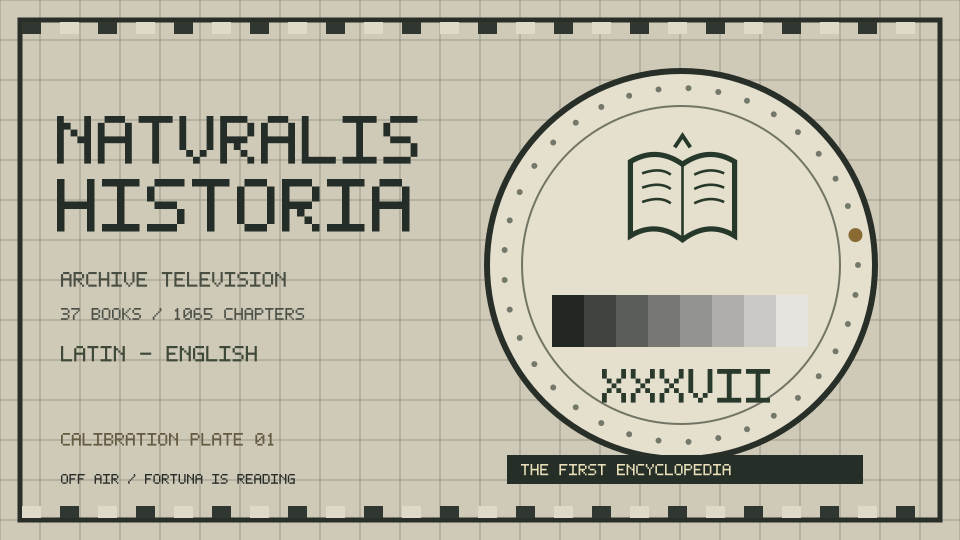</a>
<a href="../../../examples/gl4ss/01-off-air.md"></a>
<a href="../../../examples/st3gg/01-off-air.md">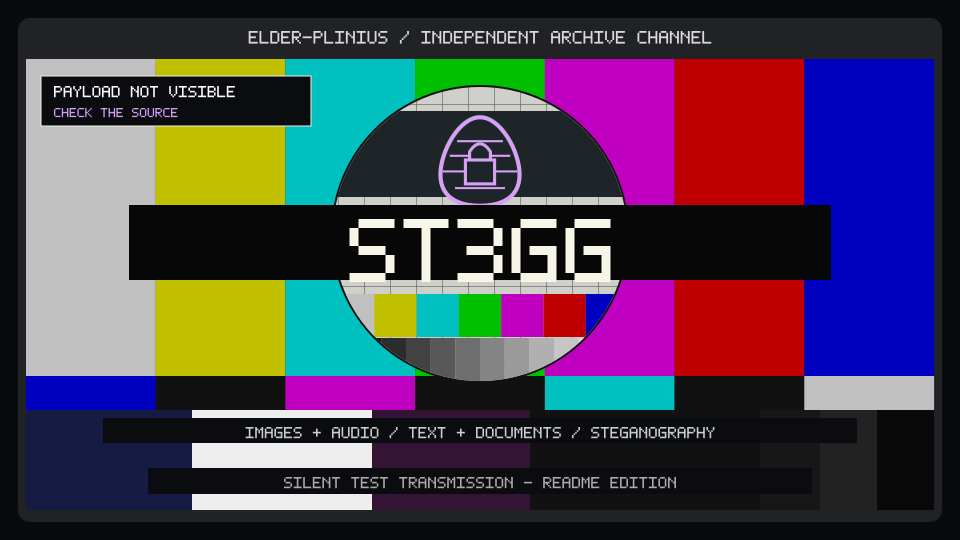</a>
</p>

<p align="center"><sub><a href="../../../examples/naturalis-historia/README.md">NATURALIS-HISTORIA</a> · <a href="../../../examples/gl4ss/README.md">GL4SS</a> · <a href="../../../examples/st3gg/README.md">ST3GG</a> · off-air test card</sub></p>

### File areas

<sub>Tiles are stills; open one to see it move. ► marks an animated original. Open the list under a row for the rest of that area.</sub>

<p><b>ANSI, BBS &amp; text mode</b> · 11 styles<br>
<a href="../../../examples/castaway/50-door-game-screen_opus_5.5.md">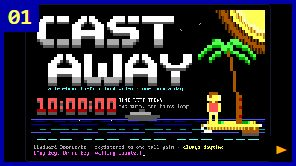</a>
<a href="../../../examples/ultra-satisfactory/23-illustrated-ansi_opus_5.5.md">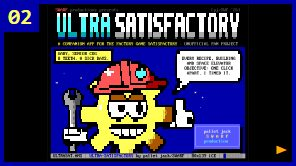</a>
<a href="../../../examples/castaway/52-teletext-page_opus_5.5.md">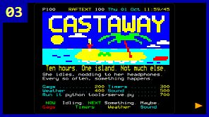</a>
<a href="../../../examples/heretic/17-ansi-04.md">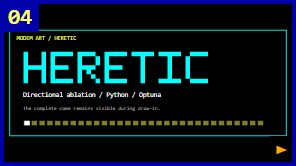</a>
<a href="../../../examples/gl4ss/04-viewdata.md">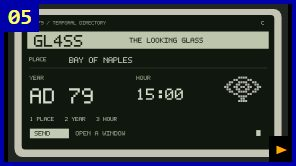</a><br>
<sub>01&nbsp;Door&nbsp;game&nbsp;screen · 02&nbsp;Illustrated&nbsp;ANSI · 03&nbsp;Teletext&nbsp;page · 04&nbsp;Modem-speed&nbsp;draw-in · 05&nbsp;Viewdata&nbsp;page</sub></p>

<details><summary>List this area's 20 headers</summary>

- [Castaway 02](../../../examples/castaway/02-bbs-stats_opus_5.5.md) · BBS data screens ►
- [Castaway 47](../../../examples/castaway/47-ansi-logo-colly_opus_5.5.md) · ANSI logo colly ►
- [Castaway 48](../../../examples/castaway/48-tdf-font-banner_opus_5.5.md) · Block-font banner ►
- [Castaway 49](../../../examples/castaway/49-ansimation_opus_5.5.md) · Modem-speed draw-in ►
- [Castaway 50](../../../examples/castaway/50-door-game-screen_opus_5.5.md) · Door game screen ►
- [Castaway 51](../../../examples/castaway/51-ripscrip-screen_opus_5.5.md) · Vector BBS screen ►
- [Castaway 52](../../../examples/castaway/52-teletext-page_opus_5.5.md) · Teletext page ►
- [Castaway 53](../../../examples/castaway/53-viewdata-page_opus_5.5.md) · Viewdata page ►
- [Castaway 54](../../../examples/castaway/54-text-mode-demo-effect_opus_5.5.md) · Text-mode plasma ►
- [Castaway 55](../../../examples/castaway/55-braille-dot-graphics_opus_5.5.md) · Braille-dot dashboard ►
- [GL4SS 04](../../../examples/gl4ss/04-viewdata.md) · Viewdata page ►
- [Heretic 17](../../../examples/heretic/17-ansi-04.md) · Modem-speed draw-in ►
- [NATURALIS-HISTORIA 04](../../../examples/naturalis-historia/04-viewdata.md) · Viewdata page ►
- [README.NFO 10](../../../examples/readme-nfo/10-ansi-05.md) · BBS data screens
- [README.NFO 15](../../../examples/readme-nfo/15-ansi-04.md) · Modem-speed draw-in ►
- [README.NFO 19](../../../examples/readme-nfo/19-ansi-06.md) · Door game screen ►
- [README.NFO 30](../../../examples/readme-nfo/30-ansi-12.md) · Braille-dot dashboard (text)
- [ST3GG 04](../../../examples/st3gg/04-viewdata.md) · Viewdata page ►
- [ULTRA-SATISFACTORY 06](../../../examples/ultra-satisfactory/06-ansi-bbs_opus_5.5.md) · ANSI login screen ►
- [ULTRA-SATISFACTORY 23](../../../examples/ultra-satisfactory/23-illustrated-ansi_opus_5.5.md) · Illustrated ANSI ►

</details>

<p><b>NFO &amp; ASCII art</b> · 11 styles<br>
<a href="../../../examples/ultra-satisfactory/22-poster-nfo_opus_5.5.md">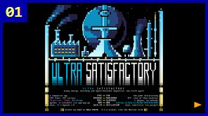</a>
<a href="../../../examples/heretic/20-nfo-03.md">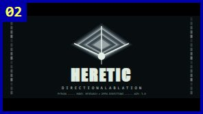</a>
<a href="../../../examples/castaway/43-file-id-diz_opus_5.5.md">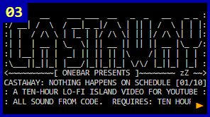</a>
<a href="../../../examples/ultra-satisfactory/24-amiga-ascii-colly_opus_5.5.md">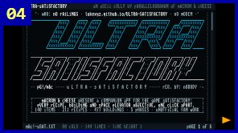</a>
<a href="../../../examples/heretic/03-nfo-02.md">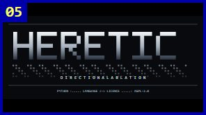</a><br>
<sub>01&nbsp;Poster&nbsp;NFO · 02&nbsp;Poster&nbsp;NFO · 03&nbsp;FILE_ID.DIZ&nbsp;card · 04&nbsp;Full-width&nbsp;Latin-1&nbsp;colly · 05&nbsp;Shaded&nbsp;block&nbsp;NFO</sub></p>

<details><summary>List this area's 18 headers</summary>

- [Castaway 07](../../../examples/castaway/07-7bit-outline-nfo_opus_5.5.md) · 7-bit outline NFO (text)
- [Castaway 11](../../../examples/castaway/11-usenet-line-art_opus_5.5.md) · Signed line art (text)
- [Castaway 43](../../../examples/castaway/43-file-id-diz_opus_5.5.md) · FILE_ID.DIZ card ►
- [Castaway 44](../../../examples/castaway/44-amiga-description-logo_opus_5.5.md) · Compact outline logo ►
- [Castaway 45](../../../examples/castaway/45-newschool-ascii_opus_5.5.md) · Dollar-fill ASCII (text)
- [Castaway 46](../../../examples/castaway/46-teletype-picture_opus_5.5.md) · Teletype picture ►
- [Heretic 03](../../../examples/heretic/03-nfo-02.md) · Shaded block NFO
- [Heretic 04](../../../examples/heretic/04-nfo-10.md) · Signed line art (text)
- [Heretic 20](../../../examples/heretic/20-nfo-03.md) · Poster NFO
- [Heretic 36](../../../examples/heretic/36-nfo-04.md) · 7-bit outline NFO (text)
- [Heretic 37](../../../examples/heretic/37-nfo-07.md) · Full-width Latin-1 colly
- [README.NFO 16](../../../examples/readme-nfo/16-nfo-01.md) · Brush-script block NFO
- [ULTRA-SATISFACTORY 01](../../../examples/ultra-satisfactory/01-nfo-release_opus_5.5.md) · Release-info NFO (text)
- [ULTRA-SATISFACTORY 15](../../../examples/ultra-satisfactory/15-brush-script-nfo_opus_5.5.md) · Brush-script block NFO ►
- [ULTRA-SATISFACTORY 21](../../../examples/ultra-satisfactory/21-shaded-block-nfo_opus_5.5.md) · Shaded block NFO ►
- [ULTRA-SATISFACTORY 22](../../../examples/ultra-satisfactory/22-poster-nfo_opus_5.5.md) · Poster NFO ►
- [ULTRA-SATISFACTORY 24](../../../examples/ultra-satisfactory/24-amiga-ascii-colly_opus_5.5.md) · Full-width Latin-1 colly ►
- [ULTRA-SATISFACTORY 32](../../../examples/ultra-satisfactory/32-generated-banner_opus_5.5.md) · Generated banner lettering (text)

</details>

<p><b>PC intros &amp; installers</b> · 14 styles<br>
<a href="../../../examples/castaway/24-skinned-installer_opus_5.5.md">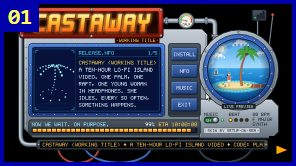</a>
<a href="../../../examples/ultra-satisfactory/14-neon-cube-field_opus_5.5.md">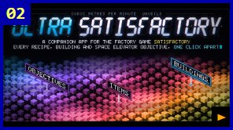</a>
<a href="../../../examples/castaway/26-vector-objects_opus_5.5.md">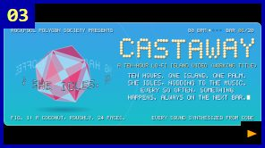</a>
<a href="../../../examples/ultra-satisfactory/16-poster-installer_opus_5.5.md">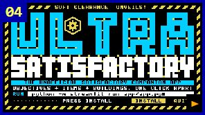</a>
<a href="../../../examples/heretic/21-pc-11.md">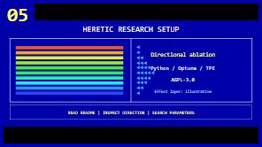</a><br>
<sub>01&nbsp;Skinned&nbsp;installer · 02&nbsp;Neon&nbsp;cube&nbsp;field · 03&nbsp;Vector&nbsp;objects · 04&nbsp;Text-mode&nbsp;poster&nbsp;installer · 05&nbsp;Firmware&nbsp;setup&nbsp;screen</sub></p>

<details><summary>List this area's 17 headers</summary>

- [Castaway 03](../../../examples/castaway/03-desktop-takeover_opus_5.5.md) · Desktop takeover ►
- [Castaway 12](../../../examples/castaway/12-bios-hijack_opus_5.5.md) · Firmware setup screen ►
- [Castaway 21](../../../examples/castaway/21-flat-field-dos-intro_opus_5.5.md) · Flat-field DOS intro ►
- [Castaway 24](../../../examples/castaway/24-skinned-installer_opus_5.5.md) · Skinned installer ►
- [Castaway 25](../../../examples/castaway/25-f-key-options-menu_opus_5.5.md) · F-key options menu ►
- [Castaway 26](../../../examples/castaway/26-vector-objects_opus_5.5.md) · Vector objects ►
- [Castaway 27](../../../examples/castaway/27-texture-movers_opus_5.5.md) · Rotozoomer and tunnel ►
- [Heretic 09](../../../examples/heretic/09-pc-12.md) · Neon cube field
- [Heretic 21](../../../examples/heretic/21-pc-11.md) · Firmware setup screen
- [Heretic 39](../../../examples/heretic/39-pc-09.md) · Pencil-on-paper intro
- [README.NFO 14](../../../examples/readme-nfo/14-pc-05.md) · Metal logo and sine scroller ►
- [README.NFO 25](../../../examples/readme-nfo/25-pc-13.md) · Vector objects ►
- [README.NFO 34](../../../examples/readme-nfo/34-pc-07.md) · Text-mode poster installer
- [ULTRA-SATISFACTORY 13](../../../examples/ultra-satisfactory/13-chrome-spheres_opus_5.5.md) · Chrome spheres ►
- [ULTRA-SATISFACTORY 14](../../../examples/ultra-satisfactory/14-neon-cube-field_opus_5.5.md) · Neon cube field ►
- [ULTRA-SATISFACTORY 16](../../../examples/ultra-satisfactory/16-poster-installer_opus_5.5.md) · Text-mode poster installer ►
- [ULTRA-SATISFACTORY 30](../../../examples/ultra-satisfactory/30-pencil-on-paper_opus_5.5.md) · Pencil-on-paper intro ►

</details>

<p><b>8-bit &amp; 16-bit micros</b> · 14 styles<br>
<a href="../../../examples/castaway/36-st-menu-disk_opus_5.5.md">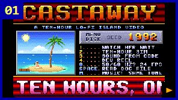</a>
<a href="../../../examples/ultra-satisfactory/28-flat-silhouette-intro_opus_5.5.md">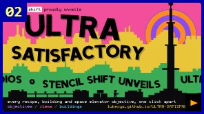</a>
<a href="../../../examples/castaway/30-petscii-picture_opus_5.5.md">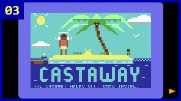</a>
<a href="../../../examples/heretic/28-c64-08.md">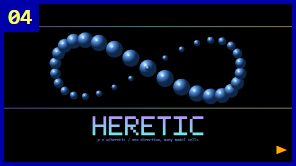</a>
<a href="../../../examples/castaway/19-megademo-menu_opus_5.5.md">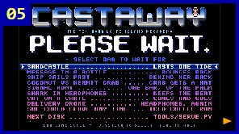</a><br>
<sub>01&nbsp;Menu&nbsp;disk · 02&nbsp;Flat-colour&nbsp;silhouette&nbsp;intro · 03&nbsp;Character-grid&nbsp;picture · 04&nbsp;Bobs&nbsp;and&nbsp;dot&nbsp;objects · 05&nbsp;Megademo&nbsp;menu</sub></p>

<details><summary>List this area's 18 headers</summary>

- [Castaway 10](../../../examples/castaway/10-dir-art_opus_5.5.md) · Disk directory art ►
- [Castaway 19](../../../examples/castaway/19-megademo-menu_opus_5.5.md) · Megademo menu ►
- [Castaway 28](../../../examples/castaway/28-c64-one-screen-intro_opus_5.5.md) · One-screen 8-bit intro ►
- [Castaway 29](../../../examples/castaway/29-c64-dycp-scroller_opus_5.5.md) · Sine-wave letter scroller ►
- [Castaway 30](../../../examples/castaway/30-petscii-picture_opus_5.5.md) · Character-grid picture ►
- [Castaway 31](../../../examples/castaway/31-amiga-logo-plate-intro_opus_5.5.md) · Logo plate and copper text ►
- [Castaway 36](../../../examples/castaway/36-st-menu-disk_opus_5.5.md) · Menu disk ►
- [Castaway 37](../../../examples/castaway/37-chip-music-jukebox_opus_5.5.md) · Chip-music jukebox ►
- [Heretic 07](../../../examples/heretic/07-c64-04.md) · Disk directory art (text)
- [Heretic 28](../../../examples/heretic/28-c64-08.md) · Bobs and dot objects ►
- [Heretic 33](../../../examples/heretic/33-c64-14.md) · Chip-music jukebox
- [README.NFO 09](../../../examples/readme-nfo/09-c64-05.md) · Logo plate and copper text ►
- [README.NFO 28](../../../examples/readme-nfo/28-c64-13.md) · Menu disk ►
- [README.NFO 29](../../../examples/readme-nfo/29-c64-06.md) · Megademo menu ►
- [README.NFO 33](../../../examples/readme-nfo/33-c64-08.md) · Bobs and dot objects ►
- [README.NFO 38](../../../examples/readme-nfo/38-c64-07.md) · Copper ribbons ►
- [ULTRA-SATISFACTORY 04](../../../examples/ultra-satisfactory/04-c64-loader_opus_5.5.md) · 8-bit loader ►
- [ULTRA-SATISFACTORY 28](../../../examples/ultra-satisfactory/28-flat-silhouette-intro_opus_5.5.md) · Flat-colour silhouette intro ►

</details>

<p><b>Demoscene</b> · 11 styles<br>
<a href="../../../examples/ultra-satisfactory/07-compo-slides_opus_5.5.md">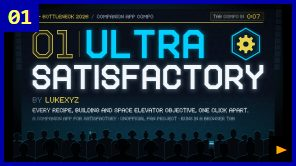</a>
<a href="../../../examples/naturalis-historia/03-demo-titles.md">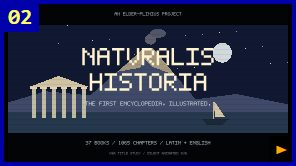</a>
<a href="../../../examples/castaway/109-procedural-effects_opus_5.5.md">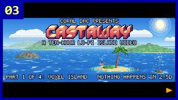</a>
<a href="../../../examples/heretic/15-demo-10.md">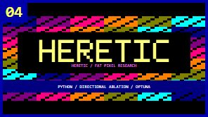</a>
<a href="../../../examples/ultra-satisfactory/41-attribute-grid-demo_opus_5.5.md">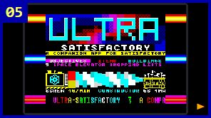</a><br>
<sub>01&nbsp;Big-screen&nbsp;compo&nbsp;slides · 02&nbsp;Demo&nbsp;opening&nbsp;titles · 03&nbsp;Procedural&nbsp;effects · 04&nbsp;Fat-pixel&nbsp;demo&nbsp;screen · 05&nbsp;Attribute-grid&nbsp;demo</sub></p>

<details><summary>List this area's 22 headers</summary>

- [Castaway 20](../../../examples/castaway/20-apple2-screen_opus_5.5.md) · Six-colour title screen ►
- [Castaway 107](../../../examples/castaway/107-demo-opening-titles_opus_5.5.md) · Demo opening titles ►
- [Castaway 108](../../../examples/castaway/108-demo-read-me_opus_5.5.md) · Demo info file (text)
- [Castaway 109](../../../examples/castaway/109-procedural-effects_opus_5.5.md) · Procedural effects ►
- [Castaway 110](../../../examples/castaway/110-256-byte-intro_opus_5.5.md) · 256-byte intro ►
- [Castaway 111](../../../examples/castaway/111-tiny-intro-info-file_opus_5.5.md) · Tiny-intro info file (text)
- [Castaway 112](../../../examples/castaway/112-party-results_opus_5.5.md) · Party results file (text)
- [Castaway 113](../../../examples/castaway/113-atari-8-bit-demo_opus_5.5.md) · Sixteen-shade raster demo ►
- [Castaway 114](../../../examples/castaway/114-cpc-demo-screen_opus_5.5.md) · Fat-pixel demo screen ►
- [GL4SS 03](../../../examples/gl4ss/03-demo-titles.md) · Demo opening titles ►
- [Heretic 13](../../../examples/heretic/13-demo-08.md) · Attribute-grid demo
- [Heretic 15](../../../examples/heretic/15-demo-10.md) · Fat-pixel demo screen
- [Heretic 26](../../../examples/heretic/26-demo-09.md) · Sixteen-shade raster demo
- [Heretic 31](../../../examples/heretic/31-demo-02.md) · Demo info file (text)
- [NATURALIS-HISTORIA 03](../../../examples/naturalis-historia/03-demo-titles.md) · Demo opening titles ►
- [README.NFO 06](../../../examples/readme-nfo/06-demo-11.md) · Six-colour title screen
- [README.NFO 07](../../../examples/readme-nfo/07-demo-01.md) · Demo opening titles ►
- [README.NFO 11](../../../examples/readme-nfo/11-demo-04.md) · 256-byte intro ►
- [README.NFO 37](../../../examples/readme-nfo/37-demo-02.md) · Demo info file (text)
- [ST3GG 03](../../../examples/st3gg/03-demo-titles.md) · Demo opening titles ►
- [ULTRA-SATISFACTORY 07](../../../examples/ultra-satisfactory/07-compo-slides_opus_5.5.md) · Big-screen compo slides ►
- [ULTRA-SATISFACTORY 41](../../../examples/ultra-satisfactory/41-attribute-grid-demo_opus_5.5.md) · Attribute-grid demo ►

</details>

<p><b>Trackers &amp; chiptune</b> · 11 styles<br>
<a href="../../../examples/ultra-satisfactory/17-amiga-tracker_opus_5.5.md">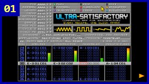</a>
<a href="../../../examples/castaway/42-multi-chip-tracker_opus_5.5.md">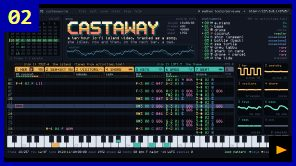</a>
<a href="../../../examples/ultra-satisfactory/09-oscilloscope_opus_5.5.md">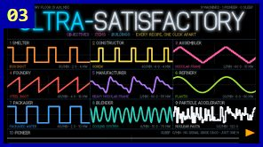</a>
<a href="../../../examples/heretic/22-trk-03.md">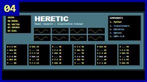</a>
<a href="../../../examples/ultra-satisfactory/20-player-stack_opus_5.5.md">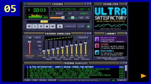</a><br>
<sub>01&nbsp;4-channel&nbsp;tracker · 02&nbsp;Multi-chip&nbsp;tracker · 03&nbsp;Oscilloscope&nbsp;channels · 04&nbsp;GUI&nbsp;tracker&nbsp;with&nbsp;scopes · 05&nbsp;Media&nbsp;player&nbsp;stack</sub></p>

<details><summary>List this area's 15 headers</summary>

- [Castaway 17](../../../examples/castaway/17-module-player_opus_5.5.md) · Module player with spectrum ►
- [Castaway 38](../../../examples/castaway/38-sample-list-board_opus_5.5.md) · Sample list as message board (text)
- [Castaway 39](../../../examples/castaway/39-dos-gui-tracker_opus_5.5.md) · GUI tracker with scopes ►
- [Castaway 40](../../../examples/castaway/40-text-mode-tracker_opus_5.5.md) · Text-mode tracker ►
- [Castaway 41](../../../examples/castaway/41-sid-tracker-text_opus_5.5.md) · Three-voice tracker ►
- [Castaway 42](../../../examples/castaway/42-multi-chip-tracker_opus_5.5.md) · Multi-chip tracker ►
- [Heretic 22](../../../examples/heretic/22-trk-03.md) · GUI tracker with scopes
- [README.NFO 04](../../../examples/readme-nfo/04-trk-07.md) · Multi-chip tracker ►
- [README.NFO 05](../../../examples/readme-nfo/05-trk-10.md) · Piano roll ►
- [README.NFO 32](../../../examples/readme-nfo/32-trk-09.md) · Oscilloscope channels ►
- [ULTRA-SATISFACTORY 09](../../../examples/ultra-satisfactory/09-oscilloscope_opus_5.5.md) · Oscilloscope channels ►
- [ULTRA-SATISFACTORY 17](../../../examples/ultra-satisfactory/17-amiga-tracker_opus_5.5.md) · 4-channel tracker ►
- [ULTRA-SATISFACTORY 19](../../../examples/ultra-satisfactory/19-handheld-tracker_opus_5.5.md) · Handheld tracker ►
- [ULTRA-SATISFACTORY 20](../../../examples/ultra-satisfactory/20-player-stack_opus_5.5.md) · Media player stack ►
- [ULTRA-SATISFACTORY 38](../../../examples/ultra-satisfactory/38-piano-roll_opus_5.5.md) · Piano roll ►

</details>

<p><b>Consoles, arcade &amp; machines</b> · 13 styles<br>
<a href="../../../examples/castaway/09-pinball-dmd_opus_5.5.md">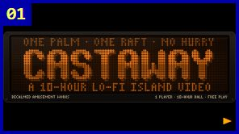</a>
<a href="../../../examples/ultra-satisfactory/10-arcade-attract_opus_5.5.md">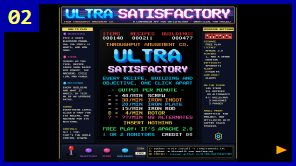</a>
<a href="../../../examples/castaway/73-vfd-front-panel_opus_5.5.md">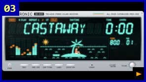</a>
<a href="../../../examples/heretic/16-mach-09.md">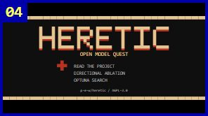</a>
<a href="../../../examples/ultra-satisfactory/40-power-on-self-test_opus_5.5.md">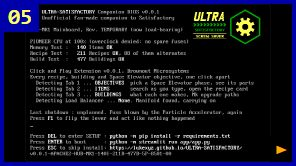</a><br>
<sub>01&nbsp;Pinball&nbsp;dot&nbsp;matrix · 02&nbsp;Arcade&nbsp;attract&nbsp;mode · 03&nbsp;VFD&nbsp;front&nbsp;panel · 04&nbsp;8-bit&nbsp;console&nbsp;title · 05&nbsp;Power-on&nbsp;self&nbsp;test</sub></p>

<details><summary>List this area's 19 headers</summary>

- [Castaway 01](../../../examples/castaway/01-mode7-island_opus_5.5.md) · Rotating ground plane ►
- [Castaway 09](../../../examples/castaway/09-pinball-dmd_opus_5.5.md) · Pinball dot matrix ►
- [Castaway 67](../../../examples/castaway/67-tape-loader_opus_5.5.md) · Tape loader ►
- [Castaway 68](../../../examples/castaway/68-insert-disk-boot_opus_5.5.md) · Insert-disk boot ►
- [Castaway 69](../../../examples/castaway/69-twin-panel-commander_opus_5.5.md) · Twin-panel commander ►
- [Castaway 70](../../../examples/castaway/70-handheld-boot-logo_opus_5.5.md) · Handheld boot logo ►
- [Castaway 71](../../../examples/castaway/71-console-title-screen_opus_5.5.md) · 8-bit console title ►
- [Castaway 72](../../../examples/castaway/72-vector-beam-display_opus_5.5.md) · Vector beam display ►
- [Castaway 73](../../../examples/castaway/73-vfd-front-panel_opus_5.5.md) · VFD front panel ►
- [Castaway 74](../../../examples/castaway/74-mono-phone-lcd_opus_5.5.md) · Mono phone LCD ►
- [Heretic 12](../../../examples/heretic/12-mach-07.md) · Handheld boot logo
- [Heretic 16](../../../examples/heretic/16-mach-09.md) · 8-bit console title
- [Heretic 19](../../../examples/heretic/19-mach-15.md) · Rotating ground plane
- [Heretic 32](../../../examples/heretic/32-mach-12.md) · VFD front panel
- [README.NFO 01](../../../examples/readme-nfo/01-mach-11.md) · Pinball dot matrix ►
- [README.NFO 23](../../../examples/readme-nfo/23-mach-07.md) · Handheld boot logo ►
- [ULTRA-SATISFACTORY 10](../../../examples/ultra-satisfactory/10-arcade-attract_opus_5.5.md) · Arcade attract mode ►
- [ULTRA-SATISFACTORY 34](../../../examples/ultra-satisfactory/34-dos-setup_opus_5.5.md) · Sound setup dialog ►
- [ULTRA-SATISFACTORY 40](../../../examples/ultra-satisfactory/40-power-on-self-test_opus_5.5.md) · Power-on self test ►

</details>

<p><b>Screensavers &amp; visualisers</b> · 10 styles<br>
<a href="../../../examples/castaway/97-classic-saver-set_opus_5.5.md">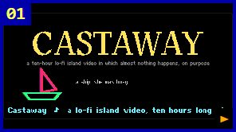</a>
<a href="../../../examples/ultra-satisfactory/08-milkdrop-visualiser_opus_5.5.md">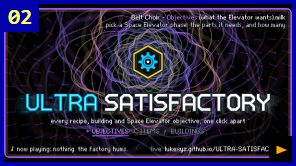</a>
<a href="../../../examples/castaway/95-light-synth_opus_5.5.md"></a>
<a href="../../../examples/castaway/96-feedback-fire_opus_5.5.md"></a>
<a href="../../../examples/heretic/14-idle-07.md"></a><br>
<sub>01&nbsp;Classic&nbsp;saver&nbsp;set · 02&nbsp;Music&nbsp;visualiser · 03&nbsp;Light&nbsp;synth · 04&nbsp;Feedback&nbsp;fire · 05&nbsp;3D&nbsp;maze</sub></p>

<details><summary>List this area's 17 headers</summary>

- [Castaway 13](../../../examples/castaway/13-bouncing-logo_opus_5.5.md) · Bouncing logo ►
- [Castaway 14](../../../examples/castaway/14-off-air_opus_5.5.md) · Off-air test card ►
- [Castaway 94](../../../examples/castaway/94-pulsing-diamonds_opus_5.5.md) · Pulsing diamonds ►
- [Castaway 95](../../../examples/castaway/95-light-synth_opus_5.5.md) · Light synth ►
- [Castaway 96](../../../examples/castaway/96-feedback-fire_opus_5.5.md) · Feedback fire ►
- [Castaway 97](../../../examples/castaway/97-classic-saver-set_opus_5.5.md) · Classic saver set ►
- [Castaway 98](../../../examples/castaway/98-3d-pipes_opus_5.5.md) · 3D pipes ►
- [Castaway 99](../../../examples/castaway/99-3d-maze_opus_5.5.md) · 3D maze ►
- [Castaway 100](../../../examples/castaway/100-sprite-saver_opus_5.5.md) · Sprite saver ►
- [GL4SS 01](../../../examples/gl4ss/01-off-air.md) · Off-air test card ►
- [Heretic 02](../../../examples/heretic/02-idle-02.md) · Light synth ►
- [Heretic 14](../../../examples/heretic/14-idle-07.md) · 3D maze
- [NATURALIS-HISTORIA 01](../../../examples/naturalis-historia/01-off-air.md) · Off-air test card ►
- [README.NFO 31](../../../examples/readme-nfo/31-idle-01.md) · Pulsing diamonds ►
- [README.NFO 36](../../../examples/readme-nfo/36-idle-10.md) · Off-air test card ►
- [ST3GG 01](../../../examples/st3gg/01-off-air.md) · Off-air test card ►
- [ULTRA-SATISFACTORY 08](../../../examples/ultra-satisfactory/08-milkdrop-visualiser_opus_5.5.md) · Music visualiser ►

</details>

<p><b>Vaporwave &amp; early web</b> · 17 styles<br>
<a href="../../../examples/castaway/57-synthwave-outrun_opus_5.5.md"></a>
<a href="../../../examples/ultra-satisfactory/42-aero-gloss_opus_5.5.md"></a>
<a href="../../../examples/castaway/56-vhs-tape_opus_5.5.md"></a>
<a href="../../../examples/gl4ss/05-luna-desktop.md"></a>
<a href="../../../examples/ultra-satisfactory/26-vaporwave_opus_5.5.md"></a><br>
<sub>01&nbsp;Synthwave&nbsp;sunset · 02&nbsp;Aero&nbsp;gloss · 03&nbsp;VHS&nbsp;tape · 04&nbsp;Rolling-hill&nbsp;desktop · 05&nbsp;Classic&nbsp;vaporwave</sub></p>

<details><summary>List this area's 28 headers</summary>

- [Castaway 04](../../../examples/castaway/04-fullwidth_opus_5.5.md) · Fullwidth text (text)
- [Castaway 56](../../../examples/castaway/56-vhs-tape_opus_5.5.md) · VHS tape ►
- [Castaway 57](../../../examples/castaway/57-synthwave-outrun_opus_5.5.md) · Synthwave sunset ►
- [Castaway 58](../../../examples/castaway/58-city-pop-sleeve_opus_5.5.md) · City-pop sleeve ►
- [Castaway 59](../../../examples/castaway/59-luna-desktop_opus_5.5.md) · Rolling-hill desktop ►
- [Castaway 60](../../../examples/castaway/60-one-bit-desktop_opus_5.5.md) · 1-bit desktop ►
- [Castaway 61](../../../examples/castaway/61-web-1-homepage_opus_5.5.md) · Web 1.0 homepage ►
- [Castaway 62](../../../examples/castaway/62-instant-messenger_opus_5.5.md) · Instant messenger ►
- [Castaway 63](../../../examples/castaway/63-y2k-cybercore_opus_5.5.md) · Y2K cybercore ►
- [Castaway 64](../../../examples/castaway/64-glitch-art_opus_5.5.md) · Glitch art ►
- [Castaway 65](../../../examples/castaway/65-memphis_opus_5.5.md) · Memphis ►
- [Castaway 66](../../../examples/castaway/66-neon-signage_opus_5.5.md) · Neon signage ►
- [GL4SS 05](../../../examples/gl4ss/05-luna-desktop.md) · Rolling-hill desktop ►
- [Heretic 01](../../../examples/heretic/01-vap-12.md) · Web 1.0 homepage
- [Heretic 08](../../../examples/heretic/08-vap-04.md) · Local forecast screen
- [Heretic 11](../../../examples/heretic/11-vap-11.md) · 1-bit desktop
- [Heretic 24](../../../examples/heretic/24-vap-17.md) · Memphis
- [Heretic 40](../../../examples/heretic/40-vap-09.md) · Rolling-hill desktop
- [NATURALIS-HISTORIA 05](../../../examples/naturalis-historia/05-luna-desktop.md) · Rolling-hill desktop ►
- [README.NFO 08](../../../examples/readme-nfo/08-vap-03.md) · VHS tape ►
- [README.NFO 12](../../../examples/readme-nfo/12-vap-09.md) · Rolling-hill desktop ►
- [README.NFO 39](../../../examples/readme-nfo/39-vap-11.md) · 1-bit desktop
- [ST3GG 05](../../../examples/st3gg/05-luna-desktop.md) · Rolling-hill desktop ►
- [ULTRA-SATISFACTORY 25](../../../examples/ultra-satisfactory/25-desktop-95_opus_5.5.md) · Late-90s desktop ►
- [ULTRA-SATISFACTORY 26](../../../examples/ultra-satisfactory/26-vaporwave_opus_5.5.md) · Classic vaporwave ►
- [ULTRA-SATISFACTORY 27](../../../examples/ultra-satisfactory/27-signalwave-forecast_opus_5.5.md) · Local forecast screen ►
- [ULTRA-SATISFACTORY 37](../../../examples/ultra-satisfactory/37-blue-screen_opus_5.5.md) · Fatal-error blue screen ►
- [ULTRA-SATISFACTORY 42](../../../examples/ultra-satisfactory/42-aero-gloss_opus_5.5.md) · Aero gloss ►

</details>

<p><b>Print &amp; physical media</b> · 5 styles<br>
<a href="../../../examples/castaway/08-tractor-feed_opus_5.5.md"></a>
<a href="../../../examples/ultra-satisfactory/31-type-in-listing_opus_5.5.md"></a>
<a href="../../../examples/heretic/10-print-03.md"></a>
<a href="../../../examples/ultra-satisfactory/12-cassette-jcard_opus_5.5.md"></a><br>
<sub>01&nbsp;Tractor-feed&nbsp;printout · 02&nbsp;Type-in&nbsp;listing · 03&nbsp;Type-in&nbsp;listing · 04&nbsp;Cassette&nbsp;and&nbsp;J-card</sub></p>

<details><summary>List this area's 8 headers</summary>

- [Castaway 08](../../../examples/castaway/08-tractor-feed_opus_5.5.md) · Tractor-feed printout ►
- [Castaway 116](../../../examples/castaway/116-scene-paperwork_opus_5.5.md) · Mail-art paperwork ►
- [Heretic 10](../../../examples/heretic/10-print-03.md) · Type-in listing (text)
- [Heretic 29](../../../examples/heretic/29-print-05.md) · Mail-art paperwork
- [README.NFO 22](../../../examples/readme-nfo/22-print-03.md) · Type-in listing (text)
- [README.NFO 26](../../../examples/readme-nfo/26-print-02.md) · Cassette and J-card ►
- [ULTRA-SATISFACTORY 12](../../../examples/ultra-satisfactory/12-cassette-jcard_opus_5.5.md) · Cassette and J-card ►
- [ULTRA-SATISFACTORY 31](../../../examples/ultra-satisfactory/31-type-in-listing_opus_5.5.md) · Type-in listing ►

</details>

<p><b>Terminals, hackers &amp; zines</b> · 19 styles<br>
<a href="../../../examples/castaway/87-file-system-landscape_opus_5.5.md"></a>
<a href="../../../examples/castaway/78-fetch-card_opus_5.5.md"></a>
<a href="../../../examples/castaway/88-tone-pad_opus_5.5.md"></a>
<a href="../../../examples/heretic/18-hack-10.md"></a>
<a href="../../../examples/heretic/30-hack-11.md"></a><br>
<sub>01&nbsp;File-system&nbsp;landscape · 02&nbsp;Fetch&nbsp;card · 03&nbsp;Dual-tone&nbsp;keypad · 04&nbsp;Falling-letters&nbsp;screen · 05&nbsp;IRC&nbsp;channel&nbsp;window</sub></p>

<details><summary>List this area's 33 headers</summary>

- [Castaway 06](../../../examples/castaway/06-rfc-manpage_opus_5.5.md) · RFC and man page (text)
- [Castaway 16](../../../examples/castaway/16-tfile_opus_5.5.md) · BBS text file (text)
- [Castaway 18](../../../examples/castaway/18-tui-monitor_opus_5.5.md) · TUI monitor ►
- [Castaway 75](../../../examples/castaway/75-text-zine-header_opus_5.5.md) · Text-zine header (text)
- [Castaway 76](../../../examples/castaway/76-clearsigned-message_opus_5.5.md) · Clearsigned message (text)
- [Castaway 77](../../../examples/castaway/77-tool-console-banner_opus_5.5.md) · Security-tool console (text)
- [Castaway 78](../../../examples/castaway/78-fetch-card_opus_5.5.md) · Fetch card ►
- [Castaway 79](../../../examples/castaway/79-roguelike-screen_opus_5.5.md) · Roguelike screen ►
- [Castaway 80](../../../examples/castaway/80-mud-transcript_opus_5.5.md) · MUD transcript (text)
- [Castaway 81](../../../examples/castaway/81-falling-letters-screen_opus_5.5.md) · Falling-letters screen ►
- [Castaway 82](../../../examples/castaway/82-irc-channel-window_opus_5.5.md) · IRC channel window ►
- [Castaway 83](../../../examples/castaway/83-diskmag-reader_opus_5.5.md) · Diskmag reader ►
- [Castaway 84](../../../examples/castaway/84-war-room-big-board_opus_5.5.md) · War-room big board ►
- [Castaway 85](../../../examples/castaway/85-digital-rain_opus_5.5.md) · Digital rain ►
- [Castaway 86](../../../examples/castaway/86-decrypt-reveal_opus_5.5.md) · Decrypt reveal ►
- [Castaway 87](../../../examples/castaway/87-file-system-landscape_opus_5.5.md) · File-system landscape ►
- [Castaway 88](../../../examples/castaway/88-tone-pad_opus_5.5.md) · Dual-tone keypad ►
- [Castaway 89](../../../examples/castaway/89-ctf-board_opus_5.5.md) · CTF board ►
- [Dance Vision 05](../../../examples/dance-vision/05-crt-terminal_opus_5.5.md) · CRT terminal ►
- [Heretic 18](../../../examples/heretic/18-hack-10.md) · Falling-letters screen ►
- [Heretic 23](../../../examples/heretic/23-hack-18.md) · CTF board
- [Heretic 25](../../../examples/heretic/25-hack-03.md) · RFC and man page (text)
- [Heretic 30](../../../examples/heretic/30-hack-11.md) · IRC channel window
- [Heretic 35](../../../examples/heretic/35-hack-15.md) · Decrypt reveal ►
- [README.NFO 02](../../../examples/readme-nfo/02-hack-09.md) · MUD transcript (text)
- [README.NFO 03](../../../examples/readme-nfo/03-hack-14.md) · Digital rain ►
- [README.NFO 13](../../../examples/readme-nfo/13-hack-15.md) · Decrypt reveal ►
- [README.NFO 17](../../../examples/readme-nfo/17-hack-16.md) · File-system landscape ►
- [README.NFO 18](../../../examples/readme-nfo/18-hack-17.md) · Dual-tone keypad ►
- [README.NFO 21](../../../examples/readme-nfo/21-hack-11.md) · IRC channel window ►
- [README.NFO 40](../../../examples/readme-nfo/40-hack-18.md) · CTF board ►
- [README.NFO 41](../../../examples/readme-nfo/41-hack-19.md) · CLI startup banner
- [ULTRA-SATISFACTORY 05](../../../examples/ultra-satisfactory/05-crt-terminal_opus_5.5.md) · CRT terminal ►

</details>

<p><b>Japan &amp; East Asia</b> · 7 styles<br>
<a href="../../../examples/castaway/90-pc-98-adventure-screen_opus_5.5.md"></a>
<a href="../../../examples/ultra-satisfactory/18-fm-synth-display_opus_5.5.md"></a>
<a href="../../../examples/castaway/91-ptt-telnet-board_opus_5.5.md"></a>
<a href="../../../examples/naturalis-historia/02-telnet-board.md"></a>
<a href="../../../examples/heretic/05-asia-03.md"></a><br>
<sub>01&nbsp;Dithered&nbsp;adventure&nbsp;screen · 02&nbsp;FM-synth&nbsp;display · 03&nbsp;Telnet&nbsp;board · 04&nbsp;Telnet&nbsp;board · 05&nbsp;Telnet&nbsp;board</sub></p>

<details><summary>List this area's 16 headers</summary>

- [Castaway 05](../../../examples/castaway/05-shiftjis-aa_opus_5.5.md) · Text-board art ►
- [Castaway 90](../../../examples/castaway/90-pc-98-adventure-screen_opus_5.5.md) · Dithered adventure screen ►
- [Castaway 91](../../../examples/castaway/91-ptt-telnet-board_opus_5.5.md) · Telnet board ►
- [Castaway 92](../../../examples/castaway/92-japanese-basic-power-on_opus_5.5.md) · BASIC power-on ►
- [Castaway 93](../../../examples/castaway/93-kaomoji-banner_opus_5.5.md) · Kaomoji banner (text)
- [GL4SS 02](../../../examples/gl4ss/02-telnet-board.md) · Telnet board ►
- [Heretic 05](../../../examples/heretic/05-asia-03.md) · Telnet board
- [Heretic 27](../../../examples/heretic/27-asia-06.md) · BASIC power-on (text)
- [Heretic 34](../../../examples/heretic/34-asia-05.md) · MML tune listing (text)
- [NATURALIS-HISTORIA 02](../../../examples/naturalis-historia/02-telnet-board.md) · Telnet board ►
- [README.NFO 20](../../../examples/readme-nfo/20-asia-05.md) · MML tune listing (text)
- [README.NFO 24](../../../examples/readme-nfo/24-asia-04.md) · Text-board art
- [README.NFO 27](../../../examples/readme-nfo/27-asia-01.md) · FM-synth display ►
- [ST3GG 02](../../../examples/st3gg/02-telnet-board.md) · Telnet board ►
- [ULTRA-SATISFACTORY 18](../../../examples/ultra-satisfactory/18-fm-synth-display_opus_5.5.md) · FM-synth display ►
- [ULTRA-SATISFACTORY 36](../../../examples/ultra-satisfactory/36-mml-listing_opus_5.5.md) · MML tune listing (text)

</details>

<p><b>Modems &amp; message boards</b> · 10 styles<br>
<a href="../../../examples/ultra-satisfactory/33-sysop-dashboard_opus_5.5.md"></a>
<a href="../../../examples/castaway/101-echomail-reader_opus_5.5.md"></a>
<a href="../../../examples/ultra-satisfactory/35-terminal-session_opus_5.5.md"></a>
<a href="../../../examples/ultra-satisfactory/39-userbar-kit_opus_5.5.md"></a><br>
<sub>01&nbsp;Sysop&nbsp;status&nbsp;screen · 02&nbsp;Echomail&nbsp;reader · 03&nbsp;Terminal&nbsp;program · 04&nbsp;Forum&nbsp;userbars</sub></p>

<details><summary>List this area's 5 headers</summary>

- [Castaway 101](../../../examples/castaway/101-echomail-reader_opus_5.5.md) · Echomail reader ►
- [Castaway 104](../../../examples/castaway/104-p2p-transfer-window_opus_5.5.md) · Transfer window ►
- [ULTRA-SATISFACTORY 33](../../../examples/ultra-satisfactory/33-sysop-dashboard_opus_5.5.md) · Sysop status screen ►
- [ULTRA-SATISFACTORY 35](../../../examples/ultra-satisfactory/35-terminal-session_opus_5.5.md) · Terminal program ►
- [ULTRA-SATISFACTORY 39](../../../examples/ultra-satisfactory/39-userbar-kit_opus_5.5.md) · Forum userbars ►

</details>

<sub>Galleries: <a href="../../../examples/castaway/README.md">Castaway</a> 116 · <a href="../../../examples/ultra-satisfactory/README.md">ULTRA-SATISFACTORY</a> 42 · <a href="../../../examples/readme-nfo/README.md">README.NFO</a> 41 · <a href="../../../examples/heretic/README.md">Heretic</a> 40 · <a href="../../../examples/dance-vision/README.md">Dance Vision</a> 6 · <a href="../../../examples/naturalis-historia/README.md">NATURALIS-HISTORIA</a> 5 · <a href="../../../examples/gl4ss/README.md">GL4SS</a> 5 · <a href="../../../examples/st3gg/README.md">ST3GG</a> 5 · <a href="../../../styles/INDEX.md">all 153 styles</a></sub>

## [S]etup · door options

The door works with no options: 10 headers, 3 drawn at a time, from all 153 styles,
with whichever engine you're signed in to. Add any of these to `npx readme-nfo`:

```text
--claude    use Claude Code
--codex     use Codex
-6          six, not ten
more        10 more (#11-20)
use 14      install header 14
```

<details><summary>Every other option</summary>

```text
--model M   pick the model
--jobs 3    drawn at once
--resume    finish a stopped
            batch
--out DIR   gallery folder
--no-open   don't open the
            browser
--seed S    repeat a draw
```

Not cloned it? Give a URL instead of running it in the folder:
`npx readme-nfo github.com/you/project`. For a private repo it uses your
`gh auth token` when `GH_TOKEN` is not set.

</details>

## [H]elp

> [!TIP]
> **"No engine found"?** Sign in first. Claude Code: install it from
> [claude.com/claude-code](https://claude.com/claude-code), run `claude` and type `/login`.
> Codex: install it from [developers.openai.com/codex](https://developers.openai.com/codex)
> and run `codex login`. Then run the door again.

**How long?** In our 2026-11-11 tests one header took 74 s with Claude Sonnet and
2 min 31 s with Codex. Ten take a few minutes, 3 at a time, and the gallery fills
as each one lands.

**What leaves my machine?** Your project's name, description, README headings,
languages and licence, plus the style briefs. They go only to your agent, under
your own sign-in. README.NFO has no server.

**Why do the examples look so polished?** The showcase art came from long
Claude Opus runs. The door is quicker and simpler, so expect simpler pieces.

**Something broke?** [Open an issue](https://github.com/lukexyz/README.NFO/issues) with what you ran.

## [G]oodbye

```text
Thanks for calling README.NFO
═════════════════════════════
archives .. 16colo.rs
            Demozoo · Pouet
            textfiles.com
tools ..... Node.js
            Playwright
licence ... MIT · Luke Woods
═════════════════════════════
+++ATH0
NO CARRIER

[ EOF ]
```

[MIT licence](../../../LICENSE) · [Style catalogue](../../../styles/INDEX.md) · [All galleries](../../../examples/README.md) · [How it works](../../generation.md)
