<!-- README.NFO header: start -->
<p align="center"><a href="#-press-start"><picture>
<source media="(prefers-color-scheme: dark)" srcset="assets/hero-dark.svg">
<source media="(prefers-color-scheme: light)" srcset="assets/hero-light.svg">
</picture></a></p>
<!-- README.NFO header: end -->
<p align="center"><sub>Hero drawn in styles <a href="../../../styles/c64.md#c64-12">c64-12</a> and <a href="../../../styles/c64.md#c64-02">c64-02</a> by <a href="src/hero.mjs">a seeded Node script</a>.</sub></p>

<h1 align="center">Retro headers for your README</h1>

<p align="center">README.NFO draws ten one-off retro headers for your project with <b>Claude Code</b> or <b>Codex</b>, numbers them, and puts the one you pick at the top of your README.</p>

<p align="center">
<a href="https://claude.com/claude-code">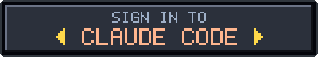</a>
<a href="https://developers.openai.com/codex">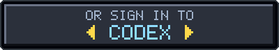</a>
</p>

<p align="center"><a href="#-press-start"><b>► Press start</b></a> · <a href="#-numbered-every-batch">Numbered, every batch</a> · <a href="#-intro-select">Intro select</a> · <a href="#-release-info">Release info</a></p>

<p align="center">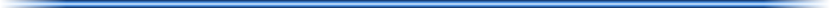</p>

## ► Press start

```sh
npx readme-nfo
```

1. Install [Node.js 22+](https://nodejs.org) and sign in to
   [Claude Code](https://claude.com/claude-code) or
   [Codex](https://developers.openai.com/codex).
2. In your project's folder, run the line above.
3. A gallery opens with 10 numbered headers. Type the number you like
   and it goes at the top of your README. Review with `git diff`, then commit.

**Claude or Codex?** It uses whichever one you're signed in to, and asks once
if you have both. To choose: `npx readme-nfo --claude` or `npx readme-nfo --codex`.

**Private repos work.** It reads your project folder, not GitHub, so there's no
token to set. Your project facts go only to the agent you picked.

**No flags needed.** The defaults are good.

<sub>Needs Node.js 22+. One header took 74 s on Claude Sonnet and 2 min 31 s on Codex in our tests; ten take a few minutes, 3 at a time.</sub>

<p align="center">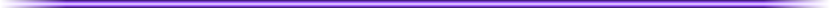</p>

## ► Numbered, every batch

<p align="center"></p>

**Want more?** `npx readme-nfo more` gives 10 new styles, numbered 11-20, on the
same gallery page. No style repeats. `npx readme-nfo use 14` swaps your header.

```text
DISK 1 ... npx readme-nfo
           headers 01-10
PICK ..... npx readme-nfo use 3
           #3 goes in README
DISK 2 ... npx readme-nfo more
           headers 11-20
```

> [!TIP]
> Or just ask your agent: *"Get me 10 headers from README.NFO"*, then
> *"number 3"*, or *"make 10 more"*.

- **One gallery page holds every batch.** Numbers keep counting (21-30, 31-40 and on) and styles never repeat.
- **It never commits.** `use 3` writes `.github/readme-nfo/header.svg`, `.github/readme-nfo/LICENSE` and one marked block at the top of README.md. Review with `git diff`, then commit.
- **Undo:** delete the block and the `.github/readme-nfo/` folder.

<details><summary><b>What a run looks like</b></summary>

```text
$ npx readme-nfo
FACTS  read from this folder
AGENT  Claude Code
       (switch: --codex)
DRAW   10 of 153 styles,
       3 at a time
OPEN   gallery, fills 01-10
01 ok  02 ok  03 ok  04 ok
05 ok  06 ok  07 ok  08 ok
09 ok  10 ok
Install which header? [1-10] 3
WROTE  .github/readme-nfo/
       header.svg
EDIT   README.md
Review with git diff, then
commit.
```

</details>

<details><summary><b>What lands in your README</b></summary>

```html
<!-- README.NFO header: start -->
<p align="center">
</p>
<!-- README.NFO header: end -->
```

`npx readme-nfo use 7` replaces it with header 07. Batches stay in `readme-headers/`, which is kept out of git.

</details>

<details><summary><b>Options</b></summary>

- `--claude` or `--codex`: choose the agent
- `-6`: six headers instead of ten
- `more`: ten new styles, numbered on from the last batch
- `use N`: install header N
- `--model NAME`: choose the agent's model
- `--jobs N`: headers drawn at once (default 3)
- `--resume DIR`: finish a batch that stopped
- `--out DIR`: save the batch somewhere else
- `--no-open`: don't open the gallery
- **Not cloned?** `npx readme-nfo github.com/you/project` reads it from GitHub instead. For a private one it uses your `gh` sign-in.

</details>

<details><summary><b>No agent found, or something failed?</b></summary>

- **No agent found?** Sign in to one, then run `npx readme-nfo` again: start `claude` and log in, or run `codex login`.
- **Chose one that isn't signed in?** `--claude` and `--codex` stop before writing anything and print how to sign in.
- **A header failed?** It gets one retry. If it fails again it is skipped and the rest of the batch carries on.

</details>

<p align="center">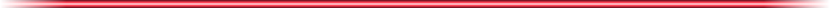</p>

## ► Intro select

<p align="center"><b>51 headers from 6 projects, all 13 style families.</b><br>Each was drawn for a real project. Click one for its page and source.</p>

<p align="center">
<a href="../../../examples/castaway/57-synthwave-outrun_opus_5.5.md"></a>
<a href="../../../examples/ultra-satisfactory/42-aero-gloss_opus_5.5.md"></a>
<br><sub>01 sunset road <i>(Castaway)</i> &nbsp;·&nbsp; 02 aero gloss <i>(ULTRA-SATISFACTORY)</i></sub>
</p>

<p align="center">
<a href="../../../examples/castaway/01-mode7-island_opus_5.5.md"></a>
<a href="../../../examples/castaway/14-off-air_opus_5.5.md"></a>
<br><sub>03 mode 7 island <i>(Castaway)</i> &nbsp;·&nbsp; 04 off-air test card <i>(Castaway)</i></sub>
</p>

<p align="center">
<a href="../../../examples/castaway/65-memphis_opus_5.5.md"></a>
<a href="../../../examples/ultra-satisfactory/12-cassette-jcard_opus_5.5.md"></a>
<br><sub>05 memphis poster <i>(Castaway)</i> &nbsp;·&nbsp; 06 cassette J-card <i>(ULTRA-SATISFACTORY)</i></sub>
</p>

<p align="center"><b>Same style, three projects.</b> One off-air brief, drawn three times.</p>

<p align="center">
<a href="../../../examples/naturalis-historia/01-off-air.md">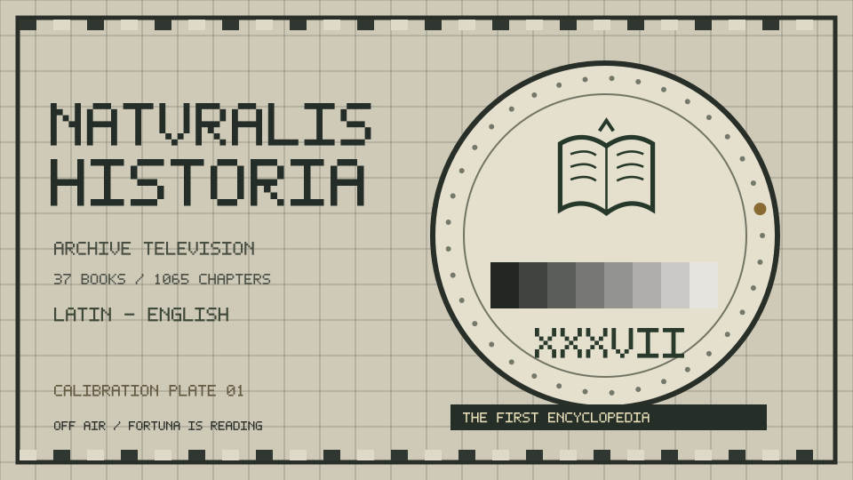</a>
<a href="../../../examples/gl4ss/01-off-air.md"></a>
<a href="../../../examples/st3gg/01-off-air.md">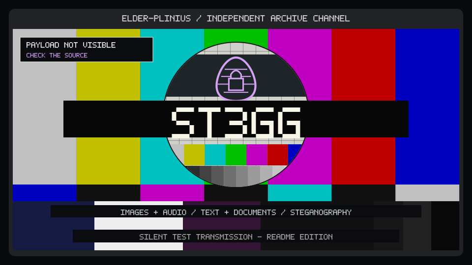</a>
<br><sub>Naturalis Historia &nbsp;·&nbsp; GL4SS &nbsp;·&nbsp; ST3GG</sub>
</p>

<p align="center"><b>The wall: 07 to 46.</b> <sub>► marks an animated original.</sub></p>

<p align="center">
<a href="../../../examples/heretic/21-pc-11.md">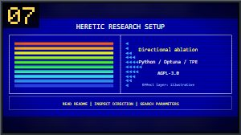</a>
<a href="../../../examples/castaway/03-desktop-takeover_opus_5.5.md">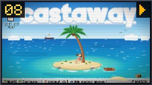</a>
<a href="../../../examples/castaway/30-petscii-picture_opus_5.5.md">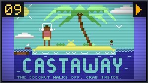</a>
<a href="../../../examples/heretic/33-c64-14.md">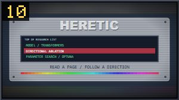</a>
<a href="../../../examples/heretic/28-c64-08.md">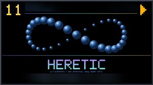</a>
<a href="../../../examples/castaway/42-multi-chip-tracker_opus_5.5.md">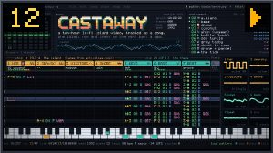</a>
<a href="../../../examples/heretic/22-trk-03.md">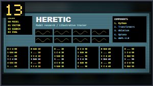</a>
<a href="../../../examples/castaway/44-amiga-description-logo_opus_5.5.md">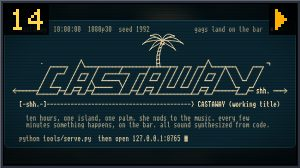</a>
<a href="../../../examples/heretic/03-nfo-02.md">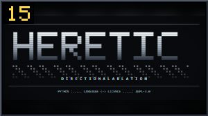</a>
<a href="../../../examples/castaway/52-teletext-page_opus_5.5.md">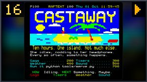</a>
</p>
<p align="center"><sub>07 BIOS gone wrong · 08 hijacked desktop · 09 PETSCII picture · 10 chip jukebox · 11 bob chain · 12 multi-chip tracker · 13 teal tracker desk · 14 outline logo NFO · 15 shaded slab NFO · 16 teletext page</sub></p>

<p align="center">
<a href="../../../examples/castaway/50-door-game-screen_opus_5.5.md">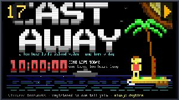</a>
<a href="../../../examples/heretic/17-ansi-04.md">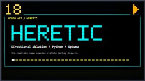</a>
<a href="../../../examples/gl4ss/04-viewdata.md">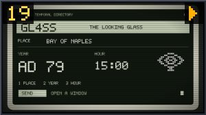</a>
<a href="../../../examples/castaway/58-city-pop-sleeve_opus_5.5.md">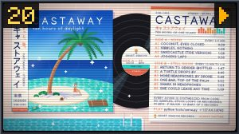</a>
<a href="../../../examples/gl4ss/05-luna-desktop.md">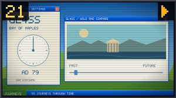</a>
<a href="../../../examples/ultra-satisfactory/26-vaporwave_opus_5.5.md">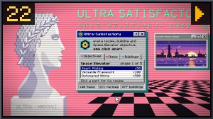</a>
<a href="../../../examples/ultra-satisfactory/27-signalwave-forecast_opus_5.5.md">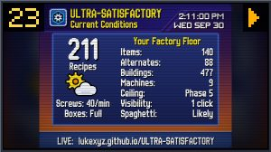</a>
<a href="../../../examples/castaway/60-one-bit-desktop_opus_5.5.md">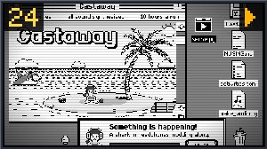</a>
<a href="../../../examples/castaway/09-pinball-dmd_opus_5.5.md">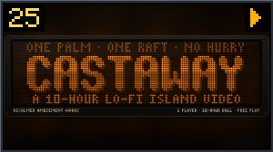</a>
<a href="../../../examples/ultra-satisfactory/10-arcade-attract_opus_5.5.md">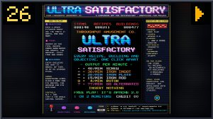</a>
</p>
<p align="center"><sub>17 door game screen · 18 ANSI stage · 19 viewdata terminal · 20 city-pop sleeve · 21 glossy desktop · 22 marble collage · 23 cable forecast · 24 1-bit desktop · 25 pinball display · 26 arcade attract</sub></p>

<p align="center">
<a href="../../../examples/ultra-satisfactory/40-power-on-self-test_opus_5.5.md">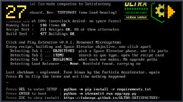</a>
<a href="../../../examples/heretic/16-mach-09.md">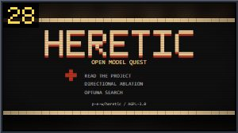</a>
<a href="../../../examples/heretic/12-mach-07.md">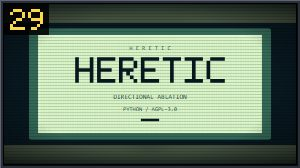</a>
<a href="../../../examples/castaway/87-file-system-landscape_opus_5.5.md">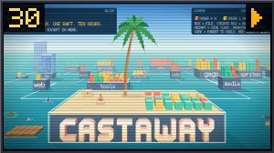</a>
<a href="../../../examples/castaway/78-fetch-card_opus_5.5.md">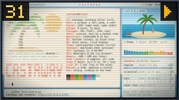</a>
<a href="../../../examples/heretic/18-hack-10.md">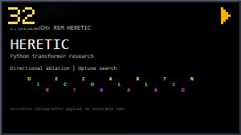</a>
<a href="../../../examples/castaway/90-pc-98-adventure-screen_opus_5.5.md">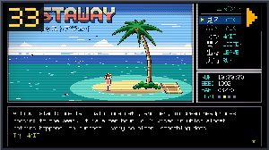</a>
<a href="../../../examples/castaway/05-shiftjis-aa_opus_5.5.md">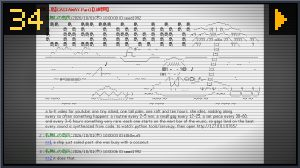</a>
<a href="../../../examples/st3gg/02-telnet-board.md">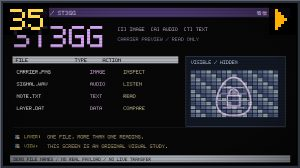</a>
<a href="../../../examples/castaway/98-3d-pipes_opus_5.5.md">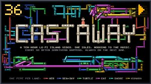</a>
</p>
<p align="center"><sub>27 power-on self test · 28 console title card · 29 LCD boot plate · 30 file-system city · 31 fetch card · 32 DOS host screen · 33 PC-98 adventure · 34 Shift-JIS text art · 35 telnet board · 36 3D pipes</sub></p>

<p align="center">
<a href="../../../examples/heretic/02-idle-02.md">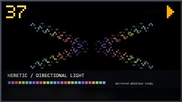</a>
<a href="../../../examples/heretic/14-idle-07.md">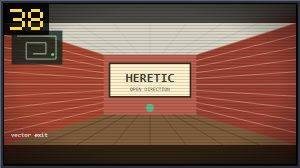</a>
<a href="../../../examples/ultra-satisfactory/33-sysop-dashboard_opus_5.5.md">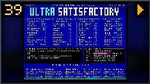</a>
<a href="../../../examples/ultra-satisfactory/35-terminal-session_opus_5.5.md">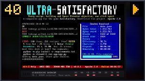</a>
<a href="../../../examples/castaway/110-256-byte-intro_opus_5.5.md"></a>
<a href="../../../examples/naturalis-historia/03-demo-titles.md"></a>
<a href="../../../examples/ultra-satisfactory/41-attribute-grid-demo_opus_5.5.md"></a>
<a href="../../../examples/heretic/15-demo-10.md"></a>
<a href="../../../examples/castaway/08-tractor-feed_opus_5.5.md"></a>
<a href="../../../examples/ultra-satisfactory/31-type-in-listing_opus_5.5.md"></a>
</p>
<p align="center"><sub>37 light synth · 38 brick maze · 39 sysop dashboard · 40 terminal session · 41 256-byte intro · 42 demo titles · 43 attribute grid · 44 brick-pixel study · 45 green-bar paper · 46 type-in listing</sub></p>

<details><summary><b>Intro index</b>: what each number is</summary>

```text
▄▄ FEATURED ▄▄▄▄▄▄▄▄▄▄▄▄▄▄▄▄▄▄▄
01 sunset road ......... vap-05
02 aero gloss .......... vap-10
03 mode 7 island ...... mach-15
04 off-air test card .. idle-10
05 memphis poster ...... vap-17
06 cassette J-card ... print-02
▄▄ PC INTROS ▄▄▄▄▄▄▄▄▄▄▄▄▄▄▄▄▄▄
07 BIOS gone wrong ...... pc-11
08 hijacked desktop ..... pc-10
▄▄ 8-BIT AND 16-BIT ▄▄▄▄▄▄▄▄▄▄▄
09 PETSCII picture ..... c64-03
10 chip jukebox ........ c64-14
11 bob chain ........... c64-08
▄▄ TRACKERS ▄▄▄▄▄▄▄▄▄▄▄▄▄▄▄▄▄▄▄
12 multi-chip tracker .. trk-07
13 teal tracker desk ... trk-03
▄▄ NFO AND ASCII ▄▄▄▄▄▄▄▄▄▄▄▄▄▄
14 outline logo NFO .... nfo-06
15 shaded slab NFO ..... nfo-02
▄▄ ANSI AND TEXT MODE ▄▄▄▄▄▄▄▄▄
16 teletext page ...... ansi-08
17 door game screen ... ansi-06
18 ANSI stage ......... ansi-04
19 viewdata terminal .. ansi-09
▄▄ INTERNET ERA ▄▄▄▄▄▄▄▄▄▄▄▄▄▄▄
20 city-pop sleeve ..... vap-06
21 glossy desktop ...... vap-09
22 marble collage ...... vap-01
23 cable forecast ...... vap-04
24 1-bit desktop ....... vap-11
▄▄ MACHINES ▄▄▄▄▄▄▄▄▄▄▄▄▄▄▄▄▄▄▄
25 pinball display .... mach-11
26 arcade attract ..... mach-08
27 power-on self test . mach-04
28 console title card . mach-09
29 LCD boot plate ..... mach-07
▄▄ HACKER AND ZINE ▄▄▄▄▄▄▄▄▄▄▄▄
30 file-system city ... hack-16
31 fetch card ......... hack-06
32 DOS host screen .... hack-10
▄▄ JAPAN AND EAST ASIA ▄▄▄▄▄▄▄▄
33 PC-98 adventure .... asia-02
34 Shift-JIS text art . asia-04
35 telnet board ....... asia-03
▄▄ SCREENSAVERS ▄▄▄▄▄▄▄▄▄▄▄▄▄▄▄
36 3D pipes ........... idle-06
37 light synth ........ idle-02
38 brick maze ......... idle-07
▄▄ HOW FILES MOVED ▄▄▄▄▄▄▄▄▄▄▄▄
39 sysop dashboard .... xfer-08
40 terminal session ... xfer-05
▄▄ DEMOSCENE ▄▄▄▄▄▄▄▄▄▄▄▄▄▄▄▄▄▄
41 256-byte intro ..... demo-04
42 demo titles ........ demo-01
43 attribute grid ..... demo-08
44 brick-pixel study .. demo-10
▄▄ PRINT ▄▄▄▄▄▄▄▄▄▄▄▄▄▄▄▄▄▄▄▄▄▄
45 green-bar paper ... print-04
46 type-in listing ... print-03
▀▀▀▀▀▀▀▀▀▀▀▀▀▀▀▀▀▀▀▀▀▀▀▀▀▀▀▀▀▀▀
```

</details>

**Disk 2: plain text.** 59 of the 153 styles can be drawn as text art you paste straight in, like the [newschool logo](../../../examples/castaway/45-newschool-ascii_opus_5.5.md) and the [outline-letter NFO](../../../examples/heretic/36-nfo-04.md).

<p align="center"><a href="../../../examples/README.md"><b>All 260 headers in 8 galleries</b></a> · <a href="../../../styles/INDEX.md"><b>All 153 styles</b></a></p>

<p align="center"></p>

## ► Release info

```text
▄▄▄▄▄▄▄▄▄▄▄▄▄▄▄▄▄▄▄▄▄▄▄▄▄▄▄▄▄▄▄
  R E A D M E . N F O
  retro headers for your README
───────────────────────────────
 STYLES .... 153 in 13 families
 SHOWCASE .. 260 in 8 galleries
 ENGINES ... Claude Code
             Codex
 FACTS ..... your folder
 NEEDS ..... Node.js 22+
 LICENCE ... MIT
───────────────────────────────
 THANKS .... 16colo.rs · Pouet
             Demozoo
             textfiles.com
▀▀▀▀▀▀▀▀▀▀▀▀▀▀▀▀▀▀▀▀▀▀▀▀[ EOF ]
```

<p align="center"><a href="../../generation.md">How it works</a> · <a href="../../../styles/INDEX.md">Style catalogue</a> · <a href="../../../examples/README.md">Galleries</a> · <a href="https://github.com/lukexyz/README.NFO/issues">Issues</a> · <a href="../../../LICENSE">MIT licence</a></p>

<p align="center"><sub>Scene styling here is homage: no real group names, logos or lettering, and all the art is original.<br>The showcase headers came from long Claude Opus runs; CLI output is quicker and simpler.</sub></p>
