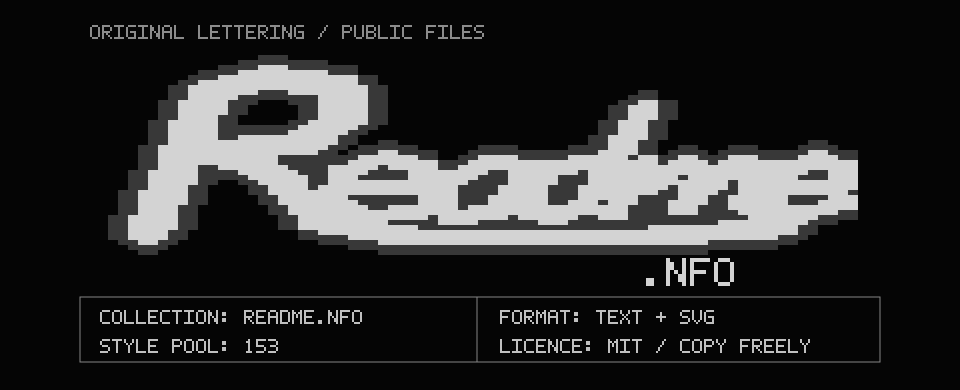
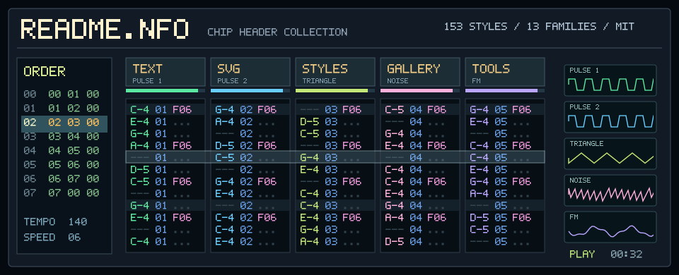
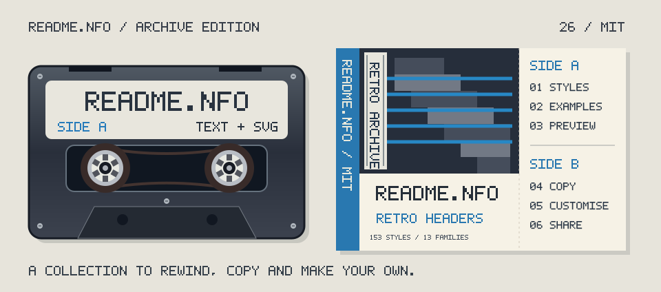
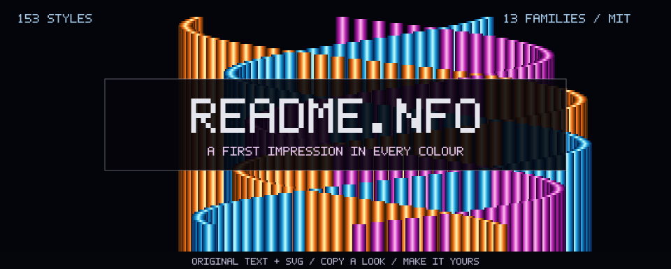
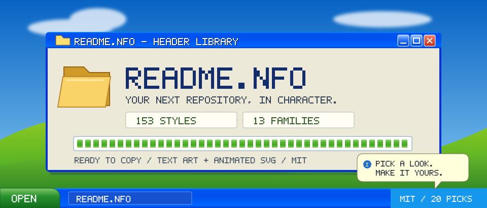
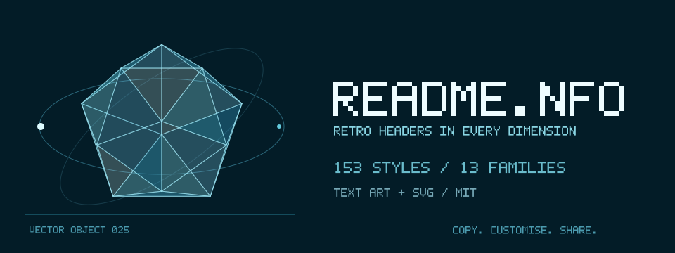

<p align="center">
  <a href="../../../examples/readme-nfo/16-nfo-01.md"></a>
</p>

Generate ten headers for your project:

```sh
npx --yes github:lukexyz/README.NFO github.com/you/project -10
```

Swap in your GitHub URL. Every header is freshly authored for your project, drawing from 153 style briefs. Requires Node.js 22+, Git and a signed-in Codex CLI. Your gallery opens when the batch is ready. [Setup, options and copying](../../generation.md).

## More favourites

Six more looks to try. Click a preview or its name for the full header and generator.

<p align="center">
  <a href="../../../examples/readme-nfo/04-trk-07.md"></a>
  <a href="../../../examples/readme-nfo/26-print-02.md"></a>
</p>

[04 — Multi-chip tracker](../../../examples/readme-nfo/04-trk-07.md) · [26 — Cassette and J-card](../../../examples/readme-nfo/26-print-02.md)

<p align="center">
  <a href="../../../examples/readme-nfo/36-idle-10.md"></a>
  <a href="../../../examples/readme-nfo/38-c64-07.md"></a>
</p>

[36 — Off-air test card](../../../examples/readme-nfo/36-idle-10.md) · [38 — Copper ribbons](../../../examples/readme-nfo/38-c64-07.md)

<p align="center">
  <a href="../../../examples/readme-nfo/12-vap-09.md"></a>
  <a href="../../../examples/readme-nfo/25-pc-13.md"></a>
</p>

[12 — Luna desktop](../../../examples/readme-nfo/12-vap-09.md) · [25 — Vector objects](../../../examples/readme-nfo/25-pc-13.md)

## Full galleries

**320 headers and logos · 153 distinct styles · twelve galleries.** [Start with twelve picks](../../../examples/START-HERE.md) or explore a complete set. [Browse styles by text / ASCII or SVG](../../../styles/INDEX.md#browse-by-output-format):

| Gallery | Headers | Theme |
| --- | ---: | --- |
| [README.NFO](../../../examples/readme-nfo/README.md) | 41 | Two random draws plus a CLI startup-banner reference; filter text / ASCII and SVG |
| [Heretic](../../../examples/heretic/README.md) | 40 | Forty fixed random styles, independently composed; filter SVG and text / ASCII and save favourites |
| [MediaLog — fresh draw](../../../examples/medialog-draw-02/README.md) | 10 | A shared media diary in ten new styles, with two text alternatives; earlier MediaLog and saved draws excluded |
| [MediaLog — compact logos](../../../examples/medialog-logos-01/README.md) | 10 | Original graphic identities at 203 × 74 pixels, with actual-size light/dark previews, static SVGs and PNG exports |
| [MediaLog — 20 more compact logos](../../../examples/medialog-logos-02/README.md) | 20 | A second graphic draw with no repeated styles: neon, chrome, glass and pocket-device identities at 203 × 74 pixels |
| [MediaLog — navy identities](../../../examples/medialog-logos-03/README.md) | 20 | Brand navy #18223a, plain lettering and new diary-inspired symbols; 203 × 74 previews and separate app icons |
| [MediaLog — ten old machines](../../../examples/medialog-logos-04/README.md) | 10 | Ten unused styles as animated navy symbols: handheld boot, demo titles, cassette, glass glenz book, one-bit window, Amiga bobs, library maze, pipes, title card, chrome; static poses included |
| [MediaLog — ten kinds of media](../../../examples/medialog-logos-05/README.md) | 10 | Static navy symbols aimed at media types: VCR readout and cracktro clapperboard (films), test card (TV), jukebox and synth screen (albums), pinball display and 8-bit joystick (games), light-synth mic (podcasts), crack-screen book stack, tick-box review slip |
| [MediaLog — ten ways to draw a book](../../../examples/medialog-logos-06/README.md) | 10 | Favourite graphic styles from earlier sets redrawn around books, simpler and free-standing: chrome hardback, synthwave sunset, glass book, Kickstart hand, pencil sketch, Aero gloss, copper-bar shelf, 3D pipes, 1-bit Mac icon, Memphis paperback |
| [MediaLog — the media set, rebound as books](../../../examples/medialog-logos-07/README.md) | 10 | Collection 05's ten styles redrawn around books, simpler and free-standing: fluorescent-display book, test-card hardback, jukebox contents page, pinball dot-matrix book, keyboard-edged book stack, chrome book with a twister spine, light-synth outline, attribute-clash pixel book, Apple II title card, swap slip bookmark |
| [Dance Vision](../../../examples/dance-vision/README.md) | 6 | Motion capture and a TV dance floor |
| [ULTRA-SATISFACTORY](../../../examples/ultra-satisfactory/README.md) | 42 | Factory recipes and machines |
| [Castaway](../../../examples/castaway/README.md) | 116 | A lo-fi island and visual gags, on six pages |
| [NATURALIS-HISTORIA](../../../examples/naturalis-historia/README.md) | 5 | An illustrated Latin-English encyclopedia |
| [GL4SS](../../../examples/gl4ss/README.md) | 5 | Places through time |
| [ST3GG](../../../examples/st3gg/README.md) | 5 | Visible carriers and hidden messages |

[All examples](../../../examples/README.md) · [Style catalogue](../../../styles/INDEX.md) · [Compare the three Pliny sets](../../../comparisons/pliny-first-draw/index.html)

[MIT licence](../../../LICENSE) · [Development and manual customisation](../../development.md) · [Musings](../../../MUSINGS.md)


```text

                ▄▄███▄▄▄▄
            ▄▄██████████████
           ███████▀▀▀████████
          ▄████▀        █████                           ▄▄
          █████         █████                          ███
         ▄████         ▄█████                         ▄██▀
         █████       ▄█████▀                          ███
         █████▄▄██████████                           ███▀
        ████████████████▀     ▄▄                    ▄███                 ▄▄
        ████████████       ▄██████▄▄   ▄████▄▄▄▄▄██████▄██ ▄██▄ ▄███▄▄▄▄████▄▄
       ▄████  ▀▀█████▄   ████▀ ▀▀███▄▄███▀▀███████▀██████████████████████▀▀███
       █████     ▀█████  ███▄▄▄▄▄██████▀   █████   █████████▄████▀██████▄▄▄███
      ▄████        ████▄██████████████    █████   ████████▀ ████▀ ███████████▀
      █████         ███████▄      ████   ██████  ▄██▀███   ▄███  ██████   ▄███
      ████           ████████▄▄███████▄████████████████    ███   ▀██████████▀▀
     █████            █████████▀▀▀▀ ████▀▀▀ ▀▀███▀  ▀▀▀         ▄▄▄██████▀
     ████▀            ▀▀██████████▄▄▄▄▄▄▄▄▄▄▄▄▄▄▄▄▄▄▄▄▄▄▄███████████████
     ▀██▀                  ▀▀▀█████████████████████████████████▀▀▀▀▀▀▀

                           R E A D M E . N F O
┌────────────────────────────────────────────────────────────────────────────┐
│  COLLECTION : README.NFO              FORMAT : TEXT + SVG                   │
│  STYLE POOL : 152                     FAMILY : 13                           │
│  LICENCE    : MIT                     STATUS : READY TO CUSTOMISE           │
└────────────────────────────────────────────────────────────────────────────┘
```
