<p align="center">
  <picture>
    <source media="(prefers-color-scheme: dark)" srcset="assets/hero-dark.svg">
    
  </picture>
</p>

<p align="center">
  <b>Retro headers for your README, drawn fresh for your project.</b><br>
  10 numbered headers from 153 researched styles, drawn by Claude Code or Codex.<br>
  Pick a number and it lands at the top of your README.
</p>

<p align="center">
  <a href="#install-notes"><b>Install</b></a> ·
  <a href="#engine">Claude or Codex</a> ·
  <a href="#release-contents">Examples</a> ·
  <a href="#after-the-run">After the run</a>
</p>

<picture><source media="(prefers-color-scheme: dark)" srcset="assets/bar-01-dark.svg">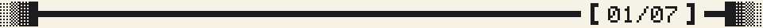</picture>

## Install notes

```sh
npx readme-nfo
```

1. Install [Node.js 22+](https://nodejs.org) and sign in to
   [Claude Code](https://claude.com/claude-code) or
   [Codex](https://developers.openai.com/codex).
2. In your project's folder, run the line above.
3. A gallery opens with 10 numbered headers. Type the number you like
   and it goes at the top of your README. Review with `git diff`, then commit.

<p align="center">
  <picture>
    <source media="(prefers-color-scheme: dark)" srcset="assets/batches-dark.svg">
    
  </picture>
</p>

**Claude or Codex?** It uses whichever one you're signed in to, and asks once
if you have both. To pick one yourself, use the two commands under
[Engine](#engine).

**Private repos work.** It reads your project folder, not GitHub, so there's no
token to set. Your project facts go only to the agent you picked.

**Want more?** `npx readme-nfo more` gives 10 new styles, numbered 11-20, on the
same gallery page. No style repeats. `npx readme-nfo use 14` swaps your header.

```text
▄▄▄ BATCHES ▄▄▄▄▄▄▄▄▄▄▄▄▄▄▄▄▄▄
 npx readme-nfo ....... 01-10
 npx readme-nfo use 3 . README
 npx readme-nfo more .. 11-20
 npx readme-nfo more .. 21-30
▀▀▀▀▀▀▀▀▀▀▀▀▀▀▀▀▀▀▀▀▀▀▀▀▀▀▀▀▀▀
```

One gallery page holds every batch. Numbers never restart and no style repeats.
The defaults are good.

> [!TIP]
> **Or just ask your agent.** In Claude Code or Codex, say
> *"Get me 10 headers from README.NFO"*, then *"number 3"*, or *"make 10 more"*.

<picture><source media="(prefers-color-scheme: dark)" srcset="assets/bar-02-dark.svg">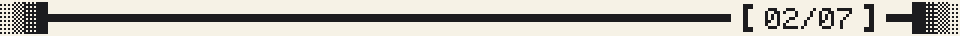</picture>

## Release info

<pre>
<b>RELEASE</b> ... README.NFO 0.1.0
<b>FOR</b> ....... any git repo
<b>MAKES</b> ..... 10 a run, numbered
<b>MORE</b> ...... 11-20, no repeats
<b>STYLES</b> .... <a href="../../../styles/INDEX.md">153 in 13 families</a>
<b>AGENT</b> ..... <a href="#engine">Claude or Codex</a>
<b>PRIVATE</b> ... <a href="#engine">works, no token</a>
<b>NEEDS</b> ..... Node.js 22+
<b>EXAMPLES</b> .. <a href="#release-contents">260 in 8 galleries</a>
<b>LICENCE</b> ... <a href="../../../LICENSE">MIT</a>
</pre>

<picture><source media="(prefers-color-scheme: dark)" srcset="assets/bar-03-dark.svg">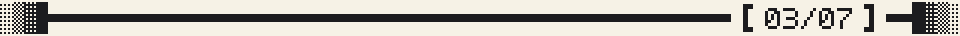</picture>

## Engine

```text
▄▄▄ ENGINE SELECT ▄▄▄▄▄▄▄▄▄▄▄▄
 no flag .. the one signed in
 --claude . Claude Code
 --codex .. Codex
 both? .... asks you once
 neither? . how to sign in
▀▀▀▀▀▀▀▀▀▀▀▀▀▀▀▀▀▀▀▀▀▀▀▀▀▀▀▀▀▀
```

```sh
npx readme-nfo --claude
```

```sh
npx readme-nfo --codex
```

> README.NFO plans, checks and installs. The agent you already use draws the
> art: Claude with no tools, Codex in a read-only sandbox.

> [!NOTE]
> **Private repo? Nothing to set up.** It reads your project folder, not
> GitHub, so there's no token to set. Private, self-hosted, GitLab and
> never-pushed projects all work. Your project facts go only to the agent you
> picked, under your own sign-in.

<picture><source media="(prefers-color-scheme: dark)" srcset="assets/bar-04-dark.svg">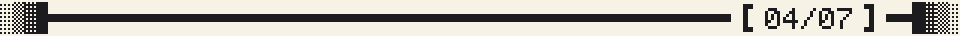</picture>

## Sample output

Six real headers, live and animated. Click one for its page and Markdown.

<p align="center">
<a href="../../../examples/castaway/01-mode7-island_opus_5.5.md"></a>
<a href="../../../examples/castaway/14-off-air_opus_5.5.md"></a>
</p>
<p align="center"><sub>▲ castaway: rotating island, then test card</sub></p>

<p align="center">
<a href="../../../examples/ultra-satisfactory/13-chrome-spheres_opus_5.5.md"></a>
<a href="../../../examples/castaway/98-3d-pipes_opus_5.5.md"></a>
</p>
<p align="center"><sub>▲ ultra-satisfactory spheres, then castaway pipes</sub></p>

<p align="center">
<a href="../../../examples/ultra-satisfactory/12-cassette-jcard_opus_5.5.md"></a>
<a href="../../../examples/castaway/65-memphis_opus_5.5.md"></a>
</p>
<p align="center"><sub>▲ ultra-satisfactory cassette, then castaway confetti</sub></p>

### One brief, three projects

The same test-card brief, drawn for three different projects. Each one is
composed for its project, not filled into a template.

<p align="center">
<a href="../../../examples/naturalis-historia/01-off-air.md">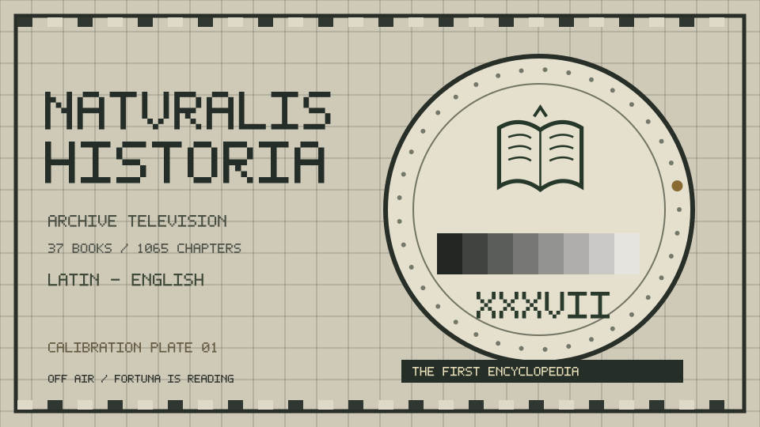</a>
<a href="../../../examples/gl4ss/01-off-air.md"></a>
<a href="../../../examples/st3gg/01-off-air.md">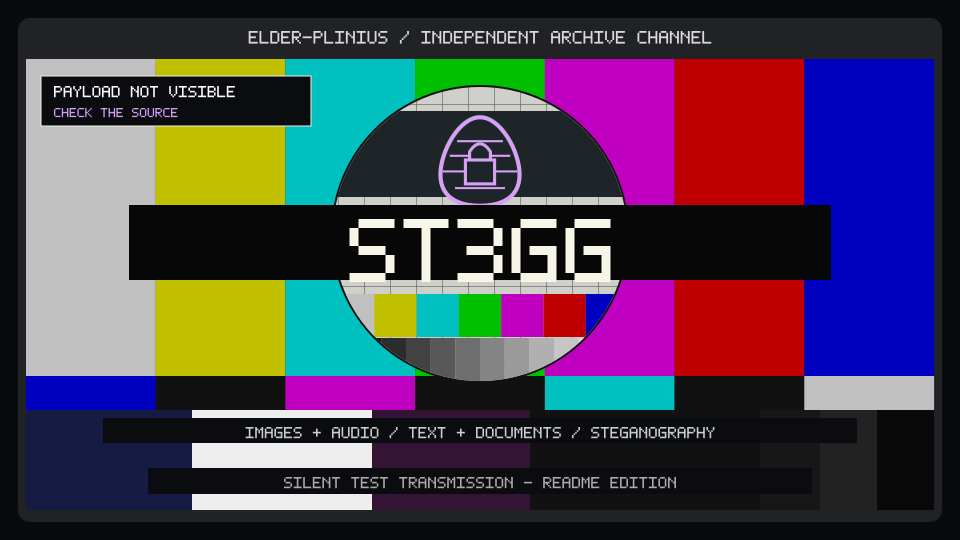</a>
</p>
<p align="center"><sub>▲ naturalis-historia, gl4ss, st3gg</sub></p>

*Honest note: the showcase headers came from long, multi-pass Claude Opus runs
(a median of about 54 minutes a header). Headers from the CLI take minutes, not hours,
and are simpler. Same styles, drawn faster.*

<picture><source media="(prefers-color-scheme: dark)" srcset="assets/bar-05-dark.svg">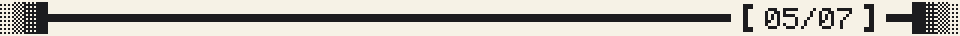</picture>

## Release contents

```text
▄▄▄ RELEASE CONTENTS ▄▄▄▄▄▄▄▄▄
 castaway/ .............. 116
 ultra-satisfactory/ ..... 42
 readme-nfo/ ............. 41
 heretic/ ................ 40
 dance-vision/ ............ 6
 naturalis-historia/ ...... 5
 gl4ss/ ................... 5
 st3gg/ ................... 5
 ────────────────────────────
 TOTAL .................. 260
▀▀▀▀▀▀▀▀▀▀▀▀▀▀▀▀▀▀▀▀▀▀▀▀▀▀▀▀▀▀
```

Thirty picks from six projects follow, numbered like a gallery: 01-10, then
11-20, then 21-30. Every tile opens its header page, with the art and the
Markdown to paste. **»** in a file list means the header moves. The small
galleries are a good place to start:
[naturalis-historia](../../../examples/naturalis-historia/README.md) ·
[gl4ss](../../../examples/gl4ss/README.md) ·
[st3gg](../../../examples/st3gg/README.md).

### Reel 1 · 01-10

<p align="center">
<a href="../../../examples/castaway/57-synthwave-outrun_opus_5.5.md" title="01 · castaway · sunset, laser grid, chrome">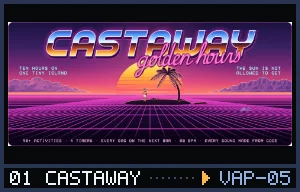</a>
<a href="../../../examples/ultra-satisfactory/42-aero-gloss_opus_5.5.md" title="02 · ultra-satisfactory · glossy aqua window">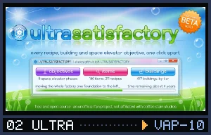</a>
<a href="../../../examples/heretic/09-pc-12.md" title="03 · heretic · neon cube field">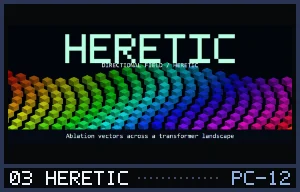</a>
<a href="../../../examples/castaway/52-teletext-page_opus_5.5.md" title="04 · castaway · teletext page, mosaic island">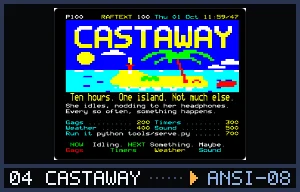</a>
<a href="../../../examples/ultra-satisfactory/10-arcade-attract_opus_5.5.md" title="05 · ultra-satisfactory · arcade attract screen">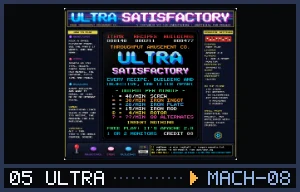</a>
<a href="../../../examples/st3gg/02-telnet-board.md" title="06 · st3gg · inverse-video message board">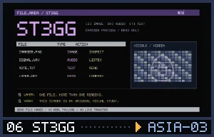</a>
<a href="../../../examples/castaway/56-vhs-tape_opus_5.5.md" title="07 · castaway · worn camcorder tape">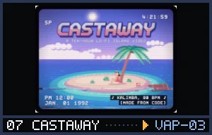</a>
<a href="../../../examples/heretic/15-demo-10.md" title="08 · heretic · fat-pixel title">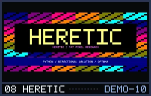</a>
<a href="../../../examples/ultra-satisfactory/41-attribute-grid-demo_opus_5.5.md" title="09 · ultra-satisfactory · attribute-grid demo">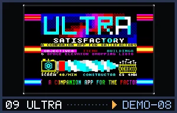</a>
<a href="../../../examples/castaway/09-pinball-dmd_opus_5.5.md" title="10 · castaway · pinball dot-matrix">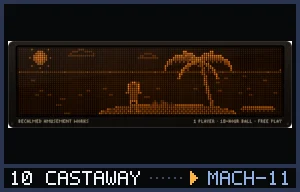</a>
</p>

<details><summary>Reel 1 file list</summary>

<pre>
<a href="../../../examples/castaway/57-synthwave-outrun_opus_5.5.md">01</a> castaway ........... <a href="../../../styles/vap.md#vap-05">vap-05</a>  »  sunset, laser grid, chrome
<a href="../../../examples/ultra-satisfactory/42-aero-gloss_opus_5.5.md">02</a> ultra-satisfactory .. <a href="../../../styles/vap.md#vap-10">vap-10</a>  »  glossy aqua window
<a href="../../../examples/heretic/09-pc-12.md">03</a> heretic ............ <a href="../../../styles/pc.md#pc-12">pc-12</a>      neon cube field
<a href="../../../examples/castaway/52-teletext-page_opus_5.5.md">04</a> castaway ........... <a href="../../../styles/ansi.md#ansi-08">ansi-08</a> »  teletext page, mosaic island
<a href="../../../examples/ultra-satisfactory/10-arcade-attract_opus_5.5.md">05</a> ultra-satisfactory .. <a href="../../../styles/mach.md#mach-08">mach-08</a> »  arcade attract screen
<a href="../../../examples/st3gg/02-telnet-board.md">06</a> st3gg .............. <a href="../../../styles/asia.md#asia-03">asia-03</a> »  inverse-video message board
<a href="../../../examples/castaway/56-vhs-tape_opus_5.5.md">07</a> castaway ........... <a href="../../../styles/vap.md#vap-03">vap-03</a>  »  worn camcorder tape
<a href="../../../examples/heretic/15-demo-10.md">08</a> heretic ............ <a href="../../../styles/demo.md#demo-10">demo-10</a>    fat-pixel title
<a href="../../../examples/ultra-satisfactory/41-attribute-grid-demo_opus_5.5.md">09</a> ultra-satisfactory .. <a href="../../../styles/demo.md#demo-08">demo-08</a> »  attribute-grid demo
<a href="../../../examples/castaway/09-pinball-dmd_opus_5.5.md">10</a> castaway ........... <a href="../../../styles/mach.md#mach-11">mach-11</a> »  pinball dot-matrix
</pre>

</details>

### Reel 2 · 11-20

<p align="center">
<a href="../../../examples/castaway/36-st-menu-disk_opus_5.5.md" title="11 · castaway · numbered menu disk">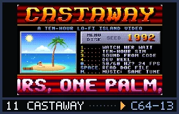</a>
<a href="../../../examples/ultra-satisfactory/26-vaporwave_opus_5.5.md" title="12 · ultra-satisfactory · marble bust, pink grid">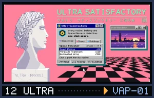</a>
<a href="../../../examples/heretic/03-nfo-02.md" title="13 · heretic · shaded block lettering">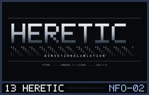</a>
<a href="../../../examples/castaway/95-light-synth_opus_5.5.md" title="14 · castaway · mirrored light trails">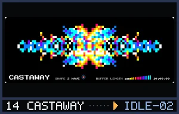</a>
<a href="../../../examples/gl4ss/04-viewdata.md" title="15 · gl4ss · viewdata page">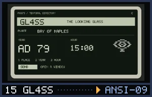</a>
<a href="../../../examples/ultra-satisfactory/27-signalwave-forecast_opus_5.5.md" title="16 · ultra-satisfactory · factory weather report">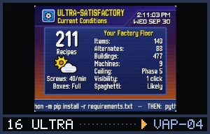</a>
<a href="../../../examples/castaway/87-file-system-landscape_opus_5.5.md" title="17 · castaway · folders as a city">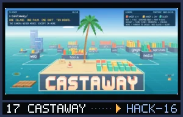</a>
<a href="../../../examples/heretic/13-demo-08.md" title="18 · heretic · attribute-grid colour">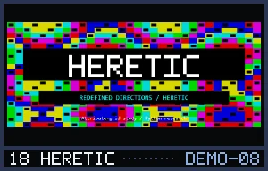</a>
<a href="../../../examples/ultra-satisfactory/33-sysop-dashboard_opus_5.5.md" title="19 · ultra-satisfactory · sysop dashboard">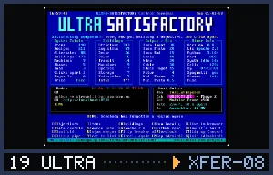</a>
<a href="../../../examples/castaway/73-vfd-front-panel_opus_5.5.md" title="20 · castaway · glowing hi-fi panel">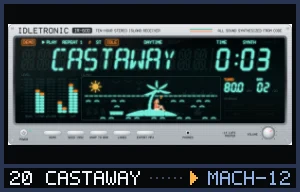</a>
</p>

<details><summary>Reel 2 file list</summary>

<pre>
<a href="../../../examples/castaway/36-st-menu-disk_opus_5.5.md">11</a> castaway ........... <a href="../../../styles/c64.md#c64-13">c64-13</a>  »  numbered menu disk
<a href="../../../examples/ultra-satisfactory/26-vaporwave_opus_5.5.md">12</a> ultra-satisfactory .. <a href="../../../styles/vap.md#vap-01">vap-01</a>  »  marble bust, pink grid
<a href="../../../examples/heretic/03-nfo-02.md">13</a> heretic ............ <a href="../../../styles/nfo.md#nfo-02">nfo-02</a>     shaded block lettering
<a href="../../../examples/castaway/95-light-synth_opus_5.5.md">14</a> castaway ........... <a href="../../../styles/idle.md#idle-02">idle-02</a> »  mirrored light trails
<a href="../../../examples/gl4ss/04-viewdata.md">15</a> gl4ss .............. <a href="../../../styles/ansi.md#ansi-09">ansi-09</a> »  viewdata page
<a href="../../../examples/ultra-satisfactory/27-signalwave-forecast_opus_5.5.md">16</a> ultra-satisfactory .. <a href="../../../styles/vap.md#vap-04">vap-04</a>  »  factory weather report
<a href="../../../examples/castaway/87-file-system-landscape_opus_5.5.md">17</a> castaway ........... <a href="../../../styles/hack.md#hack-16">hack-16</a> »  folders as a city
<a href="../../../examples/heretic/13-demo-08.md">18</a> heretic ............ <a href="../../../styles/demo.md#demo-08">demo-08</a>    attribute-grid colour
<a href="../../../examples/ultra-satisfactory/33-sysop-dashboard_opus_5.5.md">19</a> ultra-satisfactory .. <a href="../../../styles/xfer.md#xfer-08">xfer-08</a> »  sysop dashboard
<a href="../../../examples/castaway/73-vfd-front-panel_opus_5.5.md">20</a> castaway ........... <a href="../../../styles/mach.md#mach-12">mach-12</a> »  glowing hi-fi panel
</pre>

</details>

### Reel 3 · 21-30

<p align="center">
<a href="../../../examples/castaway/88-tone-pad_opus_5.5.md" title="21 · castaway · keypad and scopes">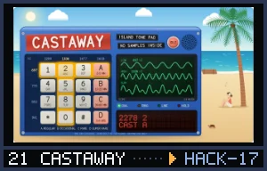</a>
<a href="../../../examples/ultra-satisfactory/40-power-on-self-test_opus_5.5.md" title="22 · ultra-satisfactory · power-on self-test">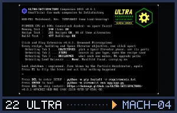</a>
<a href="../../../examples/heretic/16-mach-09.md" title="23 · heretic · pixel quest title">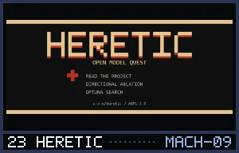</a>
<a href="../../../examples/castaway/60-one-bit-desktop_opus_5.5.md" title="24 · castaway · 1-bit desktop">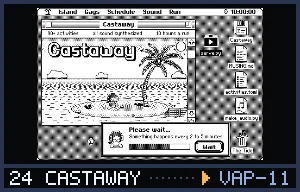</a>
<a href="../../../examples/naturalis-historia/05-luna-desktop.md" title="25 · naturalis-historia · blue-and-green desktop">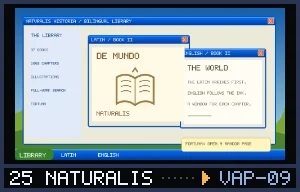</a>
<a href="../../../examples/ultra-satisfactory/35-terminal-session_opus_5.5.md" title="26 · ultra-satisfactory · terminal session">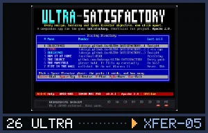</a>
<a href="../../../examples/castaway/58-city-pop-sleeve_opus_5.5.md" title="27 · castaway · record sleeve">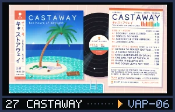</a>
<a href="../../../examples/st3gg/03-demo-titles.md" title="28 · st3gg · demo title card">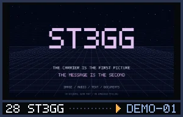</a>
<a href="../../../examples/ultra-satisfactory/38-piano-roll_opus_5.5.md" title="29 · ultra-satisfactory · piano roll">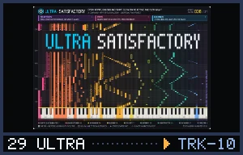</a>
<a href="../../../examples/castaway/90-pc-98-adventure-screen_opus_5.5.md" title="30 · castaway · adventure-game screen">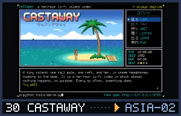</a>
</p>

<details><summary>Reel 3 file list</summary>

<pre>
<a href="../../../examples/castaway/88-tone-pad_opus_5.5.md">21</a> castaway ........... <a href="../../../styles/hack.md#hack-17">hack-17</a> »  keypad and scopes
<a href="../../../examples/ultra-satisfactory/40-power-on-self-test_opus_5.5.md">22</a> ultra-satisfactory .. <a href="../../../styles/mach.md#mach-04">mach-04</a> »  power-on self-test
<a href="../../../examples/heretic/16-mach-09.md">23</a> heretic ............ <a href="../../../styles/mach.md#mach-09">mach-09</a>    pixel quest title
<a href="../../../examples/castaway/60-one-bit-desktop_opus_5.5.md">24</a> castaway ........... <a href="../../../styles/vap.md#vap-11">vap-11</a>  »  1-bit desktop
<a href="../../../examples/naturalis-historia/05-luna-desktop.md">25</a> naturalis-historia .. <a href="../../../styles/vap.md#vap-09">vap-09</a>  »  blue-and-green desktop
<a href="../../../examples/ultra-satisfactory/35-terminal-session_opus_5.5.md">26</a> ultra-satisfactory .. <a href="../../../styles/xfer.md#xfer-05">xfer-05</a> »  terminal session
<a href="../../../examples/castaway/58-city-pop-sleeve_opus_5.5.md">27</a> castaway ........... <a href="../../../styles/vap.md#vap-06">vap-06</a>  »  record sleeve
<a href="../../../examples/st3gg/03-demo-titles.md">28</a> st3gg .............. <a href="../../../styles/demo.md#demo-01">demo-01</a> »  demo title card
<a href="../../../examples/ultra-satisfactory/38-piano-roll_opus_5.5.md">29</a> ultra-satisfactory .. <a href="../../../styles/trk.md#trk-10">trk-10</a>  »  piano roll
<a href="../../../examples/castaway/90-pc-98-adventure-screen_opus_5.5.md">30</a> castaway ........... <a href="../../../styles/asia.md#asia-02">asia-02</a> »  adventure-game screen
</pre>

</details>

### Plain text, too

Some styles make text you can paste anywhere: a commit message, a terminal, an
NFO. [heretic/04](../../../examples/heretic/04-nfo-10.md) is one.

<details><summary>Show heretic/04 as plain text</summary>

```text
                   .----------------.
                  /  open language   \
             .---'--------------------'---.
            /       .---.    .---.        \
           |        | o |----| o |         |
           |        '---'    '---'         |
           |            \__/              |
            \           /  \             /
             '---------'    '-----------'
                  /\              /\
                 /__\------------/__\
                   .-'          '-.
                  '----.    .----'
                       |____|

        heretic - open directions, drawn in plain text
        Python / directional ablation / Optuna
```

</details>

<picture><source media="(prefers-color-scheme: dark)" srcset="assets/bar-06-dark.svg">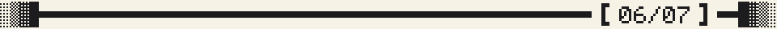</picture>

## After the run

```text
$ npx readme-nfo
 AGENT ... Claude Code
           (switch: --codex)
 PROJECT . this folder
 DRAW .... 10 of 153
           3 at a time
 GALLERY . open, filling in

 Install which header?
 [1-10, Enter = later] 3

 WROTE .github/readme-nfo/
         header.svg
         LICENSE
 EDIT  README.md (marked block)

 Review with git diff,
 then commit.
```

Your README gets one marked block at the very top:

```html
<!-- README.NFO header: start -->
<p align="center">
  
</p>
<!-- README.NFO header: end -->
```

- **Swap it:** `npx readme-nfo use 7` replaces the block. Nothing else moves.
- **Undo it:** delete the block and `.github/readme-nfo/`.
- **Nothing is committed for you.** Batches stay in `readme-headers/`, which is
  kept out of git, so `git status` stays clean.

<picture><source media="(prefers-color-scheme: dark)" srcset="assets/bar-07-dark.svg">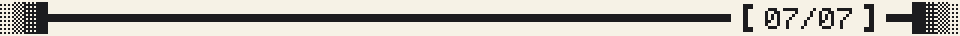</picture>

## Options and credits

<details><summary><b>OPTIONS</b> · every flag</summary>

```text
▄▄▄ OPTIONS ▄▄▄▄▄▄▄▄▄▄▄▄▄▄▄▄▄▄
 engine ....... « auto »
   --claude  --codex
 how many ..... « 10 »
   --count N
 model ........ « agent's own »
   --model NAME
 at once ...... « 3 »
   --jobs N
 formats ...... « all »
   --format svg|text
 browser ...... « opens »
   --no-open
 same draw .... « random »
   --seed TEXT
 reuse styles . « never »
   --allow-repeats
 a repo not cloned
   npx readme-nfo <repo URL>
▀▀▀▀▀▀▀▀▀▀▀▀▀▀▀▀▀▀▀▀▀▀▀▀▀▀▀▀▀▀
```

</details>

**How long?** One header took 74 s with Claude Sonnet and 2 min 31 s with
Codex in testing. Ten take a few minutes, 3 at a time.
More: [generation docs](../../generation.md) ·
[style catalogue](../../../styles/INDEX.md) ·
[development](../../development.md).

<pre>
▄▄▄ CREDITS ▄▄▄▄▄▄▄▄▄▄▄▄▄▄▄▄▄▄
 code ...... Luke Woods
 research .. <a href="https://16colo.rs">16colo.rs</a>
             <a href="https://demozoo.org">Demozoo</a> · <a href="https://www.pouet.net">Pouet</a>
             <a href="http://textfiles.com">textfiles.com</a>
 tools ..... Node.js
             Playwright
 art ....... drawn by coding
             agents from
             researched briefs
 licence ... <a href="../../../LICENSE">MIT</a>
─────────────────────[ EOF ]──
</pre>

<picture><source media="(prefers-color-scheme: dark)" srcset="assets/bar-eof-dark.svg">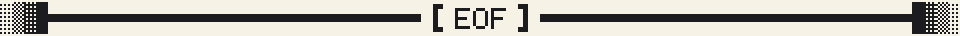</picture>

<details><summary>The logo as plain text</summary>

```text
  ▄▄▄                                                                    ▄▄▄
 █▓▒░ █████▄ ██████ ▄████▄ █████▄ ██▄ ▄██ ██████    ██▄ ██ ██████ ▄████▄ ░▒▓█
 ▓▒░  ██  ██ ██     ██  ██ ██  ██ ██▀█▀██ ██        ███▄██ ██     ██  ██  ░▒▓
 ▒░   █████▀ █████  ██▄▄██ ██  ██ ██ ▀ ██ █████     ██▀███ █████  ██  ██   ░▒
 ░    ██▀██▄ ██     ██▀▀██ ██  ██ ██   ██ ██        ██ ▀██ ██     ██  ██    ░
      ██  ██ ██▄▄▄▄ ██  ██ ██▄▄█▀ ██   ██ ██▄▄▄▄ ▄▄ ██  ██ ██     ▀█▄▄█▀
      ▀▀  ▀▀ ▀▀▀▀▀▀ ▀▀  ▀▀ ▀▀▀▀   ▀▀   ▀▀ ▀▀▀▀▀▀ ▀▀ ▀▀  ▀▀ ▀▀      ▀▀▀▀
 ░▒▓██████████████████████████████████████████████████████████████████████▓▒░

                   R E T R O   R E A D M E   H E A D E R S
```

</details>
