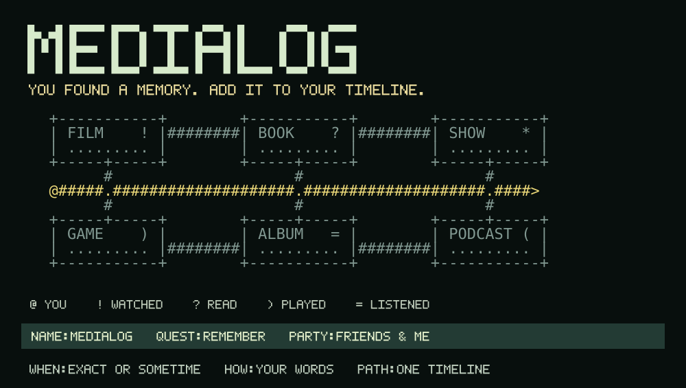

<!-- MediaLog original artwork. Rebuild: node src/03-hack-08.mjs. MIT: LICENSE.README-NFO.txt. -->

<p align="center">
  
</p>

**MediaLog — a media diary you share.**

Everything you’ve watched, read, played, listened to, on one timeline. Log a film, a book, a show, a game, an album or a podcast: when, and how it was. Then see what the people you know have been into.

<details>
<summary>Text / ASCII alternative</summary>

```text
MediaLog — a media diary you share.
You found a memory. Add it to your timeline.

  +-----------+        +-----------+        +-----------+
  | FILM    ! |########| BOOK    ? |########| SHOW    * |
  | ......... |        | ......... |        | ......... |
  +-----+-----+        +-----+-----+        +-----+-----+
        #                    #                    #
  @#####.####################.####################.####>
        #                    #                    #
  +-----+-----+        +-----+-----+        +-----+-----+
  | GAME    ) |        | ALBUM   = |        | PODCAST ( |
  | ......... |########| ......... |########| ......... |
  +-----------+        +-----------+        +-----------+

@ you   ! watched   ? read   ) played   = listened
When: exact or sometime. How: your words. Party: friends & me.
```

</details>

> **Candidate 03 · hack-08** · A dungeon of remembered things

[Generator](src/03-hack-08.mjs) · [Style](../../styles/hack.md#hack-08) · [MIT notice](LICENSE.README-NFO.txt)
