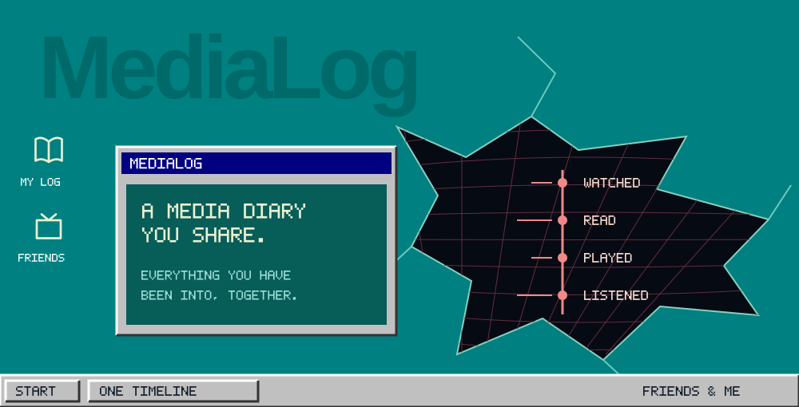

<!-- MediaLog original artwork. Rebuild: node src/06-pc-10.mjs. MIT: LICENSE.README-NFO.txt. -->

  

**MediaLog — a media diary you share.**

Everything you’ve watched, read, played, listened to, on one timeline. Log a film, a book, a show, a game, an album or a podcast: when, and how it was. Then see what the people you know have been into.

> **Candidate 06 · pc-10** · A timeline under the desktop

[Generator](src/06-pc-10.mjs) · [Style](../../styles/pc.md#pc-10) · [MIT notice](LICENSE.README-NFO.txt)
