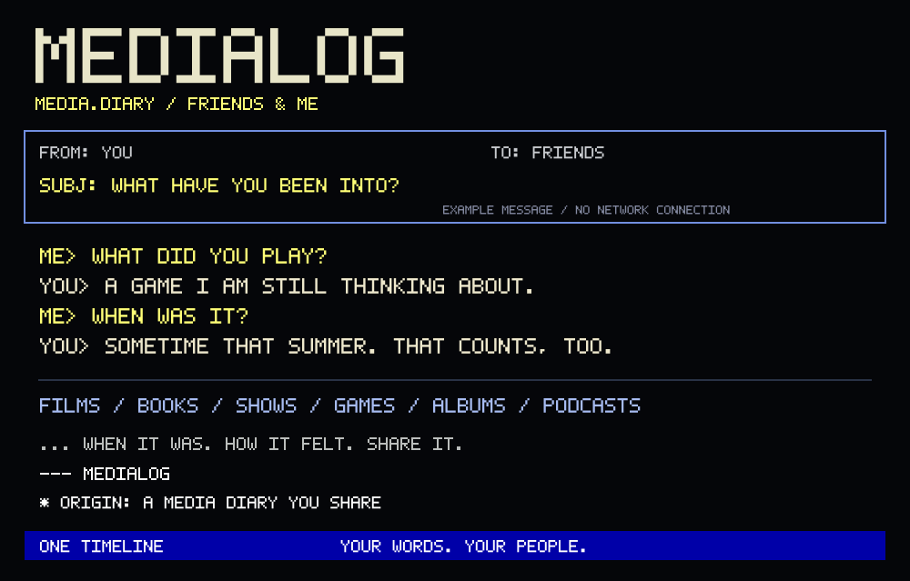

<!-- MediaLog original artwork. Rebuild: node src/09-xfer-02.mjs. MIT: LICENSE.README-NFO.txt. -->

<p align="center">
  
</p>

**MediaLog — a media diary you share.**

Everything you’ve watched, read, played, listened to, on one timeline. Log a film, a book, a show, a game, an album or a podcast: when, and how it was. Then see what the people you know have been into.

<details>
<summary>Text / ASCII alternative</summary>

```text
AREA: MEDIA.DIARY / FRIENDS & ME
FROM: You                  TO: Friends
SUBJ: What have you been into?

ME> What did you play?
YOU> A game I am still thinking about.
ME> When was it?
YOU> Sometime that summer. That counts, too.

Films / books / shows / games / albums / podcasts
... When it was. How it felt. Share it.
--- MediaLog
 * Origin: A media diary you share

Illustrative conversation; no network connection.
```

</details>

> **Candidate 09 · xfer-02** · A message to your people

[Generator](src/09-xfer-02.mjs) · [Style](../../styles/xfer.md#xfer-02) · [MIT notice](LICENSE.README-NFO.txt)
