<!-- Original MediaLog identity. MIT: LICENSE.README-NFO.txt. Edit src/01-vap-16.mjs. -->

# Signal saved

A play button becomes a saved moment and a conversation. Cyan and pink signal offsets give the mark a clean, deliberate glitch.

**MediaLog — a media diary you share.** Everything you’ve watched, read, played and listened to, on one timeline.

[SVG](assets/01-vap-16.svg) · [Static SVG](assets/01-vap-16-still.svg) · [Generator](src/01-vap-16.mjs) · [Style vap-16](../../styles/vap.md#vap-16) · [MIT notice](LICENSE.README-NFO.txt)

<!-- LOGO-META {"name":"Signal saved","description":"A play button becomes a saved moment and a conversation. Cyan and pink signal offsets give the mark a clean, deliberate glitch.","choices":["One speech-tail mark joins experiencing and sharing","The timeline ends in a saved pink dot; glitch is confined to one small stripe"],"animated":true} -->
