<!-- Original MediaLog identity. MIT: LICENSE.README-NFO.txt. Edit src/10-idle-04.mjs. -->

# Taste constellation

Six coloured waveform loops share one centre: all your kinds of media, and the tastes that overlap with your friends. A gentle visualiser motion keeps the emblem alive.

**MediaLog — a media diary you share.** Everything you’ve watched, read, played and listened to, on one timeline.

[SVG](assets/10-idle-04.svg) · [Static SVG](assets/10-idle-04-still.svg) · [Generator](src/10-idle-04.mjs) · [Style idle-04](../../styles/idle.md#idle-04) · [MIT notice](LICENSE.README-NFO.txt)

<!-- LOGO-META {"name":"Taste constellation","description":"Six coloured waveform loops share one centre: all your kinds of media, and the tastes that overlap with your friends. A gentle visualiser motion keeps the emblem alive.","choices":["Six loops represent the six media types named in the brief","The overlapping orbits describe shared taste, while one line connects the whole name"],"animated":true} -->
