<!-- Original MediaLog identity. MIT: LICENSE.README-NFO.txt; font: LICENSE.FONT.txt. -->

# Opening titles

A letterboxed horizon fades up from black and pans in three parallax layers under a low warm sun, like the first part of a PC demo.

**Motion:** Fades up from black once, then the ridges pan slowly in parallax and the stars twinkle. The [static SVG](assets/02-demo-01-still.svg) holds the resting pose.

MediaLog is a media diary you share: everything you’ve watched, read, played and listened to, on one timeline.

[SVG](assets/02-demo-01.svg) · [Static SVG](assets/02-demo-01-still.svg) · [Icon SVG](assets/02-demo-01-icon.svg) · [Generator](src/02-demo-01.mjs) · [Style demo-01](../../styles/demo.md#demo-01) · [MIT notice](LICENSE.README-NFO.txt) · [Font notice](LICENSE.FONT.txt)

The style reference informs the symbol; the navy brand colour and plain lettering take precedence over the catalogue palette and typography.

<!-- LOGO-META {"name":"Opening titles","description":"A letterboxed horizon fades up from black and pans in three parallax layers under a low warm sun, like the first part of a PC demo.","choices":["Letterbox bars, a palette fade and a slow sideways pan carry the opening-titles grammar into a single frame","Steel-blue VGA ranges are pulled toward the brand navy; one warm sun is the only accent"],"animated":true,"motion":"Fades up from black once, then the ridges pan slowly in parallax and the stars twinkle.","format":"SVG","ascii":false,"brand":"#18223a","typography":"DejaVu Sans Bold, plain outlined wordmark","size":{"width":203,"height":74},"transparent":true} -->
