<!-- Original MediaLog identity. MIT: LICENSE.README-NFO.txt; font: LICENSE.FONT.txt. -->

# Now showing

A video-recorder front panel reads ▶ 1:58 in teal fluorescent segments behind smoked glass, with an orange film-reel annunciator and a progress bar most of the way through.

**Leads with:** films.

MediaLog is a media diary you share: everything you’ve watched, read, played and listened to, on one timeline.

[SVG](assets/01-mach-12.svg) · [Icon SVG](assets/01-mach-12-icon.svg) · [Light PNG](assets/01-mach-12-light.png) · [Dark PNG](assets/01-mach-12-dark.png) · [Generator](src/01-mach-12.mjs) · [Style mach-12](../../styles/mach.md#mach-12) · [MIT notice](LICENSE.README-NFO.txt) · [Font notice](LICENSE.FONT.txt)

The style reference informs the symbol; the navy brand colour and plain lettering take precedence over the catalogue palette and typography.

<!-- LOGO-META {"name":"Now showing","description":"A video-recorder front panel reads ▶ 1:58 in teal fluorescent segments behind smoked glass, with an orange film-reel annunciator and a progress bar most of the way through.","choices":["Seven-segment digits keep their ghosted unlit segments; annunciators become play, pause, record and a film reel","A runtime and a part-filled progress bar make the panel about watching films, not hi-fi; no lettering is used"],"media":["films"],"animated":false,"format":"SVG","ascii":false,"brand":"#18223a","typography":"DejaVu Sans Bold, plain outlined wordmark","size":{"width":203,"height":74},"transparent":true} -->
