<!-- Original MediaLog identity. MIT: LICENSE.README-NFO.txt; font: LICENSE.FONT.txt. -->

# Extra ball

A game controller drawn in round orange plasma dots on a pinball backbox display, lit at three brightness levels with dark gaps between the dots.

**Leads with:** games.

MediaLog is a media diary you share: everything you’ve watched, read, played and listened to, on one timeline.

[SVG](assets/04-mach-11.svg) · [Icon SVG](assets/04-mach-11-icon.svg) · [Light PNG](assets/04-mach-11-light.png) · [Dark PNG](assets/04-mach-11-dark.png) · [Generator](src/04-mach-11.mjs) · [Style mach-11](../../styles/mach.md#mach-11) · [MIT notice](LICENSE.README-NFO.txt) · [Font notice](LICENSE.FONT.txt)

The style reference informs the symbol; the navy brand colour and plain lettering take precedence over the catalogue palette and typography.

<!-- LOGO-META {"name":"Extra ball","description":"A game controller drawn in round orange plasma dots on a pinball backbox display, lit at three brightness levels with dark gaps between the dots.","choices":["The dot-matrix grid with visible unlit dots and stepped brightness carries the backbox look into a square-ish panel","A controller, not text or a score, makes it the games mark of the set"],"media":["games"],"animated":false,"format":"SVG","ascii":false,"brand":"#18223a","typography":"DejaVu Sans Bold, plain outlined wordmark","size":{"width":203,"height":74},"transparent":true} -->
