<!-- Original MediaLog identity. MIT: LICENSE.README-NFO.txt; font: LICENSE.FONT.txt. -->

# Channel keys

A synth status screen in lavender on deep navy: spectrum bars with peak-hold ticks above a piano keyboard where one key is lit green.

**Leads with:** albums.

MediaLog is a media diary you share: everything you’ve watched, read, played and listened to, on one timeline.

[SVG](assets/05-asia-01.svg) · [Icon SVG](assets/05-asia-01-icon.svg) · [Light PNG](assets/05-asia-01-light.png) · [Dark PNG](assets/05-asia-01-dark.png) · [Generator](src/05-asia-01.mjs) · [Style asia-01](../../styles/asia.md#asia-01) · [MIT notice](LICENSE.README-NFO.txt) · [Font notice](LICENSE.FONT.txt)

The style reference informs the symbol; the navy brand colour and plain lettering take precedence over the catalogue palette and typography.

<!-- LOGO-META {"name":"Channel keys","description":"A synth status screen in lavender on deep navy: spectrum bars with peak-hold ticks above a piano keyboard where one key is lit green.","choices":["One keyboard strip, a sliced spectrum analyser and hairline frames keep the X68000 player look at icon size","The lit key is the only green on the screen, as on the original displays; tiny labels and counters are left out"],"media":["albums"],"animated":false,"format":"SVG","ascii":false,"brand":"#18223a","typography":"DejaVu Sans Bold, plain outlined wordmark","size":{"width":203,"height":74},"transparent":true} -->
