<!-- Original MediaLog identity. MIT: LICENSE.README-NFO.txt; font: LICENSE.FONT.txt. -->

# Final cut

A brushed-chrome clapperboard stands on a glossy mirror floor between two cream-and-red twister columns, the cracktro centrepiece turned into a film mark.

**Leads with:** films.

MediaLog is a media diary you share: everything you’ve watched, read, played and listened to, on one timeline.

[SVG](assets/06-pc-05.svg) · [Icon SVG](assets/06-pc-05-icon.svg) · [Light PNG](assets/06-pc-05-light.png) · [Dark PNG](assets/06-pc-05-dark.png) · [Generator](src/06-pc-05.mjs) · [Style pc-05](../../styles/pc.md#pc-05) · [MIT notice](LICENSE.README-NFO.txt) · [Font notice](LICENSE.FONT.txt)

The style reference informs the symbol; the navy brand colour and plain lettering take precedence over the catalogue palette and typography.

<!-- LOGO-META {"name":"Final cut","description":"A brushed-chrome clapperboard stands on a glossy mirror floor between two cream-and-red twister columns, the cracktro centrepiece turned into a film mark.","choices":["The metal logo, mirror reflection and twisters of the 2000s cracktro revival frame a clapperboard instead of lettering","A chrome band with a white horizon gives the steel finish; red and cream twisters are the only colour"],"media":["films"],"animated":false,"format":"SVG","ascii":false,"brand":"#18223a","typography":"DejaVu Sans Bold, plain outlined wordmark","size":{"width":203,"height":74},"transparent":true} -->
