<!-- Original MediaLog identity. MIT: LICENSE.README-NFO.txt; font: LICENSE.FONT.txt. -->

# Fire button

A ball-top joystick in red, white and yellow is drawn on the attribute grid of an 8-bit home computer: colour changes only at cell edges, over a chunky blue plasma inside a red border.

**Leads with:** games.

MediaLog is a media diary you share: everything you’ve watched, read, played and listened to, on one timeline.

[SVG](assets/08-demo-08.svg) · [Icon SVG](assets/08-demo-08-icon.svg) · [Light PNG](assets/08-demo-08-light.png) · [Dark PNG](assets/08-demo-08-dark.png) · [Generator](src/08-demo-08.mjs) · [Style demo-08](../../styles/demo.md#demo-08) · [MIT notice](LICENSE.README-NFO.txt) · [Font notice](LICENSE.FONT.txt)

The style reference informs the symbol; the navy brand colour and plain lettering take precedence over the catalogue palette and typography.

<!-- LOGO-META {"name":"Fire button","description":"A ball-top joystick in red, white and yellow is drawn on the attribute grid of an 8-bit home computer: colour changes only at cell edges, over a chunky blue plasma inside a red border.","choices":["Pixels stay fine while colour is set per 8 × 8 cell, so the stick and ball share inks the way the hardware forces","Two yellow raster stripes run into the border; saturated reds and yellows replace the neon cyan and magenta of the original palette"],"media":["games"],"animated":false,"format":"SVG","ascii":false,"brand":"#18223a","typography":"DejaVu Sans Bold, plain outlined wordmark","size":{"width":203,"height":74},"transparent":true} -->
