<!-- Original MediaLog identity. MIT: LICENSE.README-NFO.txt; font: LICENSE.FONT.txt. -->

# Stacked

Three framed crack-screen panels become a stack of books — orange, blue and green covers with white titles that carry green and violet colour fringes — with an open book resting on top.

**Leads with:** books.

MediaLog is a media diary you share: everything you’ve watched, read, played and listened to, on one timeline.

[SVG](assets/09-demo-11.svg) · [Icon SVG](assets/09-demo-11-icon.svg) · [Light PNG](assets/09-demo-11-light.png) · [Dark PNG](assets/09-demo-11-dark.png) · [Generator](src/09-demo-11.mjs) · [Style demo-11](../../styles/demo.md#demo-11) · [MIT notice](LICENSE.README-NFO.txt) · [Font notice](LICENSE.FONT.txt)

The style reference informs the symbol; the navy brand colour and plain lettering take precedence over the catalogue palette and typography.

<!-- LOGO-META {"name":"Stacked","description":"Three framed crack-screen panels become a stack of books — orange, blue and green covers with white titles that carry green and violet colour fringes — with an open book resting on top.","choices":["The thick single-colour frames and white type of early hi-res title cards become book covers and spine titles","Colour fringes on every white edge mimic how hi-res white picks up green and violet; nothing is lettered"],"media":["books"],"animated":false,"format":"SVG","ascii":false,"brand":"#18223a","typography":"DejaVu Sans Bold, plain outlined wordmark","size":{"width":203,"height":74},"transparent":true} -->
