<!-- Original MediaLog identity. MIT: LICENSE.README-NFO.txt; font: LICENSE.FONT.txt. -->

# Three channels

A stack of three books with plum, violet and lavender covers lies with rounded spines to the left, and the edge of each page block is a miniature piano keyboard with one key lit lime, climbing from book to book like a chord.

**Book:** book stack. **Style first used:** [Channel keys](../medialog-logos-05/05-asia-01.md), collection 05.

MediaLog is a media diary you share: everything you’ve watched, read, played and listened to, on one timeline.

[SVG](assets/05-asia-01.svg) · [Icon SVG](assets/05-asia-01-icon.svg) · [Light PNG](assets/05-asia-01-light.png) · [Dark PNG](assets/05-asia-01-dark.png) · [Generator](src/05-asia-01.mjs) · [Style asia-01](../../styles/asia.md#asia-01) · [MIT notice](LICENSE.README-NFO.txt) · [Font notice](LICENSE.FONT.txt)

The style reference informs the symbol; the navy brand colour and plain lettering take precedence over the catalogue palette and typography.

<!-- LOGO-META {"name":"Three channels","description":"A stack of three books with plum, violet and lavender covers lies with rounded spines to the left, and the edge of each page block is a miniature piano keyboard with one key lit lime, climbing from book to book like a chord.","choices":["The synth player’s one-keyboard-per-channel strips become a stack of books: white pages read as white keys","Lavender, violet and plum on the covers; lime only on the sounding keys, as on the original displays"],"book":"book stack","repeatOf":{"style":"asia-01","collection":"medialog-logos-05","slug":"05-asia-01","name":"Channel keys"},"animated":false,"format":"SVG","ascii":false,"brand":"#18223a","typography":"DejaVu Sans Bold, plain outlined wordmark","size":{"width":203,"height":74},"transparent":true} -->
