<!-- Header 02-vhs-tape_opus_5.5 for MediaLog: "VHS Tape" (catalogue entry vap-03). Both images are generated by src/02-vhs-tape_opus_5.5.mjs; this page is hand-written. -->

<p align="center">
  
</p>

<h1 align="center">MediaLog</h1>

<p align="center">
  <b>Everything you've watched, read, played, listened to, on one timeline.</b>
</p>

<p align="center">
  A media diary you share. Log a film, a book, a show, a game, an album or a podcast: when, and how it was.<br>
  Then see what the people you know have been into.
</p>

<p align="center">
  
</p>

<p align="center">
  <sub>A log, five years at a time. Each kind has its colour. A day if you know it, a month if that is all you know, and <i>sometime in</i> for the rest, which on this tape is most of 2015 to 2019.<br>
  In development. There is no public link yet, so for now there is only this tape, and the tracking is doing its best.</sub>
</p>

<details>
<summary><b>◀◀ INDEX</b>: the tape, entry by entry, newest first</summary>

```text
 MEDIALOG · TAPE INDEX · NEWEST FIRST, THE WAY THE TIMELINE READS
 ═════════════════════════════════════════════════════════════════════════
 COUNTER  WHEN    KIND     ENTRY                                     HOW
 ─────────────────────────────────────────────────────────────────────────
 2025-2029
   2026
 1:52:10  21 MAR  TV SHOW  The Long Queue · S2 E1-10                 ♥
                           "Said 'one more' nine times."
 1:46:02  FEB     BOOK     Mostly Puddles · O. Pibworth · audiobook  liked
                           "Listened. Counts as read."
 1:43:18  09 JAN  VIDEO    Wobbly Table, Fixed (41 min)              liked
                           "It still wobbles."
   2025
 1:37:51  30 NOV  ANIME    Space Grocer Rin · S1 E1-12               ♥
 1:31:09  AUG     PODCAST  The Spoon Hour · episodes 1-40            ♥
                           "It is mostly spoons."
 2020-2024
   2022
 0:58:44  17 JUN  MOVIE    A Fortnight in Fog · Ambrose Fellwether
                           verdict: "Too long. Loved it."
   Sometime in 2020-2024
 0:51:20  --      COMIC    The Adequate Man · issues 1-6             liked
 2015-2019
   2016
 0:27:41  12 NOV  ALBUM    Soft Furnishings · The Draught Excluders  ♥
                           "Side B, mostly."
 0:19:02  MAR     MANGA    Grandma Drift · vols 1-3                  liked
   Sometime in 2015-2019
 0:08:19  --      GAME     Snail Derby Deluxe · Mildly Interactive
                           verdict: "Great, I think."
 ─────────────────────────────────────────────────────────────────────────
 0:00:00                   colour bars. everything starts here
```

A selection. Four of these are the recordings in the banner; the deck skips the rest at five times speed, and the INDEX number on its display is counting them.

</details>

<details>
<summary><b>TRACKING</b>: what the date stamp knows, and why the old ones are fuzzy</summary>

```text
 DATE STAMP ........ as exact as you were. a day if you have one
                     (MAR. 21), just a month if that is all you have
                     (FEB. --), and SOMETIME IN for the rest
 --:-- ............. none of these entries came with a time of day, so
                     the clock line was never set. the most realistic
                     VCR feature in this header
 TRACKING .......... the older the recording, the more worn the tape.
                     auto tracking cannot recover a date nobody wrote
                     down. it tries anyway, at six guesses a second,
                     then files it under SOMETIME IN 2015-2019
 FIVE-YEAR BLOCKS .. the timeline is filed 2025-2029, 2020-2024,
                     2015-2019, then by year inside each block, and the
                     index marks on the tape follow it
 THE VERB .......... changes with the light: WATCHED for the telly,
                     READ for the lamp, LISTENED TO for the record
                     player, PLAYED for the telly again. the audiobook
                     could not decide, so the line wavers
 SP / LP ........... SP, except while the record is on, when it is LP.
                     a long-playing record on a tape in long play.
                     nobody asked for this
 THE PLANT ......... a sprout in 2016, a houseplant by 2026. it is on
                     the sill in every recording. nobody logged it
```

</details>

<details>
<summary><b>PIP</b>: picture in picture, or what the people you know have been into</summary>

```text
 PIP ▶ FEED · FRIENDS & ME · RECENTLY LOGGED                    [FILTERS]
 ─────────────────────────────────────────────────────────────────────────
 LOGGED YESTERDAY
   Mum              The Long Queue · TV show · S2 E3 · 2026           ♥
                    "Who is the man in the hat. Is he in the queue
                    or is he the queue." Read more
   Dave from        Mostly Puddles · book · 2025-2029             liked
   book club        "Finished it in the bath. Thematic."
   Imogen upstairs  Snail Derby Deluxe · game · 2020-2024
                    verdict: "The pink one takes shortcuts."
 ─────────────────────────────────────────────────────────────────────────
 YOUR THREADS                         TALKED ABOUT THIS MONTH
   The Long Queue ........ 3 new        Snail Derby Deluxe
                                        3 people · 7 posts
                                        Dave: "she is right, it does"
```

Switch the feed between Friends & me, Friends and Everyone, order it by Recently logged or By date, and search it by title or creator. On this tape your own log is the main picture and theirs is the little one in the corner, which is how picture in picture has always worked.

</details>

<details>
<summary><b>END CREDITS</b>: the tape, the living room, the lettering, the greetings</summary>

```text
 MEDIALOG
 everything you've watched, read, played, listened to, on one timeline

 RECORDED ........... one living room, 2015 to 2026, mostly after dark
 CAMCORDER .......... burned in every date it was given, and dashes
                      where it was not given one
 TAPE ............... Drawerful E-300, five years a cassette. the label
                      has been crossed out four times: WATCHED, READ,
                      PLAYED, LISTENED TO. it now says EVERYTHING
 LETTERING .......... Index Mono, an 8 x 12 on-screen-display face with
                      two-pixel strokes, drawn for this header, and a
                      heavy condensed MediaLog cut to sit beside the
                      app's own open-book mark
 LIVING ROOM ........ drawn in code, no footage: one sofa, one telly,
                      one lamp, one record player, and a plant that
                      took ten years to get there
 ON THE TELLY ....... The Long Queue, in which the queue moves and stays
                      exactly as long, and Snail Derby Deluxe, in which
                      the pink one is winning

 GREETINGS TO
   everyone who has logged a film as "sometime in" and stood by it
   the people who said "one more" and meant nine
   Dave from book club, who reads in the bath on purpose
   whoever keeps setting the clock to --:--
```

</details>

<p align="center"><sub>Every title, creator, studio, artist and person on this tape is invented, Drawerful included. The open-book mark and the kind colours are MediaLog's own.</sub></p>
