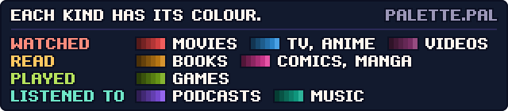

<!-- Header 06-procedural-effects_opus_5.5 for MediaLog, in the style of the full-frame procedural effects of early-1990s PC demos (catalogue entry demo-03), here the voxel landscape. Both pictures are generated by src/06-procedural-effects_opus_5.5.mjs; this page is hand-written. Every title, creator and person on it is invented. -->

<p align="center">
  
</p>

<h1 align="center">MediaLog</h1>

<p align="center">
  <b>Everything you've watched, read, played, listened to, on one timeline.</b><br>
  <sub>A media diary you share. In development.</sub>
</p>

Log a film, a book, a show, a game, an album or a podcast: when, and how it was. Then see what the people you know have been into.

Up there is your log as a 1993 voxel engine would fly it: a stripe for every kind, each in its own colour, and the years marked off five at a time. Engines of that era saved effort with distance, and so does memory. Up close everything renders to the day, further back to the month, and further back still in big lazy blocks. MediaLog takes all three: an entry can carry a day, just a month, or go under *sometime in*. Past that there is only fog, which the engine calls draw distance and everyone else calls the early 2010s.

Then, one hill at a time, the verb takes turns and the palette follows it. Say *read* and only books, comics and manga stay in colour, while the rest of the field lies fallow until you get round to it.

<p align="center">
  
</p>

<details>
<summary><b>MYLOG.TXT</b>: a sample log, five years at a time, sharpest at the top</summary>

```text
  MY LOG                                            BY DATE  ·  EVERYTHING
  ════════════════════════════════════════════════════════════════════════

  2025-2029
  ─────────
  2026 ──┬─ 03 Oct  Everything I Know About Queues                      <3
         │          Book · Ottoline Marsh · audiobook
         │          "Listened to it in a queue. Very immersive."
         │
         ├─ 19 Sep  The Lido Is Closed Today                            +1
         │          TV show · Lantern & Ferry · S2 E1-10
         │          "Closed again. Best season yet."
         │
         ├─ 30 Aug  The Canteen on Deck Nine                            <3
         │          Anime · Studio Teacup · S1 E1-12
         │          "The dinner lady is the main character. Correct."
         │
         ├─ 12 Aug  Three Hours of a Very Patient Heron      "Worth it" :)
         │          Video · Pond Cam Seven
         │          "He caught one at 2:41. I cheered. Alone."
         │
         └─ Jul     Two Men Read the Manual                             <3
                    Podcast · Barnaby & Clem · S4 E41
                    "Still on page 3."

  2025 ──┬─ 21 Nov  Frogs of the Night Shift                            +1
         │          Comics · Nib & Gutter
         │
         └─ Apr     Live at the Village Hall                            +1
                    Music · Polite Thunder
                    "A phone goes off in track 5. They kept it in."

  2020-2024
  ─────────
  2023 ──── Mar     How to Be Slightly Taller            "Worked a bit" :)
                    Book · Dr Ivo Plank · ebook

  2021 ──── Nov     Lollipop Lady Tactics             "Stopped traffic" :)
                    Game · Hi-Vis Softworks

  SOMETIME IN 2015-2019
  ─────────────────────
         ┌─ ▒▒ ▒▒▒  A film with a bicycle in it                         +1
         │          Movie · someone French, probably
         │          "It was blue. Or the bicycle was."
         │
         └─ ▒▒ ▒▒▒  That podcast about canals                           <3
                    Podcast · two men, possibly brothers

  SOMETIME IN 2010-2014
  ─────────────────────
         ── ░░ ░░░  Something with a dragon?                "Loved it?" :)
                    Game, or possibly a book

  ░░░░░░░░░░░░░░░░░░░░░░░ beyond the draw distance ░░░░░░░░░░░░░░░░░░░░░░░

  <3 loved      +1 liked      "..." :) a verdict of your own
```

</details>

<details>
<summary><b>FLIGHT.CFG</b>: how the flight is drawn</summary>

```ini
; FLIGHT.CFG  ·  MediaLog, a low flight over your log, mode 13h style
; lines starting with ; are notes nobody asked for

[screen]
width      = 320        ; square pixels
height     = 132
fonts      = none       ; every letter is pixels, drawn for this banner

[terrain]
heightmap  = rolling hills, crests wandering left and right
colourmap  = one stripe per kind, light and fog baked in
draw       = column by column, front to back

[flight]
frames     = 30         ; per hill
hill       = 2.4 s
loop       = 14.4 s     ; two hills in full colour, then one per verb

[detail]
near       = 1x1        ; to the day
middle     = 2x2        ; to the month
far        = 4x4        ; sometime in
beyond     = fog        ; the early 2010s

[palette]
entries    = 193 of 256 ; kinds x shades x fog levels in use, paths, fog
palettes   = 5          ; every kind, then one for each verb

[requires]
display    = VGA, or anything that can pretend
memory     = a rough idea of when you saw it
```

**The flight.** The landscape is a height map (rolling hills, their crests wandering left and right) and a colour map (a stripe for each kind), drawn the way the early-nineties height-map engines drew them: for every column of the screen, walk away from the camera and paint only what rises above everything nearer. An SVG cannot run that, so the generator runs it thirty times, one hill apart, and stacks the frames into a single sprite sheet that a stepped CSS animation flips through. The hills repeat, so the last frame flows straight back into the first.

**Level of detail.** Those engines sampled faraway terrain more coarsely to keep up. This one makes a show of it: full resolution up close, blossoms and all, then 2x2 blocks, then 4x4 blocks, then fog. The ruler on the right labels the bands the way MediaLog's timeline groups a log, five years at a time.

**The palette.** The sprite sheet holds no colour at all. Each pixel is one byte, an index into a palette sorted by brightness, and an SVG filter (a discrete component transfer) stands in for the VGA DAC, turning indices into colours. Swap the filter and every pixel recolours at once without redrawing a thing: one palette with every kind in colour, then one for each verb that keeps only that verb's kinds lit. The play triangle in the mark follows along. With reduced motion switched on, the banner holds its first frame, every kind in colour.

</details>

<details>
<summary><b>GREETZ</b></summary>

```text
  greetings fly out low over the stripes to ...

    Marguerite, logged yesterday: Lollipop Lady Tactics, fourth time
    through, verdict "Still stopping traffic"  ·  Big Teodor, who left
    3 new replies in the thread about Two Men Read the Manual, all three
    of them "page 3"  ·  Auntie Wyn, whose notes run longer than the
    books  ·  Dev from the quiz team, who logged The Lido Is Closed
    Today, S2 E4, with the note "closed"  ·  everyone talking about
    The Canteen on Deck Nine this month  ·  and you, for finally
    pinning the bicycle film down to a month: March, or possibly April

  no greetings to whoever filed a three-hour heron under Music
```

</details>
