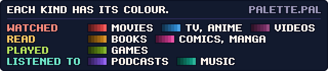

# MediaLog header examples

Ten retro README headers for MediaLog, a media diary you share: log a film, a book, a show, a game, an album or a podcast, when, and how it was, then see what the people you know have been into. Each one replaces the title and pitch at the top of that README. The ten styles were drawn at random from the [style catalogue](../../styles), and each header is an original composition, not a template. Build times are in [../build-log.csv](../build-log.csv).

Each example is its own `.md` in this folder. Animated art is in `assets/`, and the generator that rebuilds it is in `src/` (`node examples/medialog/src/<option>.mjs`). Rebuild this page with `node examples/medialog/src/build-gallery.mjs`. MediaLog is in development, so the headers carry no links, install commands or badges. The facts come from the owner's description and two screenshots of the app: the kinds and their colours, the five-year timeline, *sometime in*, reactions, notes, the feed and threads.

Every title, creator, friend, studio and band in the pictures is invented; the only real works named are public-domain classics. Real trackers, computers and BBS programs are style references only: none of their names, logos or lettering is drawn. The open-book mark and the kind colours are MediaLog's own.

| # | Option | Style | What it is |
| --- | --- | --- | --- |
| 01 | [DOS Text-Mode Tracker](01-text-mode-tracker_opus_5.5.md) | [trk-04](../../styles/trk.md#trk-04) | Animated SVG: MediaLog as an olive-gold DOS text-mode tracker, its four channels (Watched, Read, Played, Listened to) scrolling an invented media diary from 2016 to today in kind colours. Orders are five-year blocks, a vague date is a "?? ???" row, and the song ends on today with a blinking cursor. |
| 02 | [VHS Tape](02-vhs-tape_opus_5.5.md) | [vap-03](../../styles/vap.md#vap-03) | Animated SVG: a purple VHS home video of one living room, rewound through four recordings that cycle the verb, with a camcorder date stamp that ends at SOMETIME IN 2015-2019, plus colour bars in the kind colours. |
| 03 | [Atari 8-Bit Demo Screen](03-atari-8-bit-demo_opus_5.5.md) | [demo-09](../../styles/demo.md#demo-09) | Animated SVG: an 8-bit demo screen with a wide-pixel chrome MediaLog logo in kind colours, a cycling verb, four friends on the grass and the log buried as five-year layers of fossils. |
| 04 | [Sysop's Waiting-for-Caller Screen](04-sysop-waiting-screen_opus_5.5.md) | [xfer-08](../../styles/xfer.md#xfer-08) | Animated SVG: MediaLog as a 1990s BBS sysop's waiting-for-caller console, grey stipple and cyan-framed windows, where friends dial in to log what they finished and the kind-coloured logo letters jump. |
| 05 | [Shaded Block NFO](05-shaded-block-nfo_opus_5.5.md) | [nfo-02](../../styles/nfo.md#nfo-02) | Animated SVG: a 1990s shaded block NFO screen for MediaLog, with a cycling verb that recolours the logo's shadow bands and a timeline that fades from solid to dots as the dates get vaguer. A text NFO is collapsed below. |
| 06 | [Full-Frame Procedural Effects](06-procedural-effects_opus_5.5.md) | [demo-03](../../styles/demo.md#demo-03) | Animated SVG: a VGA-style voxel flight over hills striped in MediaLog's kind colours, with level-of-detail bands labelled as five-year blocks and a palette swap per verb. Past the last block there is only fog. |
| 07 | [Piano Roll and Falling Notes](07-piano-roll_opus_5.5.md) | [trk-10](../../styles/trk.md#trk-10) | Animated SVG: a dark piano-roll editor whose coloured notes spell MediaLog across 2015 to now in five-year bars, with lit keys, a cycling verb, pedal notes for "sometime in" and a status bar of invented diary entries. |
| 08 | [Arcade Attract Mode](08-arcade-attract_opus_5.5.md) | [mach-08](../../styles/mach.md#mach-08) | Animated SVG: a cocktail-table arcade seen from above, looping MediaLog's title, kind colours, a timeline demo and a high-score table where every score is a date. Player 2 is FRIENDS, and the picture flips for them. |
| 09 | [Chrome Spheres over a Checkerboard](09-chrome-spheres_opus_5.5.md) | [pc-03](../../styles/pc.md#pc-03) | Animated SVG: an italic chrome MEDIALOG logo over a receding checker floor, six kind-coloured mirror spheres on a carousel, a verb drum, a day-night sky and a horizon scroller. |
| 10 | [Tractor-Feed Printout](10-tractor-feed_opus_5.5.md) | [print-04](../../styles/print.md#print-04) | Animated SVG: MEDIALOG as a dot-matrix home banner on rainbow fan-fold, a printer cycling through WATCHED, READ, PLAYED and LISTENED TO, a green-bar slip, and a drawer of punched cards holding one person's log. |

<br>

---

## 01 · DOS Text-Mode Tracker

<sub><code>01-text-mode-tracker_opus_5.5.md</code></sub>

<!-- Header 01-text-mode-tracker_opus_5.5 for MediaLog. The banner is generated by src/01-text-mode-tracker_opus_5.5.mjs: edit that, not the SVG. -->

<p align="center">
  
</p>

<h1 align="center">MediaLog</h1>

<p align="center">
  <b>Everything you've watched, read, played, listened to, on one timeline.</b><br>
  <sub>a media diary you share · in development</sub>
</p>

**MediaLog** is a media diary you share. Log a film, a book, a show, a game, an album or a podcast: when, and how it was. Then see what the people you know have been into.

Up there, your log plays as a tracker module. The line has four verbs and one timeline, so the song has four channels and one pattern list. Each kind of media is an instrument in its own colour, orders are five-year blocks, patterns are years, and every entry is a note. A day is `14 Jan`, a month is `?? Mar`, and `?? ???` is "sometime in 2015-2019", which is a perfectly good row. The song stops at today, where the cursor waits for an answer to the home page's question: what did you play?

<details>
<summary><b>Order List (F11)</b>: a life, five years at a time</summary>

<pre>
 Order   Block       Patterns
 000     2015-2019   2016   ????
 001     2020-2024   2020-24   2022   2024
 002     2025-2029   2025   2026
 003     ---
</pre>

An order is a five-year block, a pattern is a year and a row is a day, as on MediaLog's timeline. Some things can only be placed roughly, so `????` is the pattern for "sometime in 2015-2019" and its rows are dated `?? ???`. A month with no day is `?? Mar`. A podcast you listened to from 2020 to 2024 is dated with the whole block, so it is one long held note. After 2026 comes `---`, which in a tracker means the end of the song: the rest of 2025-2029 has not happened yet, and the song goes back to 2016.

</details>

<details>
<summary><b>Effect column</b>: the diary, annotated in tracker</summary>
<br>

| Code | In a tracker | In the diary |
| --- | --- | --- |
| `SB0` `SB1` | pattern loop: go back and play it again | *Floor Four*, S3 E1-6: "Watched the finale again. Same floor." The playback really does go back a row and play it twice. |
| `H44` | vibrato | *Paper Ronin*, S1 E1-12: "Episode 9. Voice went wobbly." |
| `D0F` | volume slide down, fast | *Quiet Facts*, E40: "Fell asleep before the fact." |
| `T20` | tempo 32, the slowest there is | *Glacier Run*: "Moved 2 cm. Thrilling." |
| `^^^` | note cut | *Juggle 101*: "Still can't." |
| a line down the channel | a held note | *Ask a Buoy*, 2020-2024, held until *Polka Gold* cuts it in 2024. *Queue Music* is held to the end of the song: "Still on hold." |

The notes take the channels in turn, watched, read, played, listened to, so the pattern is an arpeggio and the verb in the Song field cycles with it, in the colour of whatever is playing. It cannot decide either.

</details>

<details>
<summary><b>Sample List (F3)</b>: the whole song, newest first</summary>

<pre>
 ♥ loved    ↑ liked    :) a verdict of your own

 2025-2029
   2026
      9 Oct  Queue Music ♥ ............ Music, Line Busy
             Still on hold.
     14 Mar  Glacier Run ↑ ............ Game, Firn Games
             Moved 2 cm. Thrilling.
        Feb  Nine Lamps ↑ ............. Book, Ida Crane, ebook
             Read it in one sitting. Four days.
      2 Jan  Juggle 101 :) Still can't  Video, Wren Dodd
             Dropped the remote.
   2025
        Dec  Quiet Facts ↑ ............ Podcast, Hollis Grey, E40
             Fell asleep before the fact.
     30 Nov  Grow Moss ♥ .............. Game, Slow Pond
             Nothing happened. Lovely.
        Jul  Ramen Ghost ↑ ............ Manga, Rin Kosaka
             Hungry now.
      5 Apr  Paper Ronin ♥ ............ Anime, Studio Hob, S1 E1-12
             Episode 9. Voice went wobbly.

 2020-2024
   2024
        Jun  Polka Gold ♥ ............. Music, Mo Bellows
             Danced. Neighbours knocked.
   2022
      2 Dec  Lair Lease ↑ ............. Game, Gloam Works
             Fixed the dragon's boiler. Got a card.
        Mar  Salt Hours ↑ ............. Book, Iris Penhale, audiobook
             Read it with my ears.
     14 Jan  Floor Four ♥ ............. TV show, Ines Marlow, S3 E1-6
             Watched the finale again. Same floor.
   2020-2024
             Ask a Buoy ♥ ............. Podcast, Dot Ferris, E1-212
             212 episodes. Still a buoy.

 2015-2019
   2016
     26 Nov  Cat Waltzes ♥ ............ Music, Pip Calloway
             The cat left during track 2.
     19 Aug  Pebble Sim ↑ ............. Game, Small Rocks
             Sorted 40,000 pebbles. Calm now.
        Apr  Beekeeper X ♥ ............ Comic, Ola Brandt
             Read it outside. One bee.
      3 Feb  Owl Lawyer ↑ ............. Movie, Petra Holm
             Cinema. Sat behind a tall man.
   Sometime in 2015-2019
             Mayor Bot 2 ↑ ............ Movie, Rex Bexley
             Haven't seen the first one.
             Moby-Dick :) Long. Wet. .. Book, H. Melville
             Finished it, sometime.
             Sock Puzzle ↑ ............ Game, Odd Pair
             One sock still missing.
</pre>

</details>

<details>
<summary><b>Song Message (Shift-F9)</b>: greetz and small print</summary>
<br>

Greetz to the tall man at the cinema, the one bee, the cat who left during track 2, the neighbours who knocked, a buoy that answered 212 times, the dragon who sent a card, the missing sock, and Line Busy: we are still holding.

The tracker on the screen does not exist. It is an original homage to the DOS text-mode trackers of the 1990s, in the olive-gold school of Scream Tracker 3; no program names, fonts or screens were copied. The key hints are costume: they name real places in MediaLog (Home, My log, Discover, the feed's Friends and Everyone, Filters, Talked about this month, sometime in), not real keys. The fields are MediaLog too: the Song is the line, the Instrument is the kind, Filter is the home page's first chip, and the feed shows Friends & me, by date. FreeTime reads 0K for the obvious reason, and the copyright is dated sometime in 2025-2029, which is as precise as anyone gets. Every title, creator, studio, artist and note here is invented; *Moby-Dick* is Herman Melville's and in the public domain.

</details>

<br>

---

## 02 · VHS Tape

<sub><code>02-vhs-tape_opus_5.5.md</code></sub>

<!-- Header 02-vhs-tape_opus_5.5 for MediaLog: "VHS Tape" (catalogue entry vap-03). Both images are generated by src/02-vhs-tape_opus_5.5.mjs; this page is hand-written. -->

<p align="center">
  
</p>

<h1 align="center">MediaLog</h1>

<p align="center">
  <b>Everything you've watched, read, played, listened to, on one timeline.</b>
</p>

<p align="center">
  A media diary you share. Log a film, a book, a show, a game, an album or a podcast: when, and how it was.<br>
  Then see what the people you know have been into.
</p>

<p align="center">
  
</p>

<p align="center">
  <sub>A log, five years at a time. Each kind has its colour. A day if you know it, a month if that is all you know, and <i>sometime in</i> for the rest, which on this tape is most of 2015 to 2019.<br>
  In development. There is no public link yet, so for now there is only this tape, and the tracking is doing its best.</sub>
</p>

<details>
<summary><b>◀◀ INDEX</b>: the tape, entry by entry, newest first</summary>

```text
 MEDIALOG · TAPE INDEX · NEWEST FIRST, THE WAY THE TIMELINE READS
 ═════════════════════════════════════════════════════════════════════════
 COUNTER  WHEN    KIND     ENTRY                                     HOW
 ─────────────────────────────────────────────────────────────────────────
 2025-2029
   2026
 1:52:10  21 MAR  TV SHOW  The Long Queue · S2 E1-10                 ♥
                           "Said 'one more' nine times."
 1:46:02  FEB     BOOK     Mostly Puddles · O. Pibworth · audiobook  liked
                           "Listened. Counts as read."
 1:43:18  09 JAN  VIDEO    Wobbly Table, Fixed (41 min)              liked
                           "It still wobbles."
   2025
 1:37:51  30 NOV  ANIME    Space Grocer Rin · S1 E1-12               ♥
 1:31:09  AUG     PODCAST  The Spoon Hour · episodes 1-40            ♥
                           "It is mostly spoons."
 2020-2024
   2022
 0:58:44  17 JUN  MOVIE    A Fortnight in Fog · Ambrose Fellwether
                           verdict: "Too long. Loved it."
   Sometime in 2020-2024
 0:51:20  --      COMIC    The Adequate Man · issues 1-6             liked
 2015-2019
   2016
 0:27:41  12 NOV  ALBUM    Soft Furnishings · The Draught Excluders  ♥
                           "Side B, mostly."
 0:19:02  MAR     MANGA    Grandma Drift · vols 1-3                  liked
   Sometime in 2015-2019
 0:08:19  --      GAME     Snail Derby Deluxe · Mildly Interactive
                           verdict: "Great, I think."
 ─────────────────────────────────────────────────────────────────────────
 0:00:00                   colour bars. everything starts here
```

A selection. Four of these are the recordings in the banner; the deck skips the rest at five times speed, and the INDEX number on its display is counting them.

</details>

<details>
<summary><b>TRACKING</b>: what the date stamp knows, and why the old ones are fuzzy</summary>

```text
 DATE STAMP ........ as exact as you were. a day if you have one
                     (MAR. 21), just a month if that is all you have
                     (FEB. --), and SOMETIME IN for the rest
 --:-- ............. none of these entries came with a time of day, so
                     the clock line was never set. the most realistic
                     VCR feature in this header
 TRACKING .......... the older the recording, the more worn the tape.
                     auto tracking cannot recover a date nobody wrote
                     down. it tries anyway, at six guesses a second,
                     then files it under SOMETIME IN 2015-2019
 FIVE-YEAR BLOCKS .. the timeline is filed 2025-2029, 2020-2024,
                     2015-2019, then by year inside each block, and the
                     index marks on the tape follow it
 THE VERB .......... changes with the light: WATCHED for the telly,
                     READ for the lamp, LISTENED TO for the record
                     player, PLAYED for the telly again. the audiobook
                     could not decide, so the line wavers
 SP / LP ........... SP, except while the record is on, when it is LP.
                     a long-playing record on a tape in long play.
                     nobody asked for this
 THE PLANT ......... a sprout in 2016, a houseplant by 2026. it is on
                     the sill in every recording. nobody logged it
```

</details>

<details>
<summary><b>PIP</b>: picture in picture, or what the people you know have been into</summary>

```text
 PIP ▶ FEED · FRIENDS & ME · RECENTLY LOGGED                    [FILTERS]
 ─────────────────────────────────────────────────────────────────────────
 LOGGED YESTERDAY
   Mum              The Long Queue · TV show · S2 E3 · 2026           ♥
                    "Who is the man in the hat. Is he in the queue
                    or is he the queue." Read more
   Dave from        Mostly Puddles · book · 2025-2029             liked
   book club        "Finished it in the bath. Thematic."
   Imogen upstairs  Snail Derby Deluxe · game · 2020-2024
                    verdict: "The pink one takes shortcuts."
 ─────────────────────────────────────────────────────────────────────────
 YOUR THREADS                         TALKED ABOUT THIS MONTH
   The Long Queue ........ 3 new        Snail Derby Deluxe
                                        3 people · 7 posts
                                        Dave: "she is right, it does"
```

Switch the feed between Friends & me, Friends and Everyone, order it by Recently logged or By date, and search it by title or creator. On this tape your own log is the main picture and theirs is the little one in the corner, which is how picture in picture has always worked.

</details>

<details>
<summary><b>END CREDITS</b>: the tape, the living room, the lettering, the greetings</summary>

```text
 MEDIALOG
 everything you've watched, read, played, listened to, on one timeline

 RECORDED ........... one living room, 2015 to 2026, mostly after dark
 CAMCORDER .......... burned in every date it was given, and dashes
                      where it was not given one
 TAPE ............... Drawerful E-300, five years a cassette. the label
                      has been crossed out four times: WATCHED, READ,
                      PLAYED, LISTENED TO. it now says EVERYTHING
 LETTERING .......... Index Mono, an 8 x 12 on-screen-display face with
                      two-pixel strokes, drawn for this header, and a
                      heavy condensed MediaLog cut to sit beside the
                      app's own open-book mark
 LIVING ROOM ........ drawn in code, no footage: one sofa, one telly,
                      one lamp, one record player, and a plant that
                      took ten years to get there
 ON THE TELLY ....... The Long Queue, in which the queue moves and stays
                      exactly as long, and Snail Derby Deluxe, in which
                      the pink one is winning

 GREETINGS TO
   everyone who has logged a film as "sometime in" and stood by it
   the people who said "one more" and meant nine
   Dave from book club, who reads in the bath on purpose
   whoever keeps setting the clock to --:--
```

</details>

<p align="center"><sub>Every title, creator, studio, artist and person on this tape is invented, Drawerful included. The open-book mark and the kind colours are MediaLog's own.</sub></p>

<br>

---

## 03 · Atari 8-Bit Demo Screen

<sub><code>03-atari-8-bit-demo_opus_5.5.md</code></sub>

<!-- Header 03-atari-8-bit-demo_opus_5.5 for MediaLog: an Atari 8-bit style demo screen (a GTIA logo with one kind colour per letter, a dusk of per-scanline colour steps, four players, and the log five years at a time as sediment). The banner is generated by src/03-atari-8-bit-demo_opus_5.5.mjs (node src/03-atari-8-bit-demo_opus_5.5.mjs); this page is hand-written. -->

<p align="center">
  
</p>

<h1 align="center">MediaLog</h1>

<p align="center">
  <b>Everything you've watched, read, played, listened to, on one timeline.</b><br>
  A media diary you share. Log a film, a book, a show, a game, an album or a podcast: when, and how it was. Then see what the people you know have been into.
</p>

<p align="center">
  <sub>A log, five years at a time, each block settling on top of the last. Each kind has its colour, all the way down. Pin an entry to the day, to the month, or just to <i>sometime in</i>, which is where the films you definitely saw end up. Then react: a heart, a thumbs-up, or a verdict of your own. In development.</sub>
</p>

<details>
<summary><b>CORE SAMPLE</b>: one MediaLog, drilled from 2026 down to 2005</summary>

<br>

The fossils in the banner, dug up and labelled. Newest layer on top; each entry has its kind, its creator or its details, when, and how it was.

```text
 CORE SAMPLE 01                     drilled 10 Oct 2026, five years a layer
 ===========================================================================

 2025-2029   Soup Dungeon                game, Lantern Turtle       Apr 2026
 still         loved      "Made it to the croutons."
 settling    Pebble Court                TV show, S3 E1-8         2 Jun 2026
               liked      "Watched the last one first. Still worked."
 ---------------------------------------------------------------------------
 2020-2024   Ninety Ways to Fold a Map   book, Dorota Pell          Mar 2022
               liked      Audiobook. "You can hear her folding. It helps."
             Kettle Season               album, Marigold Static   9 Sep 2021
               loved      "Track 3 is just the kettle."
 ---------------------------------------------------------------------------
 2015-2019   Gravel Moon                 film, Ottavio Penn       3 Oct 2016
               loved      "Cried at the gravel."
 sometime    Moderately Large Crab II    film, Kestrel Pictures
 in            "Fine. Fine!"  Definitely saw it. Depth not known.
 ---------------------------------------------------------------------------
 2010-2014   Detective Otter, Vol. 4     comic, Mabel Ostrow        Aug 2013
               liked      Ebook. "Solves it on page two, then waits."
             Weather for Pigeons         podcast, The Moth Bureau   Feb 2012
               loved      "Mostly drizzle."
 ---------------------------------------------------------------------------
 2005-2009   Re-Grouting a Bath, Part 2  video, Juniper Fold     14 Jun 2007
               liked      "Never found Part 1. Bath fine."
 ---------------------------------------------------------------------------
 bedrock     not yet logged
```

Up on the grass, the people you know have been busy too. Logged yesterday: Odile watched *The Second-Best Swan* (loved it). Hamish read *The Patient Orchard*, slowly. Bea played *Parcel Golf* and putted a fridge. Ade listened to *Bridges, Mostly Small*, and liked it.

</details>

<details>
<summary><b>COLOUR REGISTERS</b>: eight letters, eight kinds</summary>

<br>

MediaLog has eight letters, and the kinds come in eight colours, which saves everyone a lot of trouble. In the banner each letter is drawn in its kind's hue, and when the verb comes round to its kinds, the letter stands up two scanlines taller.

| Letter | Colour | Kinds | Verb |
| :---: | --- | --- | --- |
| **M** | red | Movies | watched |
| **e** | blue | TV shows, Anime | watched |
| **d** | amber | Books | read |
| **i** | magenta | Comics, Manga | read |
| **a** | green | Games | played |
| **L** | violet | Podcasts | listened to |
| **o** | teal | Music | listened to |
| **g** | plum | Videos | watched |

The filter chips run the same way: Everything, Movies, TV shows, Anime, Books, Comics, Manga, Games, Podcasts, Music, Videos. *Watched* covers the most kinds, which is about right.

</details>

<details>
<summary><b>ABOUT THIS SCREEN</b>: an 8-bit demo screen, five years at a time</summary>

<br>

The banner follows a demo screen on an 8-bit home computer whose scene is still going strong. That machine draws its picture from a display list: a short program that picks a graphics mode for each band of scanlines and can fire an interrupt on any line to change the colour registers. So the screen above is a stack of bands, each in its own mode, and the colours change on the exact line where the bands do.

- **The logo** is in the spirit of the colour chip's mode 11: fifteen hues on a black background, at one brightness per scanline. Every hue on a line shares that brightness, so one chrome ramp runs through all eight letters at once. The bevel highlight and the extrusion take the liberties the scene's interlace modes take.
- **The sky** is the background register stepping every few lines, a hue step and then a brightness step, from indigo down to orange at the grass.
- **The headline** is text rows: two of the 40-column mode and, between them, the big mode with every pixel doubled across and down, which is the verb.
- **The ground** is the colour chip's mode 9: sixteen brightnesses of one hue, on pixels four times wider than tall, so sediment comes out as soft brickwork. An interrupt on the first line of each layer switches the hue, which is also, roughly, how geology works.
- **The fossils and the people** are players: the machine's sprites, laid over the picture. It can show four on a line, so no layer holds more than that, and four people fit on the grass, one per verb. The stars and the settling dust are missiles, their thin little siblings.
- **The motion** is one 16-second cycle, four seconds a verb: the verb changes, its letters lift and a glint runs down them, its person steps into the light and acts it out while the other three wait in the shade, its fossils light up and the feed moves on. The film from sometime in 2015-2019 drifts up and down its layer one scanline at a time, because its depth is its date and nobody knows it. Nothing flashes, and with reduced motion switched on the screen holds still on its first frame.
- **Palette**: 16 hues by 16 brightness steps, built in OKLCH, with eight of the hues placed on MediaLog's own kind colours. Every colour on the screen is one of those 256.

Credited references, nothing copied: the machine's hardware documentation (display lists, the colour chip's shaded modes, players and missiles) and the scene's screens as its archives describe them. No group's logo, font, picture or words are used; the letters, the 8x8 font, the strata, the fossils and the four people are drawn for this banner. Every title, creator and person in it is made up.

</details>

<br>

---

## 04 · Sysop's Waiting-for-Caller Screen

<sub><code>04-sysop-waiting-screen_opus_5.5.md</code></sub>

<!-- Header 04-sysop-waiting-screen_opus_5.5 for MediaLog. Generated by src/04-sysop-waiting-screen_opus_5.5.mjs: edit that, not this. -->

<p align="center">
  
</p>

<h1 align="center">MediaLog</h1>

<p align="center"><b>Everything you've watched, read, played, listened to, on one timeline.</b></p>

<p align="center">A media diary you share. Log a film, a book, a show, a game, an album or a podcast: when, and how it was. Then see what the people you know have been into.</p>

The picture is MediaLog as a bulletin board's waiting-for-caller screen, the console a sysop watched all night while the phone mostly did not ring. On this board a call is somebody you know finishing something: the modem rings, their entry types itself in, the letter for its kind jumps up, and they log off to go and start the next thing. Each kind has its colour. Your own log is kept five years to a drawer, and anything you can only place roughly is filed under *sometime in*. The sysop is you. MediaLog is still in development, so for now the board is waiting for its first caller.

<details>
<summary><b>MYLOG.TXT</b> · the sysop's own log, five years at a time</summary>

```text
╔═══════════════════════════════════════════════════════════════════════My log═╗
║                                                                              ║
║ 2025-2029 ────────────────────────────────────────────────────────────────── ║
║   2026                                                                       ║
║     9 Oct    The Night Switchboard  <3                                       ║
║              TV show, S2 E1-10                                               ║
║              "Shouted 'pick up!'"                                            ║
║     Aug      The Crossed Line  +1                                            ║
║              Comics, Hal Brindle                                             ║
║     Jun      Ringing Off  :) Ends on a dial tone                             ║
║              Movie, Ida Fenwick                                              ║
║     14 Mar   A Year on Hold  +1                                              ║
║              Book, Petula Graves, audiobook                                  ║
║              "Listened to it on hold."                                       ║
║   2025                                                                       ║
║     30 Dec   Operator, Please  <3                                            ║
║              Music, The Party Lines                                          ║
║                                                                              ║
║ 2020-2024 ────────────────────────────────────────────────────────────────── ║
║   2022                                                                       ║
║     2 Feb    Dial Tone Detective  +1                                         ║
║              Game, Pulse Dial Games                                          ║
║              "Solved it. It was the cat."                                    ║
║   Sometime in 2020-2024                                                      ║
║              Please Hang Up First  <3                                        ║
║              Movie, Ines Vale                                                ║
║              "Called my mum after."                                          ║
║                                                                              ║
║ 2015-2019 ────────────────────────────────────────────────────────────────── ║
║   2016                                                                       ║
║     3 Dec    Payphones of Wales, Pt 3  +1                                    ║
║              Video, Coinbox Carol                                            ║
║   Sometime in 2015-2019                                                      ║
║              Extension 4  :) Hummable                                        ║
║              Music, The Engaged Tones                                        ║
║                                                                              ║
║ 2010-2014 ────────────────────────────────────────────────────────────────── ║
║   Sometime in 2010-2014                                                      ║
║              Three Men in a Boat  +1                                         ║
║              Book, Jerome K. Jerome                                          ║
║              "No phones in it. Restful."                                     ║
║                                                                              ║
╚══════════════════════════════════════════════════════════════════════════════╝
  <3 loved   +1 liked   :) a verdict of your own   a log, five years at a time
```

</details>

<details>
<summary><b>CALLS.LOG</b> · tonight's callers, and Auntie Gwen's note in full</summary>

```text
 CALLS.LOG                     MediaLog, node 1                 Sat 10-Oct-2026
 ──────────────────────────────────────────────────────────────────────────────
 21:58:10  RING
 21:58:11  RING
 21:58:13  CONNECT     2400  Nell, logging a book
           LOGGED      Forty Years of Doorbells  +1
                       Book, Morwenna Pike, ebook  Feb
 21:58:19  NO CARRIER  Nell logged off. Read the end first.
 21:58:28  RING
 21:58:29  RING
 21:58:31  CONNECT     2400  Big Gav, logging a game
           LOGGED      Milk Float Rally  <3
                       Game, Dawn Round Games  2010-2014
                       "Delivered 400 milks. Proud."
 21:58:37  NO CARRIER  Gav logged off. 2010-2014, he thinks.
 21:58:46  RING
 21:58:47  RING
 21:58:49  CONNECT     2400  Auntie Gwen, logging a podcast
           LOGGED      Shed Tapes  <3
                       Podcast, Clive & Norm, E41-44  Sep
                       "E43 is about a hinge. I thought it would be about the
                       door. It is not about the door. Norm talks about the
                       hinge for forty minutes and Clive says 'right' eleven
                       times. I counted. I have ordered the hinge."
 21:58:55  NO CARRIER  Gwen logged off. Left a long note.
 21:59:04  RING
 21:59:05  RING
 21:59:07  CONNECT     2400  Ozzie, logging an anime
           LOGGED      Lunchbox Ranger  +1
                       Anime, Studio Thermos, S1 E1-12  9 Oct
 21:59:13  NO CARRIER  Ozzie logged off. Episode 13 called.
 21:59:22  RING
 21:59:23  RING
 21:59:25  CONNECT     2400  Theo, logging a movie
           LOGGED      Gravy Boat  :) Too much gravy
                       Movie, Ida Fenwick  10 Oct
 21:59:31  NO CARRIER  Theo logged off. Gone to make gravy.
 21:59:35  OK          Waiting for anyone to finish anything.
 ──────────────────────────────────────────────────────────────────────────────
 5 calls. 5 things finished. 0 things judged.
```

</details>

<details>
<summary><b>SYSOP.CFG</b> · the init string, the switches and the keys, explained</summary>

```text
 SYSOP.CFG                                                     MediaLog, node 1
 ──────────────────────────────────────────────────────────────────────────────
 [Modem]
 Init          AT&F&W&R&P&L S0=1
               AT    attention, modem
               &F    factory settings
               &W    watched
               &R    read
               &P    played
               &L    listened to
               S0=1  answer on the first ring
 Results       RING        somebody you know finished something
               CONNECT     they are logging it: when, and how it was
               NO CARRIER  they have gone to start the next thing
               OK          back to waiting

 [Switches]
 Snoop         ON   see what the people you know have been into
 Sometime in   ON   for whatever you can only place roughly
 Judging       OFF  their taste is fine. Gravy Boat is a lot, but fine.
 Answer        ON   always. Somebody might have finished something.

 [Drawers]
 Size          five years
 Open          2025-2029, year 2 of 5
 Next          opens 01-Jan-2030. The sysop will be here.
 Closed        2020-2024, 2015-2019, 2010-2014. Still in there.

 [Keys]
 L             Log it: a film, a book, a show, a game, an album or a podcast
 Esc           Exit. Never pressed.
 ALT-H, D, M   Home, Discover, My log
 ALT-T         Threads (3 new)
 ALT-F         Feed: Friends & me, Friends or Everyone
               in order: Recently logged, or By date
```

</details>

<p><sub>Every person, title, band, studio and channel on this board is invented, apart from <i>Three Men in a Boat</i>, which is old enough to belong to everybody.</sub></p>

<br>

---

## 05 · Shaded Block NFO

<sub><code>05-shaded-block-nfo_opus_5.5.md</code></sub>

<!-- Header 05-shaded-block-nfo_opus_5.5 for MediaLog: a shaded block NFO (catalogue entry nfo-02). The banner is drawn by src/05-shaded-block-nfo_opus_5.5.mjs: edit that and re-run it. The text NFO in the details block is hand-set. -->

<p align="center">
  
</p>

<p align="center">
  <b>MediaLog</b> · a media diary you share · in development<br>
  <sub>Everything you've watched, read, played, listened to, on one timeline.</sub>
</p>

**MediaLog** is a media diary you share. Log a film, a book, a show, a game, an album or a podcast: when, and how it was. Then see what the people you know have been into.

Every kind has its colour: Movies, TV shows, Anime, Books, Comics, Manga, Games, Podcasts, Music and Videos. The log runs five years at a time, then year by year, and an entry can carry a day (21 Mar), just a month (Feb) or no exact date at all, because **sometime in** holds whatever you can only place roughly. How it was gets a heart, a thumbs-up or a short verdict of your own with a little face, plus a note if you have one. Then the feed shows what your friends have been logging, next to your threads about a title and what's being talked about this month.

<sub>On a shade ramp, solid means sure. In the banner each entry wears its kind's colour, and its shade says how sure the date is: solid to the day, dark shade to the month, medium shade for sometime in. Below that the timeline dissolves into dots, the way the foot of an NFO letter does.</sub>

<details>
<summary><b>MEDIALOG.NFO</b> · the rest of the file: the feed, your threads, a longer log, the key, greetz</summary>

```text
 ▓▒░ M E D I A L O G . N F O ░▒▓                         the rest of the file
 ────────────────────────────────────────────────────────────────────────────

                d e a r   d i a r y ,   a n d   f r i e n d s

 ──■ LOGGED YESTERDAY ■──────────────────── Friends & me · Recently logged ──

    Hattie Vane ................. Quorum · TV show · S2 E1-10 · 2026 · loved
        "Never been this invested in a show of hands."
                                                                  Read more →

    Otto Marsh ......................... Pigeon Census · Game · 2016 · liked
        "Counted 41. The game says 40. I stand by 41."
                                                                  Read more →

 ──■ YOUR THREADS ■──────────────────────────────────────────────────────────

    Quorum ........................................................... 3 new
    Moderately Large Shark ........................................... 1 new

 ──■ TALKED ABOUT THIS MONTH ■───────────────────────────────────────────────

    Middlemarch · George Eliot .......................... 4 people · 9 posts
    └ Wren Calloway: "Chapter 20. Rooting for absolutely everyone."

 ──■ MY LOG ■──────────────────────────────────────── five years at a time ──

    2025-2029
      2026
        █ 21 Mar  Quorum ........................ TV show · S2 E1-10 · loved
                  └ Watched the vote twice.
        ▓ Feb     Middlemarch ...... Book · George Eliot · audiobook · liked
      2025
        █ 03 Oct  Tiny Robot Bakery ...... Anime · Studio Crumpet · S1 E1-12
      sometime in 2025-2029
        ▒         Gravel, Discussed .. Podcast · Hard Shoulder Audio · liked

    2020-2024
      2022
        ▓ Jun     Captain Teatowel .... Comic · Bev Ollerton · ebook · loved
      sometime in 2020-2024
        ▒         Toaster, Restored (Part 9 of 9) .. Video · SlowFix · liked

    2015-2019
      2016
        █ 12 Nov  Pigeon Census ...... Game · Breadcrumb Interactive · loved
      sometime in 2015-2019
        ▒         Moderately Large Shark .............. Movie · Lorna Fathom
                  └ :) Big enough
        ▒         Songs to Defrost a Freezer To .. Music · The Damp Tuesdays
        ░
        ·    ·
          ·

 ──■ THE KEY ■───────────────────────────────────────────────────────────────

    █  to the day ...... 21 Mar ........ you wrote it down that night
    ▓  to the month .... Feb ........... you wrote it down eventually
    ▒  sometime in ..... 2015-2019 ..... you were definitely there
    ░  not logged yet .. ? ............. the one with the boat

 ──■ SIGNING IN ■────────────────────────────────────────────────────────────

    an email and a password, with "Forgot your password?" for the rest of
    us, or continue with Google, or continue with GitHub. the diary keeps
    the dates. the boat is on you.

 ──■ GREETZ ■────────────────────────────────────────────────────────────────

    everyone who logs the audiobook and the book separately · the friend
    whose every verdict is "fine" · whoever is still in Middlemarch · and
    every five-year drawer, especially the one marked sometime

 ────────────────────────────────────────────────────────────────────────────
    logo, frame and every loose square by nib of Five Year Drawer (nib!5yd)
    this file has watched, read, played and listened to nothing. it only
    remembers, roughly, and it has a feeling there was a boat.
```

</details>

<br>

---

## 06 · Full-Frame Procedural Effects

<sub><code>06-procedural-effects_opus_5.5.md</code></sub>

<!-- Header 06-procedural-effects_opus_5.5 for MediaLog, in the style of the full-frame procedural effects of early-1990s PC demos (catalogue entry demo-03), here the voxel landscape. Both pictures are generated by src/06-procedural-effects_opus_5.5.mjs; this page is hand-written. Every title, creator and person on it is invented. -->

<p align="center">
  
</p>

<h1 align="center">MediaLog</h1>

<p align="center">
  <b>Everything you've watched, read, played, listened to, on one timeline.</b><br>
  <sub>A media diary you share. In development.</sub>
</p>

Log a film, a book, a show, a game, an album or a podcast: when, and how it was. Then see what the people you know have been into.

Up there is your log as a 1993 voxel engine would fly it: a stripe for every kind, each in its own colour, and the years marked off five at a time. Engines of that era saved effort with distance, and so does memory. Up close everything renders to the day, further back to the month, and further back still in big lazy blocks. MediaLog takes all three: an entry can carry a day, just a month, or go under *sometime in*. Past that there is only fog, which the engine calls draw distance and everyone else calls the early 2010s.

Then, one hill at a time, the verb takes turns and the palette follows it. Say *read* and only books, comics and manga stay in colour, while the rest of the field lies fallow until you get round to it.

<p align="center">
  
</p>

<details>
<summary><b>MYLOG.TXT</b>: a sample log, five years at a time, sharpest at the top</summary>

```text
  MY LOG                                            BY DATE  ·  EVERYTHING
  ════════════════════════════════════════════════════════════════════════

  2025-2029
  ─────────
  2026 ──┬─ 03 Oct  Everything I Know About Queues                      <3
         │          Book · Ottoline Marsh · audiobook
         │          "Listened to it in a queue. Very immersive."
         │
         ├─ 19 Sep  The Lido Is Closed Today                            +1
         │          TV show · Lantern & Ferry · S2 E1-10
         │          "Closed again. Best season yet."
         │
         ├─ 30 Aug  The Canteen on Deck Nine                            <3
         │          Anime · Studio Teacup · S1 E1-12
         │          "The dinner lady is the main character. Correct."
         │
         ├─ 12 Aug  Three Hours of a Very Patient Heron      "Worth it" :)
         │          Video · Pond Cam Seven
         │          "He caught one at 2:41. I cheered. Alone."
         │
         └─ Jul     Two Men Read the Manual                             <3
                    Podcast · Barnaby & Clem · S4 E41
                    "Still on page 3."

  2025 ──┬─ 21 Nov  Frogs of the Night Shift                            +1
         │          Comics · Nib & Gutter
         │
         └─ Apr     Live at the Village Hall                            +1
                    Music · Polite Thunder
                    "A phone goes off in track 5. They kept it in."

  2020-2024
  ─────────
  2023 ──── Mar     How to Be Slightly Taller            "Worked a bit" :)
                    Book · Dr Ivo Plank · ebook

  2021 ──── Nov     Lollipop Lady Tactics             "Stopped traffic" :)
                    Game · Hi-Vis Softworks

  SOMETIME IN 2015-2019
  ─────────────────────
         ┌─ ▒▒ ▒▒▒  A film with a bicycle in it                         +1
         │          Movie · someone French, probably
         │          "It was blue. Or the bicycle was."
         │
         └─ ▒▒ ▒▒▒  That podcast about canals                           <3
                    Podcast · two men, possibly brothers

  SOMETIME IN 2010-2014
  ─────────────────────
         ── ░░ ░░░  Something with a dragon?                "Loved it?" :)
                    Game, or possibly a book

  ░░░░░░░░░░░░░░░░░░░░░░░ beyond the draw distance ░░░░░░░░░░░░░░░░░░░░░░░

  <3 loved      +1 liked      "..." :) a verdict of your own
```

</details>

<details>
<summary><b>FLIGHT.CFG</b>: how the flight is drawn</summary>

```ini
; FLIGHT.CFG  ·  MediaLog, a low flight over your log, mode 13h style
; lines starting with ; are notes nobody asked for

[screen]
width      = 320        ; square pixels
height     = 132
fonts      = none       ; every letter is pixels, drawn for this banner

[terrain]
heightmap  = rolling hills, crests wandering left and right
colourmap  = one stripe per kind, light and fog baked in
draw       = column by column, front to back

[flight]
frames     = 30         ; per hill
hill       = 2.4 s
loop       = 14.4 s     ; two hills in full colour, then one per verb

[detail]
near       = 1x1        ; to the day
middle     = 2x2        ; to the month
far        = 4x4        ; sometime in
beyond     = fog        ; the early 2010s

[palette]
entries    = 193 of 256 ; kinds x shades x fog levels in use, paths, fog
palettes   = 5          ; every kind, then one for each verb

[requires]
display    = VGA, or anything that can pretend
memory     = a rough idea of when you saw it
```

**The flight.** The landscape is a height map (rolling hills, their crests wandering left and right) and a colour map (a stripe for each kind), drawn the way the early-nineties height-map engines drew them: for every column of the screen, walk away from the camera and paint only what rises above everything nearer. An SVG cannot run that, so the generator runs it thirty times, one hill apart, and stacks the frames into a single sprite sheet that a stepped CSS animation flips through. The hills repeat, so the last frame flows straight back into the first.

**Level of detail.** Those engines sampled faraway terrain more coarsely to keep up. This one makes a show of it: full resolution up close, blossoms and all, then 2x2 blocks, then 4x4 blocks, then fog. The ruler on the right labels the bands the way MediaLog's timeline groups a log, five years at a time.

**The palette.** The sprite sheet holds no colour at all. Each pixel is one byte, an index into a palette sorted by brightness, and an SVG filter (a discrete component transfer) stands in for the VGA DAC, turning indices into colours. Swap the filter and every pixel recolours at once without redrawing a thing: one palette with every kind in colour, then one for each verb that keeps only that verb's kinds lit. The play triangle in the mark follows along. With reduced motion switched on, the banner holds its first frame, every kind in colour.

</details>

<details>
<summary><b>GREETZ</b></summary>

```text
  greetings fly out low over the stripes to ...

    Marguerite, logged yesterday: Lollipop Lady Tactics, fourth time
    through, verdict "Still stopping traffic"  ·  Big Teodor, who left
    3 new replies in the thread about Two Men Read the Manual, all three
    of them "page 3"  ·  Auntie Wyn, whose notes run longer than the
    books  ·  Dev from the quiz team, who logged The Lido Is Closed
    Today, S2 E4, with the note "closed"  ·  everyone talking about
    The Canteen on Deck Nine this month  ·  and you, for finally
    pinning the bicycle film down to a month: March, or possibly April

  no greetings to whoever filed a three-hour heron under Music
```

</details>

<br>

---

## 07 · Piano Roll and Falling Notes

<sub><code>07-piano-roll_opus_5.5.md</code></sub>

<!-- MediaLog header 07: piano roll, editor form (catalogue trk-10). The banner is generated by src/07-piano-roll_opus_5.5.mjs: edit that, not the SVG. -->

<p align="center">
  
</p>

<h1 align="center">MediaLog</h1>

<p align="center">
  <b>Everything you've watched, read, played, listened to, on one timeline.</b><br>
  A media diary you share. Log a film, a book, a show, a game, an album or a podcast: when, and how it was. Then see what the people you know have been into.
</p>

<p align="center">
  <sub>Pictured as a piano roll, since a diary is a timeline already. It is in 5/4 at one beat a year, so every bar is a five-year drawer, and the name is spelled in entries: one letter per kind, in that kind's colour. A day or a month makes a short note. "Sometime in" makes a pedal note, held for five years by someone who cannot remember pressing it. Velocity is how it was. MediaLog is in development: nothing to install yet.</sub>
</p>

<details>
<summary><b>How to read the roll</b>: bars, colours, pedals and velocity</summary>

<br>

| On the roll | In MediaLog |
| :--- | :--- |
| **Time**, left to right, one bar of 5/4 per five years | The timeline: a log, five years at a time. 2015-2019, then 2020-2024, then 2025-2029 |
| **A note** | An entry: a title, its kind, its creator, and when |
| **Its colour** | Its kind. Movies red, TV shows and anime blue, books amber, comics and manga magenta, games green, podcasts violet, music teal, videos plum |
| **A short note** | Something you can pin to a day (12 Nov) or just a month (Feb) |
| **A pedal held for the whole bar** | "Sometime in": for what you can only place roughly |
| **Velocity** | How it was: a heart for loved, a thumbs-up for liked, or a short verdict in your own words with a little face |
| **The status bar** | One entry at a time, with its details (S3 E1-8, ebook, audiobook) and its note, if it has one |
| **Ghost notes** | What your friends logged, shown faintly, as an editor shows other channels. The feed switches between Friends & me, Friends and Everyone |
| **The playhead stopping at now** | The home page's question. It asks "What did you play?", which, in a piano roll, is fair |

</details>

<details>
<summary><b>Track sheet</b>: the diary in the picture, entry by entry</summary>

```text
 MediaLog · one person's log, arranged for nineteen keys
 5/4, one beat a year · loop 2015 → now · 8 letters, 2 pedals, 1 rest
 ──────────────────────────────────────────────────────────────────────

 BAR 1 · 2015-2019
 pedal  sometime in 2015-2019    Midnight at the Garden Centre
        movie, Pim Haversack     verdict: "definitely saw it"
 M      12 Nov 2015              The Polite Werewolf               loved
        movie, Agnes Molloy-Fitch
        note: clapped at the end. was at home.
 e      Feb 2018                 Bakers of the Fjord               liked
        TV show, Fenn & Daughter, S3 E1-8
        note: bought a whisk.
 d      3 Jun 2019               The Patient Hedge                 loved
        book, Margit Oyelaran, ebook
        note: finished it on a bus. kept riding.

 BAR 2 · 2020-2024
 pedal  sometime in 2020-2024    An Unabridged History of Toast    liked
        book, H. Crust, audiobook
 i      Sep 2020                 Captain Tuesday
        comic, R. P. Quill       verdict: "mostly capes"
 a      Mar 2022                 Tiny Ferry Tycoon                 liked
        game, Puffin Hat Games
        note: the ferries have names now.
 L      14 Apr 2023              Spoons, Ranked                    loved
        podcast, Dilys & Bram
        note: disagreed with number four. out loud.
 o      Jul 2024                 Hymns for a Damp Allotment
        music, The Lukewarm Kettles   verdict: "banger, probably"

 BAR 3 · 2025-2029, so far
 g      9 May 2026               Man Restores One Teaspoon         liked
        video, Mildly Restored
        note: watched all four hours.
 rest   nothing vague yet

 GHOST NOTES · friends & me
 Tove   a book, 2015             while you were clapping at home
 Tove   an album, 2017           while you were buying a whisk
 Oskar  a film, 2019             while you were riding the bus
 Oskar  a TV show, 2021          while you were naming ferries
 Nadia  a podcast, 2021          while you were still naming ferries
 Nadia  a game, 2024             while you were humming hymns
```

Every title, creator and person above is invented. The phases are not a feature: this person simply did one thing at a time, in order, for eleven years, which made the letters easy.

</details>

<details>
<summary><b>Session credits</b>: who played what, and greetz</summary>

```text
 ARRANGED BY ........ one Node script: no dependencies, no clock, and
                      loaded dice. It refuses to build if the name runs
                      past now
 PERFORMED BY ....... one diary, in eight phases
 CONDUCTED BY ....... a playhead that only goes one way
 KEY ................ all twelve of them. The letters do not care
 TEMPO .............. one beat a year. Largo, generously
 LONGEST NOTES ...... Midnight at the Garden Centre and the toast book.
                      Five years each, held
 SHORTEST LETTER .... the i. Five months a stroke, and a dot on top
 TYPE ............... the name is set in entries. No typefaces were harmed
 LYRICS ............. none. Someone asked "what did you play?" and we took
                      it literally

 GREETZ ............. everyone who has filed a film under "sometime in"
                      and felt seen · the friend who logs the same podcast
                      four minutes after you · whoever is still on the
                      crumpets chapter · the ferries, by name
```

MediaLog is in development, so there is nothing to install, open or press play on yet. The roll is a picture of a diary: it does not play anything, and neither does MediaLog. It only remembers that you did.

</details>

<br>

---

## 08 · Arcade Attract Mode

<sub><code>08-arcade-attract_opus_5.5.md</code></sub>

<p align="center">
  
</p>

<h1 align="center">MediaLog</h1>

<p align="center">
  <b>Everything you've watched, read, played, listened to, on one timeline.</b><br>
  A media diary you share. Log a film, a book, a show, a game, an album or a podcast: when, and how it was.
  Then see what the people you know have been into.<br>
  <sub>In development. Pictured here as an arcade table in attract mode, which it is not. The high scores are dates.</sub>
</p>

<p align="center">
  <kbd>FRIENDS &amp; ME</kbd> <kbd>FRIENDS</kbd> <kbd>EVERYONE</kbd>
  &nbsp;·&nbsp;
  <kbd>RECENTLY LOGGED</kbd> <kbd>BY DATE</kbd>
  &nbsp;·&nbsp;
  <kbd>♥ LOVED</kbd> <kbd>LIKED</kbd> <kbd>A FEW WORDS OF YOUR OWN</kbd>
</p>

**HOW TO PLAY.** Log it: the title, what kind of thing it is, who made it, and any details worth keeping (S3 E1-8, audiobook, ebook). Say when: a day, just a month, or *sometime in*, for the things you can only place roughly. Say how it was: a heart, a thumbs-up, or a short verdict of your own with a little face. Add a note if you must. You will. Then turn the feed to your friends and find out what they have been into.

**EACH KIND HAS ITS COLOUR**, on the table and in the app: movies red, TV shows and anime blue, books amber, comics and manga magenta, games green, podcasts violet, music teal, videos plum. Your life comes back as a timeline, five years at a time and then a year at a time, newest first.

<details>
<summary><b>HIGH SCORES</b>: friends &amp; me, by date, for monitors that only do one colour</summary>

```text
   1UP  ME                      HI-SCORE                2UP  FRIENDS
   20261009                     20261009                    20260900

                            - HIGH SCORES -
                         FRIENDS & ME · BY DATE

   RANK  SCORE     NAME  WHAT                     HOW
   1ST   20261009  YOU   PARKING 2: REVERSE       ♥ LOVED
                         film · dir. Hal Marrowbone
                         "Watched it forwards."
   2ND   20260900  KIT   VERY SMALL HORSES        LIKED
                         TV show · S3 E1-8 · Prudence Halfpenny
                         "Still very small."
   3RD   20260412  BEA   FITTED SHEETS, PART 4    LIKED
                         video · @linencupboard
                         "Folded one. It is now a ball."
   4TH   20250300  OLU   SALARYMAN BEEKEEPER      :) MORE BEES
                         manga · ebook · Studio Waggle
   5TH   20220200  ROZ   LIGHTHOUSE KEEPER 2      :) TOO MANY STAIRS
                         game · Foghorn Interactive
   6TH   202?????  TAM   WAITING FOR THE KETTLE   LIKED
                         podcast · The Limescale Collective
                         "Paused it to put the kettle on."
   7TH   20170813  IDA   DAMP SEASON              ♥ LOVED
                         album · Doug and the Dehumidifiers
                         "Track 4 is just rain. Fair."
   8TH   201?????  YOU   IN SEARCH OF LOST TIME   ♥ LOVED
                         book · Marcel Proust · audiobook
                         "Can't remember when. Fitting."

                     RANKED BY DATE, NOT BY TASTE.

   WHAT DID YOU PLAY?                         STAYED FOR THE CREDITS
```

The scores are dates, written the way a cabinet writes a score: eight digits, padded. A month with no day is padded with zeros. *Sometime in* is padded with question marks, so 202????? is sometime in 2020-2024 and 201????? is sometime in 2015-2019, which is roughly when somebody got through all of Proust. The names are initials, as cabinets insist. Everything in the log is invented, apart from Proust, who is real, long and out of copyright.

</details>

<details>
<summary><b>DEMO PLAY</b>: what the little book is doing, five years to a screen</summary>

```text
  STAGE 2015-2019 .............................. A LOG, FIVE YEARS AT A TIME.
    BUMP  IN SEARCH OF LOST TIME ..... sometime in 2015-2019. it spans the
                                       whole screen, because that is all
                                       anyone knows
    HOP   DAMP SEASON ................ ♥ 13 AUG 2017

  STAGE 2020-2024 ........................... A DAY, A MONTH, OR SOMETIME IN.
    BUMP  WAITING FOR THE KETTLE ..... sometime in 2020-2024
    HOP   LIGHTHOUSE KEEPER 2 ........ FEB 2022. :) TOO MANY STAIRS

  STAGE 2025-2029 ...................... HOW WAS IT? ♥, A THUMB, OR A VERDICT
    HOP   SALARYMAN BEEKEEPER ........ MAR 2025. :) MORE BEES
    HOP   FITTED SHEETS, PART 4 ...... 12 APR 2026. liked
    HOP   PARKING 2: REVERSE ......... 9 OCT 2026. ♥ loved
    STOP  today. the ground runs out. 2027-2029: NOT YET.

  1UP   00000000 > 201????? > 20170813 > 202????? > 20220200
                 > 20250300 > 20260412 > 20261009
```

Every hop moves the 1UP score up the timeline, and the demo always finishes on today's high score. You cannot beat today. You can only log it.

</details>

<details>
<summary><b>TEST MODE</b>: every switch on the table, and what it does</summary>

```text
  MEDIALOG                         TEST MODE                  IN DEVELOPMENT
  ──────────────────────────────────────────────────────────────────────────
  SWITCHES
   SHOW ................. friends & me, friends, or everyone
   ORDER ................ recently logged, or by date
   FIND ................. title or creator, plus filters
   PRECISION ............ a day, a month, or sometime in
   SCORING .............. a heart, a thumbs-up, or a few words and a face
   NOTES ................ optional. people write them anyway
   TIMELINE ............. five years at a time, then a year at a time
   DIFFICULTY ........... remembering when
   CONTINUE? ............ S3 E1

  BONUS ROUNDS
   YOUR THREADS ......... conversations about a title, each with a count
                          of new replies
                            VERY SMALL HORSES ............... 3 new
   TALKED ABOUT ......... titles people are on about, with how many
   THIS MONTH             people and posts, and the latest comment
                            LIGHTHOUSE KEEPER 2 · 4 people · 9 posts
                            ROZ: "do not count the stairs."

  CABINET
   TOP BAR .............. home, discover, my log, send, notifications, you
   SIGN IN .............. email and password, or carry on with Google or
                          GitHub. "forgot your password?" is a link
   PLAYERS .............. 1UP is you. 2UP is everyone you know
   ORIENTATION .......... on 2UP's turn the picture turns to face them
  ──────────────────────────────────────────────────────────────────────────
```

</details>

<details>
<summary><b>CREDITS</b>: we stayed for them</summary>

```text
  CREDITS                                               (WE STAYED FOR THEM)
  ──────────────────────────────────────────────────────────────────────────
  CABINET, GLASS, TEA ........ imaginary. MediaLog is an app, not furniture
  KIND COLOURS, BOOK MARK .... MediaLog's own
  FONT, LOGO, SPRITES ........ drawn for this header, 8 x 8 at a time
  THE STYLE .................. arcade attract mode: the loop a coin-op
                               plays to an empty room, high-score table,
                               blinking prompt and all
  THE SAMPLE LOG ............. invented, apart from Proust

  GREETZ
   KIT, BEA, OLU, ROZ, TAM, IDA, and YOU (twice) ·
   everyone filed under sometime in ·
   the friend whose every verdict is "fine" ·
   the very small horses, still very small

  NO GREETZ
   2027. not yet.
  ──────────────────────────────────────────────────────────────────────────
```

</details>

<br>

---

## 09 · Chrome Spheres over a Checkerboard

<sub><code>09-chrome-spheres_opus_5.5.md</code></sub>

<p align="center">
  
</p>

<p align="center">
  <b>MediaLog</b>: everything you've watched, read, played, listened to, on one timeline.<br>
  <sub>six kinds on the carousel &middot; one drum that turns to whichever verb is at the front &middot; one sphere lost in the haze</sub>
</p>

A media diary you share. Log a film, a book, a show, a game, an album or a podcast: when, and how it was. Then see what the people you know have been into.

- **Each kind has its colour.** Movies are red, TV shows and anime blue, books amber, comics and manga magenta, games green, podcasts violet, music teal, videos plum. Six of them ride the carousel. The sunset borrows the rest.
- **A log, five years at a time.** Blocks of five years (2025-2029, 2015-2019), then years, then entries: a day if you know it (12 Sep), a month if you half know it (Feb).
- **Sometime in** holds what you can only place roughly. Up there it is the haze on the horizon: the floor runs away from you, and everything ends up in it eventually.
- **How it was:** a heart for loved, a thumbs-up for liked, or a verdict of your own ("So slow, so good"), plus a note if you insist.
- **The people you know:** a feed of what your friends logged, threads about a title, and what got talked about this month.

<sub>In development. Nothing to install yet. Signing in is email and password, or carry on with Google or GitHub.</sub>

<details>
<summary><b>THE CAROUSEL</b>: six spheres, six kinds, one drum trying to keep up</summary>

```text
── THE CAROUSEL, FROM ABOVE ─────────────────────────────────────────────

              .    .    .   ~ the haze ~   .    .    .
                 (o)  sometime in 2015-2019, give or take a tile

                                 GAME
                               ( green )

                   BOOK                       ALBUM
                 ( amber )                   ( teal )

                   SHOW                       PODCAST
                  ( blue )                   ( violet )

                                 FILM
                                ( red )
                                   ^
                     you, the drum, and the logo

  The ring turns once every 30 seconds: film, show, book, game, album,
  podcast, film. Each time a new sphere reaches the front, the drum
  under the logo turns one face:

      film  ->  WATCHED             game     ->  PLAYED
      show  ->  WATCHED             album    ->  LISTENED TO
      book  ->  READ                podcast  ->  LISTENED TO

  Two kinds share WATCHED and two share LISTENED TO, so the drum turns
  six times a lap and changes its mind four times. It is still the most
  decisive thing in the banner.
```

</details>

<details>
<summary><b>LOGGED</b>: a sample log, five years at a time</summary>

```text
── 2025-2029 ─────────────────────────────────────────────────────────────

   2026
   ● The Quiet Kettle ...................................... ♥     12 Sep
     Film, Imelda Strand
     It never boils. I could not look away.

   ● Very Small Houses ..................................... ♥        Feb
     TV show, S2 E1-10
     Watched the one with the shed twice. The shed is fine.

   2025
   ● Greatest Holds .................................... liked      3 Nov
     Album, Ensemble Please Hold
     Your call is important to them. So is track four.

   ● Forklift Romance .................. "So slow, so good" :)
     Game, Damp Rock Games

── 2015-2019 ─────────────────────────────────────────────────────────────

   Sometime in 2015-2019
   ● War and Peace ..................................... liked
     Book, Leo Tolstoy, ebook
     Finished it in here somewhere. Would like that to count.

   ● A Fortnight of Mild Peril ............................. ♥
     Film
     Definitely saw it. Possibly on a plane. It is the sphere in the
     haze, and it is not coming any closer.
```

</details>

<details>
<summary><b>GREETZ</b>: the people you know, and what they have been into</summary>

```text
── FEED · FRIENDS & ME · RECENTLY LOGGED ─────────────────────────────────

  Logged yesterday

  Otis         The Quiet Kettle      Film, Imelda Strand        2026   ♥
               "It never boils. I could not look away."      Read more

  Ffion        Forklift Romance      Game, Damp Rock Games      2025
               "So slow, so good" :)

  Auntie Bev   Is It Soup?           Podcast, S1 E1-40     2020-2024   ♥
               "Episode 12 settled nothing."

  Wendell      War and Peace         Book, Leo Tolstoy     2015-2019
               "Would like this to count."

── YOUR THREADS ───────────────────── ── TALKED ABOUT THIS MONTH ─────────
  ● Is It Soup?             3 new       Very Small Houses
                                        4 people · 9 posts
                                        Auntie Bev: "the shed, though"
```

</details>

<details>
<summary><b>HOW IT RUNS</b>: one SVG, no video, and the known issues</summary>

```text
── HOW THE FLOOR RUNS AWAY ───────────────────────────────────────────────
  No GIF, no video, no JavaScript: one SVG file and CSS keyframes.
  A checkerboard is rows XOR columns. When the camera backs away in a
  straight line the column edges never move on screen: they are wedges
  fanning out of the vanishing point, so they are two fixed clip paths.
  The rows are 32 rectangles on one shared keyframe track, played
  backwards, each starting a little after the last. Everything you ever
  logged recedes at half a tile a second. Memory works the same way.

── HOW THE CAROUSEL STAYS IN ORDER ───────────────────────────────────────
  An SVG paints in a fixed order and a carousel does not. So every sphere
  is painted twice, once behind and once in front, and each copy only
  shows on its own half of the ring. The generator then runs five and a
  half minutes of orbit and bounce to prove that two spheres on the same
  half never touch.

── HOW THE DRUM KNOWS ────────────────────────────────────────────────────
  It does not know. It is a hexagonal prism on the same 30-second clock
  as the carousel, one face per sphere, turned a sixth of the way each
  time a sphere arrives. Each face is squashed by cos(a) and lifted by
  sin(a). The verbs were not consulted.

── KNOWN ISSUES ──────────────────────────────────────────────────────────
  * The scroller is slow. A diary is not a race. Closed: by design.
  * One sphere cannot be placed. It wanders about in the haze and was
    definitely there sometime in 2015-2019. Closed: cannot reproduce
    exactly, can reproduce roughly.
  * Comics, manga, anime and videos have no sphere. There were six seats.
    They are in the sky instead. Open.
  * The floor never arrives. Closed: it is the past.

── SMALL PRINT ───────────────────────────────────────────────────────────
  Chrome spheres over a checkerboard is the demoscene's oldest in-joke
  for "a demo". This one is drawn from scratch for MediaLog: the logo,
  the spheres, the drum and the type are all geometry from one generator
  script. Every title, creator and friend above is made up, apart from
  War and Peace, which Tolstoy made up.

              ═════  log it while you still know when  ═════
```

</details>

<br>

---

## 10 · Tractor-Feed Printout

<sub><code>10-tractor-feed_opus_5.5.md</code></sub>

<!-- Header 10-tractor-feed_opus_5.5 for MediaLog. Generated by src/10-tractor-feed_opus_5.5.mjs: edit that, not this. -->

<p align="center">
  
</p>

<h1 align="center">MediaLog</h1>

<p align="center">
  <b>Everything you've watched, read, played, listened to, on one timeline.</b><br>
  <sub>CONTINUOUS STATIONERY &nbsp;·&nbsp; ONE LIFE, FAN-FOLDED &nbsp;·&nbsp; FIVE YEARS PER DIVIDER &nbsp;·&nbsp; TEAR AT PERFORATION</sub>
</p>

MediaLog is a media diary you share. Log a film, a book, a show, a game, an album or a podcast: when, and how it was. Then see what the people you know have been into.

It keeps the record, not the thing. The film stays wherever you watched it; MediaLog writes down that you did, roughly when, and that you loved it, liked it or have a short verdict of your own, plus a note if you have one, which you always do. Each kind has its colour. The timeline files everything five years at a time, then by year, then by day if you know it, by month if you nearly know it, and under **sometime in** if all you know is that it was definitely the late 2010s and there was a kettle.

<p align="center">
  
</p>

The home page asks "What did you play?" and the sign-in page says "listened to". The verb changes, and so does the printer's mind, and so does the pen on the slip. Below the home page question is the Feed: friends and you, just friends, or everyone, recently logged or by date, beside your threads about titles and what has been talked about this month. Sign in with an email and a password, or carry on with Google or GitHub. MediaLog is in development, so there is nothing to install yet.

<details>
<summary><b>The whole print job</b>: a banner page, then one person's log, five years at a time, as a line printer would list it</summary>

<br>

```text
################################################################################
****** START *** JOB 2015-2019 *** USER: YOU *** WHEN: SOMETIME, ROUGHLY *******

     W     W  RRRRRRR  PPPPPP    LLLLL     WWW    R         PPPPP    LLLLL
     WW   WW  R        P     P     L      W   W   R        P     P  L     L
     W W W W  R        P     P     L     W     W  R        P     P  L
     W  W  W  RRRRR    P     P     L     W     W  R        P     P  L  LLLL
     W     W  R        P     P     L     WWWWWWW  R        P     P  L     L
     W     W  R        P     P     L     W     W  R        P     P  L     L
     W     W  RRRRRRR  PPPPPP    LLLLL   W     W  RRRRRRR   PPPPP    LLLLL

*********** VERB: WATCHED / READ / PLAYED / LISTENED TO *** PICK ONE ***********
################################################################################

MEDIALOG LOG LISTING        MY LOG        FIVE YEARS AT A TIME         PAGE 0001
YEAR   WHEN  KIND     TITLE                      BY               HOW IT WAS
---- ------  -------- -------------------------- ---------------- --------------

================================== 2025-2029 ===================================
2026 21 MAR  TV SHOW  GENTLE ROUNDABOUTS         M. FENNIMORE     LOVED
             S2 E1-10. NOTE: THERE IS A MINI ONE IN EPISODE 6. I STOOD UP.
2026    FEB  BOOK     QUEUEING: A HISTORY        DR P. HALLOWAY   LIKED
             AUDIOBOOK. NOTE: LISTENED TO IT IN A QUEUE. FELT SEEN.
2026    JAN  PODCAST  MOSTLY ABOUT GRAVEL        CLEMENTINE ROOK  ODDLY GRIPPING
2025 30 AUG  ANIME    LIGHTHOUSE CLUB            PENNYWHISTLE     LOVED
             S1 E1-12. NOTE: NOBODY HAS EVER SWITCHED THE LIGHTHOUSE ON.
2025    JUN  MUSIC    SONGS FOR FOLDING LAUNDRY  THE DAMP SOCKS   LIKED
             NOTE: TRACK 4 IS THE FITTED SHEET ONE. SKIP TRACK 4.

================================== 2020-2024 ===================================
2022 14 JAN  VIDEO    A VERY ORDINARY CHAIR      CAREFUL HANDS    LIKED
             NOTE: FORTY MINUTES. IT IS STILL A VERY ORDINARY CHAIR.

================================== 2015-2019 ===================================
2016 12 NOV  MOVIE    THE KETTLE THAT KNEW       A. OKONJO-PELL   GLORIOUS MESS
             NOTE: THE KETTLE KNEW. WE ALL KNEW THE KETTLE KNEW.

============================ SOMETIME IN 2015-2019 =============================
             GAME     TIDY THE MOON              WOBBLY SHELF     LIKED
             NOTE: PUT THE MOON BACK. SLIGHTLY TO THE LEFT.
             BOOK     A THOUSAND STAIRS          O. TREADWELL     MOSTLY STAIRS
             EBOOK. NOTE: FINISHED IT. DATE UNKNOWN. LEGS STILL GOING.

------------ FEED: FRIENDS *** RECENTLY LOGGED *** LOGGED YESTERDAY ------------
FERGAL M.     TIDY THE MOON, WOBBLY SHELF                                   2026
              "ALSO PUT THE MOON BACK. ALSO SLIGHTLY LEFT."            READ MORE
WENDELINE R.  THE KETTLE THAT KNEW, A. OKONJO-PELL                     2020-2024
              "HOW DID IT KNOW."                                       READ MORE

################################################################################
**** END *** JOB 2015-2019 *** TEAR AT PERFORATION *** FILE UNDER: SOMETIME ****
################################################################################
```

</details>

<details>
<summary><b>Colophon</b>: what is printed here, and what is not</summary>

<br>

- **The style** is continuous stationery: tractor-feed paper with sprocket holes down both edges, the home banner printed sideways across joined sheets with a picture at each end, a torn-off slip of green-bar listing paper, the job banner page and the 80-column punched card. Everything is drawn from scratch by one small Node script: the heavy banner face, the 3x5 and 5x7 dot fonts, the printer, every pictogram and the card file. No real program, printer, font, clip art or card form is copied.
- **The colours** are MediaLog's own: navy ink, and each kind's colour (movies red, TV shows and anime blue, books amber, comics and manga magenta, games green, podcasts violet, music teal, videos plum). The open book with the play triangle and the pen is MediaLog's mark, redrawn in dots.
- **The log is invented.** Every title, creator, studio, artist, verdict and friend here is made up. Any resemblance to a real stair is coincidental.
- **Under reduced motion** the banner holds one complete frame: MEDIALOG on the desk and WATCHED beside the printer.

</details>
